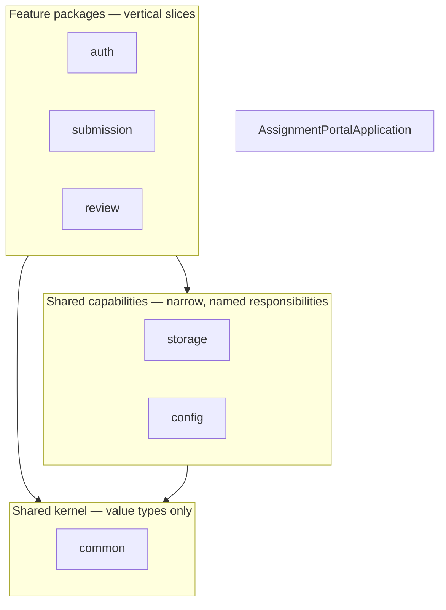

# CLAUDE.md — Engineering Handbook

This file is the **rules of engagement** for this repository. It applies to human
contributors and to AI assistants alike. When a request conflicts with this document, follow
this document and say so, rather than silently diverging.

Read it before making any change. Update it when a rule changes.

---

## 1. Project purpose

Build a **Git-Driven Online Assignment Submission Portal**: a small but production-style
application in which students submit coursework as PDF files and reviewers approve or reject
them.

The application is intentionally modest. The **real deliverable is the delivery pipeline** —
a change must travel from a GitHub pull request, through Jenkins, Maven, unit, integration
and Selenium tests, a Docker image, a registry, Ansible provisioning, deployment, a health
check, and a rollback path — repeatably and with evidence.

Consequences of that purpose:

- A feature that cannot be tested, built, or deployed by the pipeline is not finished.
- Operational concerns (health checks, rollback, configuration) are first-class, not
  afterthoughts.
- Complexity in the application is a **cost** charged against the pipeline budget. Prefer the
  simplest thing that satisfies the requirement.

## 2. Architecture

**A modular monolith, not microservices.**

- One deployable unit: a Spring Boot executable JAR with embedded Tomcat.
- One relational system of record: MySQL.
- Server-rendered Thymeleaf UI — no SPA, no separate frontend build.
- Internal boundaries are expressed as **packages with a strict dependency direction**, not as
  network hops.
- Session-based authentication for a browser-oriented application.

Modularity is a discipline, not a deployment topology. Splitting the monolith is explicitly
not planned; if that ever changed, it would require an ADR superseding
[ADR-001](docs/adr/ADR-001-modular-monolith.md).

Full description: [`docs/architecture/system-overview.md`](docs/architecture/system-overview.md).

## 3. Stack

Fixed unless an existing repository constraint forces a justified change **recorded in an
ADR**.

| Concern | Technology |
| --- | --- |
| Language | Java 21 |
| Framework | Spring Boot 4.1.1 |
| Web | Spring MVC, server-rendered |
| View | Thymeleaf |
| Security | Spring Security (session-based, CSRF enabled) |
| Persistence | Spring Data JPA |
| Database | MySQL 8.4 |
| Migrations | Flyway |
| Build | Maven |
| Unit & integration tests | JUnit 5, Testcontainers |
| End-to-end tests | Selenium 4 |
| Containerisation | Docker, Docker Compose |
| CI | Jenkins |
| Provisioning | Ansible |

Do not add a dependency, framework, or language to this list casually. A new entry needs a
stated engineering objective and, if it changes an architectural decision, an ADR.

## 4. Package structure

**Package by feature, not by layer.** Base package:

```
com.vit.assignmentportal
```



Rules:

- Each feature package owns its entity, repository, service, controller, and templates. A
  feature is a **vertical slice**: `submission/` contains everything about submissions.
- Layers are **inside** the feature, not beside it. There is no top-level `controllers/`,
  `services/`, or `repositories/` package.
- Dependencies flow **inward and downward** only: features → capabilities → `common`. A
  feature never reaches into another feature's repository or entity; it calls that feature's
  service.
- A package that holds shared code must describe a **single concrete responsibility**
  (`storage`, `config`). See naming rules below.
- `common` is the **shared kernel** — value types, enums, and domain exceptions only. It is
  **not** a utilities bucket. The moment it holds a class with no single nameable
  responsibility, the package has failed and the class belongs in a feature instead.

Verified layout and dependency rules:
[`docs/architecture/application-structure.md`](docs/architecture/application-structure.md).

## 5. Naming rules

**Banned outright:** `Utils`, `Helper`, `CommonUtils`, `Misc`, `Manager`, `Processor`, and any
other name that describes a shape rather than a responsibility. A class named `Utils` becomes
a dumping ground; a class named `ChecksumService` cannot.

Reusable logic must be named for **what it does**:

| Name | Responsibility |
| --- | --- |
| `ChecksumService` | Computes and verifies SHA-256 digests of uploaded files |
| `FileValidationService` | Enforces PDF-only, ≤ 10 MB, and content checks |
| `StorageService` | Maps a storage identifier to a location and performs file I/O |
| `CurrentUserService` | Resolves the authenticated principal and its role |
| `AuditService` | Records who did what, to which entity, and when |

Other conventions:

- Classes: `PascalCase`. Methods and fields: `camelCase`. Constants: `UPPER_SNAKE_CASE`.
- Entities are singular nouns (`Submission`, not `SubmissionEntity`). Suffix only when it
  disambiguates: `SubmissionRepository`, `SubmissionService`, `SubmissionController`.
- DTOs are **Java records** where the value is immutable, and are named for their role
  (`SubmissionSummary`, `ReviewDecision`), not `SubmissionDto`.
- Test classes mirror the class under test and end in `Test` (unit) or `IT` (integration).
- Database tables and columns: `snake_case`, plural tables (`submissions`,
  `submission_status_history`).
- **Avoid Lombok.** Use records, explicit accessors, or plain fields. A Lombok dependency
  requires a concrete, documented reason and an ADR.
- **A template ships no HTML comment that can reach the browser.** Thymeleaf renders
  `<!-- … -->` verbatim, so a note written for the next developer is served to every reader too —
  and the notes on the error page name `BasicErrorController` and `SecurityConfiguration`. Write
  commentary as `<!--/* … */-->`, which the parser discards before rendering.
  `UiRenderingIT.shipsNoTemplateCommentaryToTheBrowser` enforces this; §7 rule 11 is why the
  disclosure matters.

## 6. Testing philosophy

Test at the **lowest layer that can prove the behaviour**, and use the higher layers only for
what the lower ones cannot reach.

| Layer | Tool | Proves | Speed |
| --- | --- | --- | --- |
| Unit | JUnit 5, no Spring context | Business rules in isolation | Milliseconds |
| Integration | Spring Boot test slice + Testcontainers MySQL | Persistence, migrations, security wiring, real SQL | Seconds |
| End-to-end | Selenium 4 against a running deployment | A real user can complete a workflow through a browser | Minutes |

Principles:

- A test asserts **behaviour**, not implementation. If a refactor breaks a test without
  changing behaviour, the test was wrong.
- **Testcontainers, not H2**, for persistence tests: the MVP must be verified against the
  same engine that runs in production. Flyway migrations are exercised by the same tests.
- Cover the **security boundaries** explicitly: anonymous access is rejected, a STUDENT
  cannot read or review another student's submission, CSRF is enforced on state-changing
  requests, and role checks hold.
- Upload handling is tested with hostile input: oversized files, non-PDF content, a PDF
  extension on non-PDF bytes, and filenames containing path-traversal sequences.
- Every bug fixed earns a regression test that fails before the fix.
- The pyramid must stay a pyramid. A stage that can be proven by a unit test does not belong
  in the Selenium suite.

Full strategy: [`docs/testing/strategy.md`](docs/testing/strategy.md).

## 7. Security rules

These are **non-negotiable**. A change that violates one is rejected regardless of how well
it works.

1. **Never hard-code a secret.** No password, token, private key, database password, Docker
   Registry credential, or deployment credential in any file — including tests, CI
   definitions, Ansible variables, and Compose files.
2. **Configuration is externalised.** Values arrive through environment variables or a
   managed secret store, injected at deploy time.
3. **CSRF protection stays enabled.** Every state-changing form submits a token. Disabling it
   requires an ADR containing a threat analysis.
4. **Uploads: PDF only, maximum 10 MB, validated server-side.** Client-side checks are a
   convenience and never a control.
5. **Never trust the original filename as a filesystem path.** Generate a server-side storage
   identifier for every upload and use only that to locate the file on disk.
6. **Record a SHA-256 checksum** for every stored file.
7. Store files on a **persistent volume**; store **metadata** in MySQL. The container
   filesystem is ephemeral and must never be the only copy of an artefact.
8. **Authorise server-side on every request**, from the authenticated principal and its role.
   Never from a client-supplied identifier.
9. **Roles are exactly `STUDENT`, `REVIEWER`, `ADMIN`.** A role is never inferred from a
   request parameter.
10. Serve uploaded files as attachments with a fixed content type — never inline-rendered.
11. User-facing errors never expose stack traces, SQL, filesystem paths, or configuration.

Full policy and threat model: [`SECURITY.md`](SECURITY.md).

## 8. Configuration and secrets

- All configuration is **externalised and environment-driven**; the same artefact is promoted
  from environment to environment without being rebuilt.
- Database URL, credentials, storage root, and registry details come from the environment.
- Precedence, lowest to highest: `application.yml` (defaults, safe to commit) →
  `application-<profile>.yml` (non-secret profile values) → environment variables
  (all secrets).
- `.env.example` documents **variable names only** and is committed. `.env` holds real values
  and is git-ignored.
- Secrets in CI live in the Jenkins credentials store. Secrets at deploy time live in Ansible
  Vault or the target host environment.
- Never log a secret, a full connection string, or a session identifier.

## 9. Git workflow

```
GitHub → Pull Request / Review → Jenkins CI → Maven Build → Unit Tests
       → Integration Tests → Selenium E2E → Docker Image → Docker Registry
       → Ansible Provisioning → Deployment → Health Check → Rollback
```

- `main` is protected. **No direct pushes.** Every change arrives via pull request.
- Branch names use a type prefix: `feature/`, `fix/`, `docs/`, `chore/`, `refactor/`.
- Commits follow **Conventional Commits**: `<type>(<scope>): <imperative summary>`, with a
  body explaining **why**.
- A PR states the problem, the approach, and the verification actually performed. It fills in
  `.github/pull_request_template.md` completely and honestly.
- CI must be green, including Selenium, before merge. A red pipeline is never bypassed.
- Changing an architectural decision means **adding or superseding an ADR**, never silently
  rewriting the record.
- Documentation moves with code in the same PR.

Detail: [`CONTRIBUTING.md`](CONTRIBUTING.md).

## 10. Expected verification commands

The canonical commands for this repository. The **Maven Wrapper is the canonical build
mechanism** — `mvn` on `PATH` is not required, and the wrapper pins the Maven version so
every machine and every CI agent builds with the same one.

```bash
# Full local verification — compile, unit tests, integration tests
./mvnw clean verify

# Unit tests only (fast feedback)
./mvnw test

# Integration tests only — requires a running Docker daemon for Testcontainers
./mvnw failsafe:integration-test

# End-to-end tests (requires a running deployment)
./mvnw verify -Pe2e

# Start the local dependencies
docker compose up -d db

# Run the application locally (reads .env / environment variables)
./mvnw spring-boot:run

# Package the artefact into the production image, and run the whole stack
./mvnw clean package -DskipTests
docker compose up -d --build
```

On Windows PowerShell or `cmd.exe`, use `mvnw.cmd`:

```powershell
.\mvnw.cmd clean verify
.\mvnw.cmd spring-boot:run
```

`clean verify` requires Docker to be running: the integration test starts a MySQL 8.4
container (docs/testing/strategy.md §3.2).

The Dockerfile runs **no** Maven: it packages the artefact `./mvnw package` already produced, so
`clean verify` is still the only build process in this repository (§1). The full container
lifecycle is [`docs/operations/docker.md`](docs/operations/docker.md).

> **Do not claim a command was run unless it was.** Report the real outcome, including
> failures, and paste the relevant output.

## 11. Current project status

**Milestone 4 — the reviewer decision, the status history, and file download are implemented. No
suite later than Milestone 2's has yet run to green, so Milestones 3 and 4 are executed but
unproven: the 2026-10-02 runs below are the first time any of this code has been exercised.**

**Added on 2026-10-06, and unrun:** the container artefacts of Milestone 5 — `Dockerfile`,
`compose.yaml`, `.dockerignore`, and `docs/operations/docker.md`. No `docker build` and no
`docker compose up` has been executed. This is a deliberate divergence from §13's sequencing, taken
on the repository owner's instruction and recorded there and in
[`docs/operations/docker.md` §8](docs/operations/docker.md).

**Added on 2026-10-07, and unrun:** the rest of the release half of Milestone 5 — the Docker Hub
release process. `deploy/compose.prod.yaml`, `deploy/env.production.example`,
`deploy/deploy-on-host.sh`, seven scripts under `scripts/ops/`, the `Release Version` /
`Docker Build` / `Publish Image` / `Deploy` stages of `Jenkinsfile`, and
[`docs/operations/docker-cd.md`](docs/operations/docker-cd.md). **No image has been built by this
pipeline, no push attempted, no deployment host contacted, and no rollback fired.** A version is
identified by a `vX.Y.Z` git tag and by nothing else; a feature branch reaches neither the registry
nor a host; `latest` is never produced. The version is baked into the image at build time and
published at `/actuator/info`, which is what lets the post-deployment smoke test prove that the
release deployed is the release answering. `docker-cd.md` §8 lists every unexercised claim one by
one. This is a second deliberate divergence from §13's sequencing, on the same instruction.

The build *has* moved since Milestone 2, and three `mvn clean verify` runs on **2026-10-02** — one
without Docker, two with — between them report where the project actually stands. They also found
three real defects, which is the strongest argument in this repository for running the suite rather
than reasoning about it.

**Run 1: no Docker daemon.** Both source sets compiled and the **unit** suite passed —
**60 Surefire tests, 0 failures, 0 errors** — and then Failsafe discovered **112 integration tests
across 10 classes and errored every one of them**. The single root cause, printed once on the first
test of the first class:

```
Caused by: java.lang.IllegalStateException: Could not find a valid Docker environment.
    at org.testcontainers.containers.GenericContainer.start(GenericContainer.java:316)
    at com.vit.assignmentportal.MySqlIntegrationTest.<clinit>(MySqlIntegrationTest.java:59)
```

`MySqlIntegrationTest` starts its shared MySQL container in a static initialiser; with no engine
reachable that initialiser throws, the class is poisoned for the JVM, and the other 111 errors are
the resulting `NoClassDefFoundError: Could not initialize class …`. Nothing in Milestones 3 or 4 was
reached — an environment failure, not a defect.

**Run 2: Docker up, and the suite executed — 112 tests, 2 failures, 0 errors.** Both failures were
real defects. Both fixes were then confirmed by run 3:

- `SubmissionUploadIT.returnsTheEnteredMetadataToTheFormAfterARefusal` — a refused upload came back
  with the Title input set to the page's own `<title>` text. `fragments/layout.html` declared
  `th:fragment="page(title, body)"`, and a fragment parameter is a local variable over everything
  `th:insert` splices in, so `${title}` in `upload.html` read the parameter instead of the flashed
  model attribute. The parameters are now `pageTitle` / `pageContent`, which cannot collide.
- `UiRenderingIT.rendersTheErrorPageWithoutExposingInternals` — "No ModelAndView found". A bare
  `GET /error` sends no `Accept` header, so `BasicErrorController` answered from its JSON handler and
  no view was resolved. The test now sets `Accept: text/html` and `ERROR_STATUS_CODE`, which is how a
  container drives an error dispatch, so it asserts against a real status rather than the 999
  sentinel. (Splitting it into a 500 case and a 404 case is why the count rises by one below.)

**Run 3: 113 tests, 1 failure, 0 errors.** The two defects above are gone. The remaining failure was
a third real defect, and the most instructive of the three because an assertion written to look for
something else found it:

- `rendersTheErrorPageWithoutExposingInternals` asserts the page does not contain the word
  "exception". It did — because `error.html`'s own explanatory comment saying "a 404, a 500, or an
  exception that reaches the container" was being **served to the browser**. Thymeleaf emits an
  ordinary HTML comment verbatim: `<!-- … -->` is content, not whitespace. Every page was shipping
  its engineering notes, and the error page's notes name `BasicErrorController`,
  `SecurityConfiguration`, and the `server.error.include-message: never` setting. That is the
  disclosure §7 rule 11 forbids, on the page an anonymous visitor is most likely to reach.

  Fixed by writing every comment that can reach a browser as a Thymeleaf **parser-level** comment,
  which the parser discards before rendering — 51 comments across 18 of the 19 template files at the
  time. The nineteenth, `fragments/portal-header.html`, was unreferenced dead code carrying ordinary
  HTML comments; it has since been deleted, so every remaining template renders without commentary.
  The assertion was **not** relaxed; it now passes because nothing reaches the browser. A new
  `shipsNoTemplateCommentaryToTheBrowser` test enforces the rule on its own terms, so the next
  comment is caught even when it does not happen to contain the word "exception".

The criterion this leaves open is unchanged — a green `clean verify`. The three fixes are written
and none has been executed.

The last recorded *green* `mvn clean verify` (2026-10-01T12:37) was **green**: 30 Failsafe tests and
5 Surefire tests, zero failures. That run covered Milestone 2's code and predates every Milestone 3
and 4 file described below, so it is evidence for the two milestones behind us and for nothing in
the two in front of us. The toolchain it used is recorded in
[`docs/operations/toolchain.md`](docs/operations/toolchain.md), whose §9 records the same gap.

Milestone 1 established the build and runtime. Milestone 2 added database-backed authentication.
Milestone 3 added the first feature that accepts user-supplied content. Milestone 4 closes the
workflow loop: a submission can now be decided, the decision is recorded, and the student can read
it — which is also the first milestone whose tests exercise a state transition end to end.


### What exists

- Root documents: `README.md`, `CLAUDE.md`, `CONTRIBUTING.md`, `SECURITY.md`, `.editorconfig`,
  `.gitattributes`, `.gitignore`, `.env.example`, `cspell.json`.
- `docs/requirements/mvp.md` — scope and explicit exclusions.
- `docs/architecture/` — system overview, application structure, data model, security.
- `docs/adr/` — ADR-001 through ADR-007.
- `docs/testing/strategy.md`, `docs/operations/toolchain.md`, `docs/evidence/`.
- `.github/` issue templates and pull request template.
- `pom.xml` — Java 21, Spring Boot 4.1.1, pinned dependency set, enforcer rules.
- **The Maven Wrapper**, pinned to Maven 3.9.16 with `distributionType=only-script`. `./mvnw` is
  the canonical build command of §10 and needs nothing on `PATH`.
- `compose.yaml` — the running system: `app` + `db`, a private network, the `app-uploads` and
  `mysql-data` volumes, health checks on both services, and explicit port publishing. It replaced
  `deploy/docker-compose.yml`, which held the `db` definition alone while there was no application
  image for an `app` service to reference; the definition was **moved rather than copied**, because
  two files each declaring a database is the drift ADR-006 exists to prevent.
- `Dockerfile` — the multi-stage production image. It packages the JAR `./mvnw package` produced and
  runs no Maven, so it is not a second build process.
- `.dockerignore` — admits exactly one file into the build context, the executable JAR.
- `docs/operations/docker.md` — the image, the stack, and the container lifecycle.
- `docs/operations/docker-cd.md` — the release process: the ref → action rules, the credentials, the
  agent and host prerequisites, the host `.env` contract, the version-identification mechanism, the
  smoke test, and the rollback. Its §8 is a claim-by-claim list of what has not been run.
- `deploy/compose.prod.yaml` — the **deployment** composition, distinct from `compose.yaml`: it
  references a published image by tag and declares no `build:`, so a host runs the tested artefact or
  fails. The database is not published on a host port and no `APP_SEED_*` variable is passed, so a
  deployment cannot seed a demo account.
- `deploy/env.production.example` — the template for a host's `.env`. Named without a leading dot
  because `.gitignore`'s `.env.*` would otherwise ignore it. It draws the ownership line: the
  database credentials and `IMAGE_REPOSITORY` are the **host's**, and the pipeline rewrites exactly
  two non-secret keys (`APP_IMAGE_TAG`, `APP_ENVIRONMENT`).
- `deploy/deploy-on-host.sh` — the host-side half of a release, run over SSH. It records the version
  currently running *before* changing anything, rewrites those two keys, pulls the exact tag, and
  replaces the container with `--no-build --remove-orphans --wait`.
- `scripts/ops/` — `env.cmd` (shared defaults, credential **IDs** only), `release-version.cmd` (the
  tag is the version), `docker-login.cmd` (token over stdin, never an argument), `publish-image.cmd`
  (refuses `latest`), `deploy-release.cmd` (the deployment and its rollback), `smoke-test.ps1` /
  `smoke-test.cmd`.
- `src/main/resources/application.yml` — externalised configuration, no secrets.

**`auth/` — identity (Milestone 2).** `User` entity and repository, `UserService`, and a
session-based Spring Security configuration with CSRF enabled: form login, logout that invalidates
the session server-side, `STUDENT`/`REVIEWER`/`ADMIN` mapped to authorities, and deny-by-default
route rules. `DevelopmentUserSeeder` creates demo accounts under the `dev` profile only, and only
when `APP_SEED_ENABLED` is true; each password comes from its own environment variable, and none
has a default. Documented in [`docs/architecture/security.md`](docs/architecture/security.md).

**`storage/` — file bytes on a volume (Milestone 3).** `StorageService`, `StorageIdentifier`,
`StorageProperties`, `StorageException`, `FileValidationService`, `ChecksumService`. PDF-only,
≤ 10 MB, validated by content and not by name; a server-generated identifier that makes path
traversal unrepresentable; SHA-256 recorded for every stored file. Bytes are written outside any
servable path. `StorageService.load` was added in Milestone 4, when the download route gave it a
caller.

**`submission/` — the student's slice (Milestone 3), and the transition it owns (Milestone 4).**
`Submission` entity and repository, `SubmissionService`, `SubmissionController`, the read models,
and three templates. Student routes: `GET /submissions/new`, `POST /submissions`,
`GET /submissions`, `GET /submissions/{id}`, `GET /submissions/{id}/file`. A student reaches only
their own work — the ownership test is a `WHERE` clause, so somebody else's submission is never
loaded rather than loaded and refused. The file and the row cannot be committed together, so
`SubmissionService` orders the writes and removes the file if the row does not commit.

Milestone 4 added `SubmissionStatusHistory` — an append-only entity and repository — and
`SubmissionService.recordDecision`, which applies a status change and writes its history row in one
transaction. The terminality rule lives on the entity (`Submission.approve` / `reject` throw
`SubmissionAlreadyDecidedException` for a row that is not `SUBMITTED`), so a second approval, a
second rejection, and a decision on already-decided work are all refused at the same place.
`Submission.version` is a `@Version` column, so two reviewers deciding concurrently cannot silently
overwrite one another.

**`review/` — the reviewer's slice (Milestone 4).** `ReviewService`, `ReviewController`,
`ReviewDecision`, `InvalidReviewException`, and two templates. Routes: `GET /review` (the queue of
`SUBMITTED` work), `GET /review/submissions/{id}`, `POST /review/submissions/{id}` (decide),
`GET /review/submissions/{id}/file`. The decision *policy* lives here — a rejection requires a
reason, an approval must not carry one, and the outcome must be `APPROVED` or `REJECTED`. The
*transition* does not: `ReviewService` calls `SubmissionService`, because `review` may not import a
submission repository or mutate a `Submission` (`application-structure.md` §4 rule 1). Reviewers
have no route that accepts a file; the artefact is read-only to them.

**Migrations.** `V1__baseline.sql` creates `users`; `V2__submissions.sql` creates `submissions`
with its `CHECK` constraints, unique stored-name index, and foreign keys;
`V3__submission_status_history.sql` creates the append-only history table. `ApplicationContextIT`
exercises each constraint by inserting rows the service would never produce.

### Not yet present — deliberately

- **No audit trail.** ADR-005 requires sign-in attempts, including failures, to be recorded. This
  is the one Milestone 2 entry criterion still unmet, and the one Milestone 4 entry criterion still
  unmet; `docs/architecture/security.md` §12 records why, and `application-structure.md` §5 records
  the unresolved question about where such a package would live. `audit_events` does not exist.
  Note the distinction: `submission_status_history` now records *workflow* transitions, which is a
  different concern from *security* events.
- **No resubmission.** A rejection is terminal in the MVP. Rejected work is not resubmitted, and
  nothing resets a submission to `SUBMITTED`.
- **No Ansible, no host provisioning, and no deployment that has ever run.** The *delivery* half of
  the pipeline is now written — a versioned image published to Docker Hub, `ssh`/`scp` to a host,
  `docker compose pull` + `up --no-build --wait`, a health check from the agent, a smoke test that
  asserts the running version, and a rollback to the previous version. What is still absent is
  **provisioning**: no playbooks, no package installation, no firewall, no TLS. The host-side
  sequence places two files and runs one script (recorded in
  [`docs/operations/docker-cd.md` §9](docs/operations/docker-cd.md)). Every one of the new
  mechanisms is **written, not run**, and CLAUDE.md §13's precondition for the delivery work — a
  green `clean verify` — is still unmet, so nothing here has been exercised. The image is
  **written, not built**; `docs/operations/docker.md` §8 and `docker-cd.md` §8 list what has not
  been run.
- **No admin UI.** `ADMIN` exists as a role, gates `/admin/**`, and can review; no management
  screens ship.

**Do not add placeholder Java classes merely to fill directories.** Empty structure with no
behaviour is worse than no structure: it implies work that has not happened. Create a class
when it has a responsibility.

## 12. Mandatory Claude response format

When reporting work in this repository, respond using **exactly** these sections, in this
order:

1. **Implementation Summary**
2. **Changed Files**
3. **File-by-File Learning Flow**
4. **Verification Performed**
5. **Decisions and Assumptions**
6. **Remaining Risks / Limitations**
7. **Next Milestone Readiness**

Rules for that response:

- **Changed Files** lists every file created, modified, or deleted, with a one-line purpose.
- **File-by-File Learning Flow** gives the recommended order in which a person should open the
  changed files to understand the work, and why that order.
- **Verification Performed** states what was actually checked and what was **not**. Never
  imply a command ran when it did not.
- **Remaining Risks / Limitations** is honest. "None" is almost always the wrong answer.

## 13. Next milestone readiness

**Milestone 4 is code-complete, executed, and unproven.** The 2026-10-02 runs compiled everything and
ran the whole suite; the three defects they found are fixed and none of the fixes has been re-run. A
`[x]` here means *implemented*, never *verified* — the one criterion that would turn the first into
the second is the last one, and it is open.

- [x] A `ReviewService` in `review/` recording one terminal decision — `APPROVED` or `REJECTED` —
      with a required comment (FR-18, FR-19), reachable only by a `REVIEWER` or an `ADMIN`.
- [x] A review queue of submissions in `SUBMITTED` (`GET /review`), and a reviewer's view of an
      artefact (FR-16, FR-17). Reaching submission data goes through `SubmissionService`; `review`
      imports no `SubmissionRepository` and mutates no `Submission` directly
      ([`application-structure.md` §4](docs/architecture/application-structure.md)).
- [x] The **terminality rule** enforced on the entity and re-asserted by the service, not in the
      view: a decision is final and a decided submission cannot be decided again (FR-20). Rejected
      work is **not** resubmitted — that is explicitly out of MVP scope.
- [x] `reviewed_at` and `reviewer_id` written in the same statement as the status, so
      `ck_submissions_decision` can never fire. It exists to catch a bug; the entity is written so
      it cannot be the source of one.
- [x] `SubmissionStatusHistory` — entity, table (`V3__submission_status_history.sql`), and one
      append-only row per transition, carrying previous status, new status, actor, timestamp and
      note (FR-15, FR-21). `SubmissionService.submit` writes the creation row and
      `recordDecision` writes the decision row, each in the same transaction as the status it
      describes.
- [x] Optimistic locking on `Submission.version`, so two reviewers deciding at once cannot silently
      overwrite one another; the loser is told their decision was not recorded.
- [x] File download for the owner (FR-13) and the reviewer (FR-17), served as an attachment with a
      fixed content type and `nosniff` (`CLAUDE.md` §7 rule 10).
- [x] The student sees the decision and the reviewer's reason on their own submission, together
      with a chronological history — and still cannot see anyone else's (FR-14).
- [x] Tests written for the whole workflow: approve, reject, a missing reason, an invalid
      transition, a second decision, a concurrent conflict, history creation, reviewer
      authorisation, a student refused at every review route, and a student confined to their own
      data. **Executed** — the 2026-10-02 runs exercised all of them. Green is still unproven: run 3
      ended on one failure, now fixed and not re-run.
- [ ] **The audit trail, still outstanding from Milestone 2** (FR-24). ADR-005 requires sign-in
      attempts — **including failures** — to be recorded. No `audit_events` table and no
      `AuditService` exist, and the package that would own one is an open question recorded in
      [`application-structure.md` §5](docs/architecture/application-structure.md).
- [ ] **`./mvnw clean verify` green, and the run recorded under
      [`docs/evidence/`](docs/evidence/).** This is the criterion that matters most and the only
      one still open. The 2026-10-02 runs narrowed it a long way: both source sets compile, the unit
      suite is green, and the whole integration suite now runs against a containerised MySQL. Run 3
      ended on a single failure — a template comment being served to the browser — which is fixed
      and not re-run. `docs/evidence/` holds no captured output for any milestone, and
      [`docs/operations/toolchain.md` §9](docs/operations/toolchain.md) records the same gap.

Nothing decided so far may be merged with a hard-coded secret. The version numbers recorded in
[`docs/operations/toolchain.md`](docs/operations/toolchain.md) must be updated with the
versions actually used. Builds have now run — 2026-10-02 — but they recorded the versions of the
tools they loaded, not the version of every tool listed in that document, so most of its rows are
still marked *unverified* at this revision.

**Milestone 5 — the delivery pipeline.** The application is now as complete as the MVP needs it to
be. The pipeline now carries both halves: continuous integration — build, unit, integration and
Selenium E2E stages, and a multi-stage `Dockerfile` that packages the Maven artefact into a
production image — and, added 2026-10-07, the release process: a `vX.Y.Z` tag is the version, the
image is published to Docker Hub under it, and a host runs that exact version or the previous one is
restored. `deploy/`, `scripts/ops/` and [`docs/operations/docker-cd.md`](docs/operations/docker-cd.md)
are the artefacts.

What Milestone 5 still carries: **Ansible provisioning and host management** (no playbooks, no TLS,
no backup story — [`docker-cd.md` §9](docs/operations/docker-cd.md)); and — if it is to be claimed
— the FR-24 audit trail carried over above.

**Nothing in Milestone 5 should be trusted before the Milestone 4 build is green**, and that
precondition is still unmet. Every Milestone 5 artefact was added ahead of it on the repository
owner's instruction, which is a deliberate divergence from the sequencing this section describes.
The consequence is recorded rather than glossed: the image has never been built, the stack has never
been started, no image has been pushed, no host has been contacted, no rollback has fired, and every
claim about any of them is *written, not proven* ([`docs/operations/docker.md` §8](docs/operations/docker.md)
and [`docker-cd.md` §8](docs/operations/docker-cd.md) list them one by one). Creating the
`Dockerfile` also removed the guard that had made the `Docker Build` stage skip, so that stage now
runs on every green build and fails it when the image does not build; the old empty `Deployment`
stub has been replaced by a **`Deploy`** stage gated on a green build **and** a `vX.Y.Z` tag **and**
a chosen `DEPLOY_ENV`.
