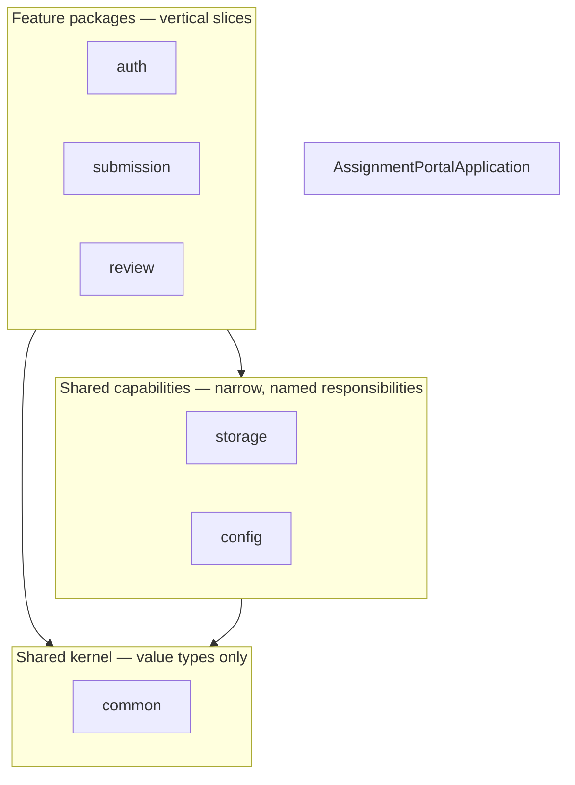

# CLAUDE.md — Engineering Handbook

This file is the **rules of engagement** for this repository. It applies to human
contributors and to AI assistants alike. When a request conflicts with this document, follow
this document and say so, rather than silently diverging.

Read it before making any change. Update it when a rule changes.

---

## 1. Project purpose

Build a **Git-Driven Online Assignment Submission Portal**: a small but production-style
application in which students submit coursework as PDF files and reviewers approve or reject
them.

The application is intentionally modest. The **real deliverable is the delivery pipeline** —
a change must travel from a GitHub pull request, through Jenkins, Maven, unit, integration
and Selenium tests, a Docker image, a registry, Ansible provisioning, deployment, a health
check, and a rollback path — repeatably and with evidence.

Consequences of that purpose:

- A feature that cannot be tested, built, or deployed by the pipeline is not finished.
- Operational concerns (health checks, rollback, configuration) are first-class, not
  afterthoughts.
- Complexity in the application is a **cost** charged against the pipeline budget. Prefer the
  simplest thing that satisfies the requirement.

## 2. Architecture

**A modular monolith, not microservices.**

- One deployable unit: a Spring Boot executable JAR with embedded Tomcat.
- One relational system of record: MySQL.
- Server-rendered Thymeleaf UI — no SPA, no separate frontend build.
- Internal boundaries are expressed as **packages with a strict dependency direction**, not as
  network hops.
- Session-based authentication for a browser-oriented application.

Modularity is a discipline, not a deployment topology. Splitting the monolith is explicitly
not planned; if that ever changed, it would require an ADR superseding
[ADR-001](docs/adr/ADR-001-modular-monolith.md).

Full description: [`docs/architecture/system-overview.md`](docs/architecture/system-overview.md).

## 3. Stack

Fixed unless an existing repository constraint forces a justified change **recorded in an
ADR**.

| Concern | Technology |
| --- | --- |
| Language | Java 21 |
| Framework | Spring Boot 4.1.1 |
| Web | Spring MVC, server-rendered |
| View | Thymeleaf |
| Security | Spring Security (session-based, CSRF enabled) |
| Persistence | Spring Data JPA |
| Database | MySQL 8.4 |
| Migrations | Flyway |
| Build | Maven |
| Unit & integration tests | JUnit 5, Testcontainers |
| End-to-end tests | Selenium 4 |
| Containerisation | Docker, Docker Compose |
| CI | Jenkins |
| Provisioning | Ansible |

Do not add a dependency, framework, or language to this list casually. A new entry needs a
stated engineering objective and, if it changes an architectural decision, an ADR.

## 4. Package structure

**Package by feature, not by layer.** Base package:

```
com.vit.assignmentportal
```



Rules:

- Each feature package owns its entity, repository, service, controller, and templates. A
  feature is a **vertical slice**: `submission/` contains everything about submissions.
- Layers are **inside** the feature, not beside it. There is no top-level `controllers/`,
  `services/`, or `repositories/` package.
- Dependencies flow **inward and downward** only: features → capabilities → `common`. A
  feature never reaches into another feature's repository or entity; it calls that feature's
  service.
- A package that holds shared code must describe a **single concrete responsibility**
  (`storage`, `config`). See naming rules below.
- `common` is the **shared kernel** — value types, enums, and domain exceptions only. It is
  **not** a utilities bucket. The moment it holds a class with no single nameable
  responsibility, the package has failed and the class belongs in a feature instead.

Verified layout and dependency rules:
[`docs/architecture/application-structure.md`](docs/architecture/application-structure.md).

## 5. Naming rules

**Banned outright:** `Utils`, `Helper`, `CommonUtils`, `Misc`, `Manager`, `Processor`, and any
other name that describes a shape rather than a responsibility. A class named `Utils` becomes
a dumping ground; a class named `ChecksumService` cannot.

Reusable logic must be named for **what it does**:

| Name | Responsibility |
| --- | --- |
| `ChecksumService` | Computes and verifies SHA-256 digests of uploaded files |
| `FileValidationService` | Enforces PDF-only, ≤ 10 MB, and content checks |
| `StorageService` | Maps a storage identifier to a location and performs file I/O |
| `CurrentUserService` | Resolves the authenticated principal and its role |
| `AuditService` | Records who did what, to which entity, and when |

Other conventions:

- Classes: `PascalCase`. Methods and fields: `camelCase`. Constants: `UPPER_SNAKE_CASE`.
- Entities are singular nouns (`Submission`, not `SubmissionEntity`). Suffix only when it
  disambiguates: `SubmissionRepository`, `SubmissionService`, `SubmissionController`.
- DTOs are **Java records** where the value is immutable, and are named for their role
  (`SubmissionSummary`, `ReviewDecision`), not `SubmissionDto`.
- Test classes mirror the class under test and end in `Test` (unit) or `IT` (integration).
- Database tables and columns: `snake_case`, plural tables (`submissions`,
  `submission_status_history`).
- **Avoid Lombok.** Use records, explicit accessors, or plain fields. A Lombok dependency
  requires a concrete, documented reason and an ADR.

## 6. Testing philosophy

Test at the **lowest layer that can prove the behaviour**, and use the higher layers only for
what the lower ones cannot reach.

| Layer | Tool | Proves | Speed |
| --- | --- | --- | --- |
| Unit | JUnit 5, no Spring context | Business rules in isolation | Milliseconds |
| Integration | Spring Boot test slice + Testcontainers MySQL | Persistence, migrations, security wiring, real SQL | Seconds |
| End-to-end | Selenium 4 against a running deployment | A real user can complete a workflow through a browser | Minutes |

Principles:

- A test asserts **behaviour**, not implementation. If a refactor breaks a test without
  changing behaviour, the test was wrong.
- **Testcontainers, not H2**, for persistence tests: the MVP must be verified against the
  same engine that runs in production. Flyway migrations are exercised by the same tests.
- Cover the **security boundaries** explicitly: anonymous access is rejected, a STUDENT
  cannot read or review another student's submission, CSRF is enforced on state-changing
  requests, and role checks hold.
- Upload handling is tested with hostile input: oversized files, non-PDF content, a PDF
  extension on non-PDF bytes, and filenames containing path-traversal sequences.
- Every bug fixed earns a regression test that fails before the fix.
- The pyramid must stay a pyramid. A stage that can be proven by a unit test does not belong
  in the Selenium suite.

Full strategy: [`docs/testing/strategy.md`](docs/testing/strategy.md).

## 7. Security rules

These are **non-negotiable**. A change that violates one is rejected regardless of how well
it works.

1. **Never hard-code a secret.** No password, token, private key, database password, Docker
   Registry credential, or deployment credential in any file — including tests, CI
   definitions, Ansible variables, and Compose files.
2. **Configuration is externalised.** Values arrive through environment variables or a
   managed secret store, injected at deploy time.
3. **CSRF protection stays enabled.** Every state-changing form submits a token. Disabling it
   requires an ADR containing a threat analysis.
4. **Uploads: PDF only, maximum 10 MB, validated server-side.** Client-side checks are a
   convenience and never a control.
5. **Never trust the original filename as a filesystem path.** Generate a server-side storage
   identifier for every upload and use only that to locate the file on disk.
6. **Record a SHA-256 checksum** for every stored file.
7. Store files on a **persistent volume**; store **metadata** in MySQL. The container
   filesystem is ephemeral and must never be the only copy of an artefact.
8. **Authorise server-side on every request**, from the authenticated principal and its role.
   Never from a client-supplied identifier.
9. **Roles are exactly `STUDENT`, `REVIEWER`, `ADMIN`.** A role is never inferred from a
   request parameter.
10. Serve uploaded files as attachments with a fixed content type — never inline-rendered.
11. User-facing errors never expose stack traces, SQL, filesystem paths, or configuration.

Full policy and threat model: [`SECURITY.md`](SECURITY.md).

## 8. Configuration and secrets

- All configuration is **externalised and environment-driven**; the same artefact is promoted
  from environment to environment without being rebuilt.
- Database URL, credentials, storage root, and registry details come from the environment.
- Precedence, lowest to highest: `application.yml` (defaults, safe to commit) →
  `application-<profile>.yml` (non-secret profile values) → environment variables
  (all secrets).
- `.env.example` documents **variable names only** and is committed. `.env` holds real values
  and is git-ignored.
- Secrets in CI live in the Jenkins credentials store. Secrets at deploy time live in Ansible
  Vault or the target host environment.
- Never log a secret, a full connection string, or a session identifier.

## 9. Git workflow

```
GitHub → Pull Request / Review → Jenkins CI → Maven Build → Unit Tests
       → Integration Tests → Selenium E2E → Docker Image → Docker Registry
       → Ansible Provisioning → Deployment → Health Check → Rollback
```

- `main` is protected. **No direct pushes.** Every change arrives via pull request.
- Branch names use a type prefix: `feature/`, `fix/`, `docs/`, `chore/`, `refactor/`.
- Commits follow **Conventional Commits**: `<type>(<scope>): <imperative summary>`, with a
  body explaining **why**.
- A PR states the problem, the approach, and the verification actually performed. It fills in
  `.github/pull_request_template.md` completely and honestly.
- CI must be green, including Selenium, before merge. A red pipeline is never bypassed.
- Changing an architectural decision means **adding or superseding an ADR**, never silently
  rewriting the record.
- Documentation moves with code in the same PR.

Detail: [`CONTRIBUTING.md`](CONTRIBUTING.md).

## 10. Expected verification commands

The canonical commands for this repository. The **Maven Wrapper is the canonical build
mechanism** — `mvn` on `PATH` is not required, and the wrapper pins the Maven version so
every machine and every CI agent builds with the same one.

```bash
# Full local verification — compile, unit tests, integration tests
./mvnw clean verify

# Unit tests only (fast feedback)
./mvnw test

# Integration tests only — requires a running Docker daemon for Testcontainers
./mvnw failsafe:integration-test

# End-to-end tests (requires a running deployment)
./mvnw verify -Pe2e

# Start the local dependencies
docker compose -f deploy/docker-compose.yml up -d

# Run the application locally (reads .env / environment variables)
./mvnw spring-boot:run
```

On Windows PowerShell or `cmd.exe`, use `mvnw.cmd`:

```powershell
.\mvnw.cmd clean verify
.\mvnw.cmd spring-boot:run
```

`clean verify` requires Docker to be running: the integration test starts a MySQL 8.4
container (docs/testing/strategy.md §3.2).

> **Do not claim a command was run unless it was.** Report the real outcome, including
> failures, and paste the relevant output.

## 11. Current project status

**Milestone 1 — the application builds and boots; the test suite is not yet green.**

`mvn clean verify` now compiles both source sets, packages the Spring Boot JAR, starts the
context, and runs the integration test against a real MySQL 8.4.11 container. It **fails at
two assertions**: Flyway's autoconfiguration was missing, so `V1__baseline.sql` never ran and
the `users` table was never created. The POM fix — adding `spring-boot-starter-flyway`, because
Spring Boot 4 moved `FlywayAutoConfiguration` out of `spring-boot-autoconfigure` — is applied
and **not yet verified by a re-run**. See ADR-003's 2026-10-01 clarification.

The Maven Wrapper is still not generated. See
[`docs/operations/toolchain.md` §9](docs/operations/toolchain.md#9-outstanding-gaps-on-this-machine).

Present in the repository:

- Root documents: `README.md`, `CLAUDE.md`, `CONTRIBUTING.md`, `SECURITY.md`, `.editorconfig`,
  `.gitattributes`, `.gitignore`, `.env.example`.
- `docs/requirements/mvp.md` — scope and explicit exclusions.
- `docs/architecture/` — system overview, application structure, data model.
- `docs/adr/` — ADR-001 through ADR-007.
- `docs/testing/strategy.md`, `docs/operations/toolchain.md`, `docs/evidence/`.
- `.github/` issue templates and pull request template.
- `pom.xml` — Java 21, Spring Boot 4.1.1, pinned dependency set, enforcer rules.
- `src/main/java/com/vit/assignmentportal/AssignmentPortalApplication.java`.
- `src/main/resources/application.yml` — externalised configuration, no secrets.
- `src/main/resources/db/migration/V1__baseline.sql` — the `users` table.
- `deploy/docker-compose.yml` — local MySQL 8.4 with a named volume and healthcheck.
- `src/test/java/.../ApplicationContextIT.java` — context, migration, and constraint proof.

**Not yet present — deliberately:**

- No authentication. Spring Security is not on the classpath yet; it arrives with the
  authentication milestone. **The application currently has no login and no route protection.**
- No feature code: `auth/`, `submission/`, `review/`, and `storage/` are empty of Java.
- No entities. `V1__baseline.sql` creates `users`; no JPA entity maps it yet.
- No `templates/` content beyond a `.gitkeep` — no controller renders a view.
- No `Dockerfile`, no `Jenkinsfile`, no Ansible playbooks, no pipeline stages.
- **No Maven Wrapper.** `mvnw`, `mvnw.cmd` and `.mvn/wrapper/maven-wrapper.properties` are
  absent, so `./mvnw clean verify` — the command in §10, the README, `CONTRIBUTING.md`, and the
  PR template — cannot run. Generate it with `mvn -N wrapper:wrapper -Dmaven=3.9.9 -Dtype=only-script`
  and commit the three files.

**Do not add placeholder Java classes merely to fill directories.** Empty structure with no
behaviour is worse than no structure: it implies work that has not happened. Create a class
when it has a responsibility.

## 12. Mandatory Claude response format

When reporting work in this repository, respond using **exactly** these sections, in this
order:

1. **Implementation Summary**
2. **Changed Files**
3. **File-by-File Learning Flow**
4. **Verification Performed**
5. **Decisions and Assumptions**
6. **Remaining Risks / Limitations**
7. **Next Milestone Readiness**

Rules for that response:

- **Changed Files** lists every file created, modified, or deleted, with a one-line purpose.
- **File-by-File Learning Flow** gives the recommended order in which a person should open the
  changed files to understand the work, and why that order.
- **Verification Performed** states what was actually checked and what was **not**. Never
  imply a command ran when it did not.
- **Remaining Risks / Limitations** is honest. "None" is almost always the wrong answer.

## 13. Next milestone readiness

**Milestone 2 — Authentication.** The application currently has **no authentication and no
route protection**; every route is open. This milestone closes that gap.

Entry criteria:

- [ ] Spring Security on the classpath, with the session-based configuration of
      [ADR-005](docs/adr/ADR-005-session-authentication.md) — form login, logout that
      invalidates the session server-side, and **CSRF left enabled**.
- [ ] A `User` entity and repository in `auth/` mapping the `users` table created by
      `V1__baseline.sql`. The table exists; nothing maps it yet.
- [ ] BCrypt password hashing, with no plaintext password anywhere in a fixture or a log.
- [ ] Roles `STUDENT`, `REVIEWER`, `ADMIN` mapped to authorities, and route rules that deny
      anonymous access to everything except the login page and `/actuator/health`.
- [ ] Session fixation protection: the session identifier rotates on successful login.
- [ ] An `AuthenticationSuccessEvent` / `AuthenticationFailureBadCredentialsEvent` listener
      writing sign-in attempts — **including failures** — to the audit trail.
- [ ] Integration tests proving: anonymous access is redirected; a wrong password is
      rejected; a state-changing request without a CSRF token is refused; the session
      identifier changes after login.

Nothing in Milestone 2 may be merged with a hard-coded secret. The version numbers recorded in
[`docs/operations/toolchain.md`](docs/operations/toolchain.md) must be updated with the
versions actually used.
