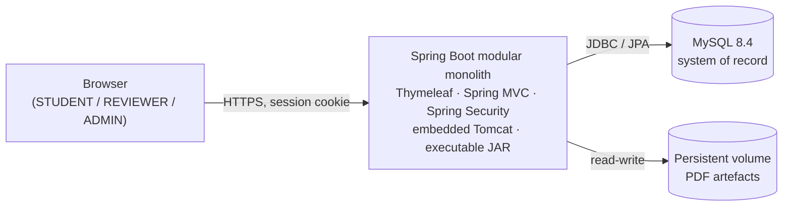

# Git-Driven Online Assignment Submission Portal

A small, production-style **modular monolith** for submitting and reviewing coursework
assignments, wrapped in a full **DevOps delivery pipeline** that runs from a GitHub pull
request through Jenkins, Maven, automated tests, Docker, Ansible provisioning, deployment,
health checking, and rollback.

The application is deliberately modest. The engineering objective of this repository is the
**delivery pipeline and the discipline around it**, not feature volume.

> **Status: Milestone 4 — the reviewer workflow is implemented.** Session sign-in with the three
> roles, PDF upload with server-side validation, SHA-256 checksums, file storage on a volume, and a
> student's own submission list and detail page all exist. Milestone 4 added the reviewer side: a
> queue of work awaiting a decision, a single terminal **approve/reject** decision with a mandatory
> rejection reason, an **append-only status history** written in the same transaction as every
> transition, **optimistic locking** so two reviewers cannot silently overwrite one another, and
> **file download** for both the owner and the reviewer.
>
> **The integration suite now executes — and the three real defects it found are fixed and
> unverified.** Three runs on 2026-10-02, each informative. The first had **no Docker daemon**: all
> 112 integration tests aborted at class initialisation, so nothing in Milestones 3 or 4 was
> reached. The second ran with Docker up: **60 unit tests green, 112 integration tests executed, 2
> failures, 0 errors.** Both were genuine defects — a Thymeleaf fragment-parameter collision that
> stopped a refused upload being handed back to the student, and a test that drove Spring Boot's
> error controller through its JSON handler and then asserted on an HTML view that was never
> resolved. The third ran the suite again — **113 tests, 1 failure** — and that failure was a third
> defect: the templates were shipping their own engineering comments to the browser, including the
> error page's notes naming `BasicErrorController` and `SecurityConfiguration`. **The last fully
> green build is still Milestone 2's.**
>
> **Not yet present — deliberately:** the audit trail (FR-24), any form of resubmission, and an
> admin UI beyond the role gate. Both halves of the pipeline are now written: continuous
> integration — a [`Jenkinsfile`](Jenkinsfile), the unit/integration/browser suites, and a
> [`Dockerfile`](Dockerfile) that packages the JAR into a production image — and, added
> 2026-10-07, the release process — a `vX.Y.Z` git tag is the version, the image is published to
> Docker Hub under it ([`deploy/`](deploy), [`scripts/ops/`](scripts/ops),
> [`docs/operations/docker-cd.md`](docs/operations/docker-cd.md)), and a host runs that exact
> version or the previous one is restored. **Nothing in either half has run to green: the image
> has never been built, no image has been pushed, no host has been contacted, and no rollback has
> fired.** What is still genuinely absent is provisioning: no Ansible, no TLS, no backup story.
>
> See [Unverified claims](#unverified-claims) before relying on any statement below.
>
> See [Current project status](CLAUDE.md#11-current-project-status) and
> [Next milestone readiness](#next-milestone-readiness).

---

## What the application does

The MVP implements exactly two workflows over a single artefact type:

```
STUDENT uploads a PDF  ──▶  SUBMITTED  ──▶  REVIEWER approves  ──▶  APPROVED
                                            └▶ REVIEWER rejects  ──▶  REJECTED (final)
```

- **STUDENT** — submits one PDF per assignment; sees the status, the reviewer's decision and reason,
  and the chronological history of their own submissions, and can download their own file.
- **REVIEWER** — works a queue of submissions awaiting a decision, reads the artefact, and records
  one terminal approve/reject decision; a rejection requires a reason.
- **ADMIN** — reaches the same reviewer screens as a `REVIEWER`. User management and the audit trail
  are **not implemented**; `/admin/**` is gated but has no controller behind it.

A decision is **final**: a decided submission cannot be decided again, and rejected work is never
resubmitted. Resubmission is explicitly **out of scope** for the MVP.

Every status change appends a row to `submission_status_history` in the same transaction as the
change itself, so the history cannot disagree with the submission it describes. The student reading
their own history sees what happened and when, but not who decided it.

### Routes

| Method & path | Who | What it does |
| --- | --- | --- |
| `GET /` | any signed-in user | Home page, with links to the actions the role may take |
| `GET /login`, `POST /login` | anonymous | Form sign-in |
| `POST /logout` | signed-in | Sign out, invalidating the session server-side |
| `GET /student/dashboard` | `STUDENT` | Own counts by status, and the most recent few |
| `GET /submissions` | `STUDENT` | The signed-in student's own submissions, newest first, paged |
| `GET /submissions/new`, `POST /submissions` | `STUDENT` | Upload one PDF |
| `GET /submissions/{id}` | `STUDENT` | One own submission: status, decision, reason, history |
| `GET /submissions/{id}/file` | `STUDENT` | Download one's own file, as an attachment |
| `GET /review`, `GET /review/queue` | `REVIEWER`, `ADMIN` | Queue of submissions awaiting a decision, oldest first, paged |
| `GET /review/submissions/{id}` | `REVIEWER`, `ADMIN` | One submission, with its history and the decision form |
| `POST /review/submissions/{id}` | `REVIEWER`, `ADMIN` | Record one terminal decision |
| `GET /review/submissions/{id}/file` | `REVIEWER`, `ADMIN` | Download the artefact |
| `GET /access-denied` | signed-in | Shown when an authenticated user lacks the role a route requires |
| `GET /error` | anonymous | The page every unhandled failure renders as — status only |
| `GET /actuator/health` | anonymous | Liveness — status only, no details |
| `GET /actuator/info` | anonymous | Build identity — the release version baked into the image, and the environment it is running in. Two identifiers and nothing else |

Authorisation is a route rule in the security filter chain, not a check inside a handler. A student
reaching another student's submission gets **404**, not **403** — "not yours" and "not there" are
deliberately the same answer, so the endpoint cannot be used to discover which identifiers exist.
Uploaded files are always served as attachments with a fixed content type, never rendered inline.
`/submissions/**` and `/student/**` are `STUDENT` only; `/review/**` is `REVIEWER` or `ADMIN`; a
signed-in user refused a route is shown `/access-denied` with a 403, rather than being sent round a
sign-in loop that cannot grant the missing role.

### Pages

Server-rendered Thymeleaf, Bootstrap-based and responsive, with **no JavaScript** — every flow
completes with scripting disabled. The pages share four fragments (`layout`, `navbar`, `flash`,
`footer`) plus `validation`, `status`, and `pagination`, so the navigation and the sign-out form are
written once. Forms carry accessible labels and are keyboard-operable; server-side validation is the
control, and a browser's own checks are a convenience layered over it. See
[`docs/evidence/ui-screenshots.md`](docs/evidence/ui-screenshots.md) for the screenshots that must be
captured to evidence the UI.

## Technology stack

| Layer | Choice |
| --- | --- |
| Language | Java 21 |
| Framework | Spring Boot 4.1.1 (Spring MVC, server-rendered) |
| View | Thymeleaf |
| Security | Spring Security, session-based, CSRF enabled |
| Persistence | Spring Data JPA over MySQL 8.4 |
| Migrations | Flyway |
| Build | Maven |
| Unit / integration tests | JUnit 5, Testcontainers |
| End-to-end tests | Selenium 4 |
| Packaging | Docker image containing a Spring Boot executable JAR |
| Local & deploy composition | Docker Compose |
| CI | Jenkins |
| Provisioning | Ansible |

Planned versions and the procedure for recording actual local versions are tracked in
[`docs/operations/toolchain.md`](docs/operations/toolchain.md).

## Architecture at a glance



A modular monolith — not microservices — with package-by-feature organisation, a single
deployable unit, and one relational system of record. Full diagrams and rationale:
[`docs/architecture/system-overview.md`](docs/architecture/system-overview.md).

## Delivery pipeline

```
GitHub → Pull Request / Review → Jenkins CI → Maven Build → Unit Tests
       → Integration Tests → Selenium E2E → Docker Image → Docker Registry
       → Ansible Provisioning → Deployment → Health Check → Rollback
```

Each stage is documented, and every stage that produces evidence stores it under
[`docs/evidence/`](docs/evidence/). The continuous-integration half — checkout through packaging,
the unit, integration and Selenium suites, and the quality gate that stops a failed revision before
it can be released — is committed as [`Jenkinsfile`](Jenkinsfile) and described in
[`docs/operations/jenkins-ci.md`](docs/operations/jenkins-ci.md) and
[`docs/testing/ci-quality-gates.md`](docs/testing/ci-quality-gates.md).

The delivery half is committed too, and described in
[`docs/operations/docker-cd.md`](docs/operations/docker-cd.md): **what runs is decided by the ref
being built.** A feature branch, `develop` or `main` runs CI and stops — the image is built locally
so a broken `Dockerfile` is caught, and it is never published. A **`vX.Y.Z` tag** runs CI and, when
it is green, publishes `IMAGE_REPOSITORY:1.0.1` to Docker Hub and deploys that exact version to a
host if `DEPLOY_ENV` names one. `latest` is never produced. The version is baked into the image at
build time and published at `/actuator/info`, so the post-deployment smoke test can prove the
release answering is the release deployed — and the previous version is restored if it cannot.

**Nothing in the delivery half has been executed.** The release rules, the credentials, the host
contract, and a claim-by-claim list of what has not been run are in `docker-cd.md` §2–§8.

## Repository layout

```
.
├── CLAUDE.md                     # Engineering handbook & rules of engagement
├── README.md                     # This file
├── CONTRIBUTING.md               # Branch, commit, and review workflow
├── SECURITY.md                   # Threat model, secret handling, reporting
├── pom.xml                       # Java 21, Spring Boot 4.1.1, pinned dependencies
├── Dockerfile                    # Multi-stage image: packages the JAR Maven built,
│                                 #   runs it as a non-root user on a Temurin 21 JRE
├── compose.yaml                  # The running system: the application and MySQL 8.4,
│                                 #   two named volumes, health checks, explicit ports
├── deploy/                       # The deployment half: compose.prod.yaml (pulls a
│                                 #   published version, never builds), the host .env
│                                 #   template, and the host-side release script
├── .dockerignore                 # admits one file into the build context: the JAR
├── mvnw / mvnw.cmd               # Maven Wrapper — the canonical build mechanism
│                                 #   pins Maven 3.9.16; no local Maven needed
├── .editorconfig / .gitattributes / .gitignore / .env.example / cspell.json
├── .github/                      # Issue templates and PR template
├── src/
│   ├── main/java/com/vit/assignmentportal/
│   │   ├── AssignmentPortalApplication.java
│   │   ├── auth/                 # identity: sign-in, roles, the User entity
│   │   ├── submission/           # the student's slice, the status transition, the history
│   │   ├── review/               # the reviewer's slice: queue, decision policy, reviewer pages
│   │   ├── storage/              # file bytes on a volume: validate, store, load, checksum
│   │   ├── config/               # the security filter chain and route rules
│   │   └── common/               # shared kernel — value types and enums only
│   ├── main/resources/
│   │   ├── application.yml       # Externalised configuration — no secrets
│   │   ├── db/migration/         # Flyway: V1 users, V2 submissions, V3 status history
│   │   ├── templates/            # Thymeleaf views, one directory per feature
│   │   └── static/               # CSS and assets
│   └── test/java/com/vit/assignmentportal/
│       ├── MySqlIntegrationTest.java      # the shared Testcontainers base class
│       ├── ApplicationContextIT.java      # migrations and every schema constraint
│       ├── auth/                 # encoder unit test + authentication/authorization ITs
│       ├── storage/              # unit tests: validation, checksums, paths, I/O
│       ├── submission/           # upload, access-isolation, failure-handling,
│       │                         #   and the two-reviewer concurrency IT
│       ├── review/               # reviewer workflow IT + decision-handler unit test
│       └── e2e/                  # Selenium: the browser journeys, the page objects,
│                                 #   and the failure-artifact extension
├── docs/
│   ├── requirements/             # What must be built (and what must not)
│   ├── architecture/             # Structure, diagrams, data model
│   ├── adr/                      # Architecture Decision Records
│   ├── testing/                  # Test strategy and the test pyramid
│   ├── operations/               # Toolchain, CI, Docker, the release process, runbooks
│   └── evidence/                 # Captured proof per pipeline stage
└── scripts/                      # ci/ dev/ ops/ helper scripts
```

## Documentation map

| Read this | To understand |
| --- | --- |
| [`CLAUDE.md`](CLAUDE.md) | The rules this repository is built by — start here |
| [`docs/requirements/mvp.md`](docs/requirements/mvp.md) | Exact MVP scope and explicit exclusions |
| [`docs/architecture/system-overview.md`](docs/architecture/system-overview.md) | Runtime and deployment topology |
| [`docs/architecture/application-structure.md`](docs/architecture/application-structure.md) | Package-by-feature layout and dependency direction |
| [`docs/architecture/data-model.md`](docs/architecture/data-model.md) | User, Submission, SubmissionStatusHistory |
| [`docs/adr/`](docs/adr/) | Why each architectural decision was made |
| [`docs/testing/strategy.md`](docs/testing/strategy.md) | What is tested at each layer |
| [`docs/operations/toolchain.md`](docs/operations/toolchain.md) | Required tool versions |
| [`docs/operations/docker.md`](docs/operations/docker.md) | The production image, the Compose stack, and the container lifecycle |
| [`docs/operations/docker-cd.md`](docs/operations/docker-cd.md) | The release process: what each ref does, publishing to Docker Hub, deploying and rolling back |
| [`CONTRIBUTING.md`](CONTRIBUTING.md) | How to propose a change |
| [`SECURITY.md`](SECURITY.md) | How uploads, secrets, and vulnerabilities are handled |

## Quick start

Requires a **JDK 21** and a **running Docker daemon**. No local Maven install is needed — the
wrapper downloads it.

> **Set `JAVA_HOME` to your JDK 21 before building.** Maven picks its JDK from `JAVA_HOME`
> and otherwise falls back to whichever `java.exe` is first on `PATH`. On a machine that also
> has a newer JDK installed, the build stops at the Java 21 check.
>
> ```powershell
> $env:JAVA_HOME = 'C:\Program Files\Eclipse Adoptium\jdk-21.0.12.101-hotspot'
> ```
>
> `JAVA_HOME` is the JDK **root** — not its `bin` directory, and not `java.exe`. Confirm with
> `mvn -version`, which prints the JDK actually in use.

> The Maven Wrapper is committed and pins **Maven 3.9.16**, so steps 3 and 4 need no local Maven
> install. Regenerate it only if that pin should move:
>
> ```bash
> mvn -N wrapper:wrapper -Dmaven=3.9.16 -Dtype=only-script
> ```
>
> See [`docs/operations/toolchain.md` §9](docs/operations/toolchain.md#9-outstanding-gaps-on-this-machine)
> for the gaps still open on this machine.

```bash
# 1. Create your local environment file and replace every change-me value
cp .env.example .env

# 2. Start MySQL 8.4
docker compose up -d db

# 3. Build, and run the unit and integration suites
./mvnw clean verify

# 4. Run the application
./mvnw spring-boot:run

# 5. Confirm it is alive
curl http://localhost:8080/actuator/health
```

On Windows PowerShell or `cmd.exe`, replace `./mvnw` with `.\mvnw.cmd`.

The application reads `DB_URL`, `DB_USERNAME`, `DB_PASSWORD`, `UPLOAD_STORAGE_PATH`, and
`APP_PORT` from the environment. Every variable, with its meaning, is documented in
[`.env.example`](.env.example). Committed defaults live in
[`application.yml`](src/main/resources/application.yml); **no secret is ever committed**.

`clean verify` requires Docker: the integration test starts a real MySQL 8.4 container rather
than an in-memory substitute, so the migration is exercised on the engine that ships. See the
[test strategy](docs/testing/strategy.md).

## Next milestone readiness

**Milestone 5 — the delivery pipeline.** The application covers the MVP's functional scope: a
student can submit and read a decision, and a reviewer can decide. The continuous-integration half
of the pipeline exists — [`Jenkinsfile`](Jenkinsfile) runs the build, the unit, integration and
Selenium suites, a started test environment, and the quality gate that refuses to build an image
from a failed revision. The image itself is now defined: a multi-stage
[`Dockerfile`](Dockerfile) that packages the JAR Maven built, and a
[`compose.yaml`](compose.yaml) that runs it beside MySQL with a volume each. What is still absent is
the delivery half: no registry publication, no Ansible playbooks, and no rollback path.

The image is **written, not built** — `Dockerfile` and `compose.yaml` were added in a sandbox with no
route to a registry, so no `docker build` has run. See
[`docs/operations/docker.md` §8](docs/operations/docker.md) for the list of unverified claims and
the commands that would close them.

The audit trail (FR-24), still outstanding from Milestone 2, is the one functional criterion not yet
met and should either ride along with Milestone 5 or be explicitly deferred in an ADR.

Nothing in Milestone 5 should be started before the current build is green, because a pipeline that
has never seen a passing build has nothing to demonstrate.

Entry criteria: [`CLAUDE.md` §13](CLAUDE.md#13-next-milestone-readiness).

## Unverified claims

**The last recorded green build is Milestone 2's** — 30 Failsafe tests and 5 Surefire tests, zero
failures. That run predates every file Milestones 3 and 4 added, so it is evidence for the milestones
behind us and for nothing in the two in front of us.

The build has since been re-run **three times** on **2026-10-02**, and between them the three runs
tell the whole story.

**Run 1 — reached test execution, no Docker daemon.** Both source sets compiled (observed, not
assumed: Failsafe discovered and reported all 112 integration tests individually, which it cannot do
unless test compilation succeeded at this revision) and the **unit suite passed — 60 tests, 0
failures, 0 errors, 0 skipped**, including Milestone 4's own `ReviewControllerTest` (5) and
`SubmissionControllerTest` (3). The **integration suite then aborted entirely**: all 112 tests across
10 classes errored at *class initialisation*, before any test body ran, with the root cause printed
once on the first test of the first class:

```
Caused by: java.lang.IllegalStateException: Could not find a valid Docker environment.
    at org.testcontainers.containers.GenericContainer.start(GenericContainer.java:316)
    at com.vit.assignmentportal.MySqlIntegrationTest.<clinit>(MySqlIntegrationTest.java:59)
```

`MySqlIntegrationTest` starts its shared MySQL 8.4 container in a static initialiser; with no engine
reachable that initialiser throws, the class is poisoned for the rest of the JVM, and every subclass
fails with `NoClassDefFoundError: Could not initialize class …` — which is what the other 111 errors
are. **Not one line of the code under test was reached.**

**Run 2 — Docker up, and the suite finally executed: 112 tests, 2 failures, 0 errors.** Both
failures were **real defects in the Milestone 3/4 work described below**, and both have been fixed:

| Test | Symptom | Cause |
| --- | --- | --- |
| `SubmissionUploadIT.returnsTheEnteredMetadataToTheFormAfterARefusal` | A refused upload came back with the Title field set to the *page's own* `<title>` text instead of what the student typed | `fragments/layout.html` declared `th:fragment="page(title, body)"`. A fragment parameter is a local variable over everything `th:insert` splices in, so `${title}` in `upload.html` resolved to the parameter rather than the flashed model attribute |
| `UiRenderingIT.rendersTheErrorPageWithoutExposingInternals` | `No ModelAndView found` — a JSON body, not the error page | A bare `GET /error` has no `Accept` header, so `BasicErrorController` chose its JSON handler; the test then asserted on an HTML view that was never resolved |

**Run 3 — both fixes confirmed, and a third defect found: 113 tests, 1 failure, 0 errors.** The two
run-2 defects are gone. The count rose by one because the error-page test was split into a 500 case
and a 404 case. The remaining failure was the most instructive of the three, because an assertion
written to look for something else found it: `rendersTheErrorPageWithoutExposingInternals` asserts
the page does not contain the word "exception", and it did — because `error.html`'s own comment
saying "an exception that reaches the container" was being **served to the browser**. Thymeleaf emits
an ordinary HTML comment verbatim: `<!-- … -->` is content, not whitespace. Every page was shipping
its engineering notes, and the error page's notes name `BasicErrorController` and
`SecurityConfiguration` — the disclosure `CLAUDE.md` §7 rule 11 forbids, on the page an anonymous
visitor is most likely to reach. Fixed by writing every comment that can reach a browser as a
Thymeleaf **parser-level** comment, which the parser discards before rendering: 51 comments across 18
of the 19 template files. The assertion was **not** relaxed — it now passes because nothing reaches
the browser, and a new `shipsNoTemplateCommentaryToTheBrowser` test enforces the rule on its own
terms.

**None of the three fixes has been re-run.** Everything below describes run 3's state; the repaired
tests are what stands between this revision and a green build.

As of 2026-10-07. The test-status rows below were established by the 2026-10-02 runs and nothing has
been re-run since; the Docker rows were added on 2026-10-06 and the release rows on 2026-10-07, and
neither set has been run at all:

| Claim | Status |
| --- | --- |
| `./mvnw clean verify` passes **at this revision** | **Failed** — run 3: the unit suite was green and 113 integration tests executed, 1 failing. All three defects it found are fixed and unverified. The last *green* run remains Milestone 2's |
| All main sources compile | **Observed** — both runs compiled both source sets at this revision |
| All test sources compile | **Observed** — Failsafe reported all 112 integration tests individually in runs 1 and 2, and all 113 in run 3 |
| The storage unit tests pass | **Passed** — 47 tests across `ChecksumServiceTest`, `FileValidationServiceTest`, `StorageIdentifierTest`, `StorageServiceTest` |
| The submission and review unit tests pass | **Passed** — `SubmissionControllerTest` (3) and `ReviewControllerTest` (5) are green |
| The upload, access-isolation, and failure-handling ITs pass | **Passed** — run 3 reported the previously failing "hand the typed metadata back" case green |
| `ApplicationContextIT` passes with the `submissions` and `submission_status_history` constraints | **Passed** — 17 tests, including the constraint probes |
| The reviewer workflow IT passes | **Passed** — `ReviewWorkflowIT`, 17 tests |
| The two-reviewer concurrency IT refuses the loser | **Passed** — `SubmissionConcurrencyIT` |
| The dashboard IT serves, isolates, and refuses a reviewer | **Passed** — `StudentDashboardIT`, 6 tests |
| The UI rendering IT finds no script, the vendored stylesheets, and the error page | **One failure in run 3** — the error-page case, on the word "exception" inside a template comment that was being served to the browser. Fixed; the no-script, stylesheet, navigation and sign-out cases passed, and the new no-comment case has not run |
| The full workflow completes with JavaScript disabled | **Partly observed** — `UiRenderingIT.rendersNoScriptOnAnyStudentPage` passed across every student page |
| The vendored `bootstrap.min.css` is present and served | **Not run** — the file is not yet in the tree (see below) |
| Spring Boot 4.1.1 and the starter coordinates resolve | **Verified** — the parent resolves, the JAR is repackaged, the context boots |
| `V1__baseline.sql` applies and `users` accepts the documented roles | **Verified** by the recorded `ApplicationContextIT` (Milestone 2 revision) |
| Authentication and route rules behave as documented | **Verified** by the recorded `AuthenticationIT` (11) and `AuthorizationIT` (14) |
| `compose.yaml` brings MySQL up healthy | **Not run** — the tests use a Testcontainers MySQL rather than the Compose service |
| the application serves `/actuator/health` | **Not run** |
| the `Dockerfile` builds an image | **Not run** — no `docker build` has been executed ([docker.md §8](docs/operations/docker.md)) |
| the image runs as a non-root user and answers its own health check | **Not run** |
| uploaded files and database rows survive replacing the application container | **Not run** — the procedure is [docker.md §5–§6](docs/operations/docker.md) |
| A real browser can complete a workflow | **Not run** — the Selenium suite and the environment scripts that start the deployment it drives exist, but no browser run has been executed |
| The pipeline publishes a versioned image to Docker Hub | **Not run** — nothing has been pushed. The rules are in [docker-cd.md §2](docs/operations/docker-cd.md) |
| The application reports its own version at `/actuator/info` | **Asserted, not run** — `AuthorizationIT` covers it; the suite has not executed since the endpoint was added |
| A release is deployed to a host and verified by a smoke test | **Not run** — no host has been contacted |
| A failed deployment rolls back to the previous version | **Not run** — the rollback has never fired. [docker-cd.md §7](docs/operations/docker-cd.md) |
| The release gate keeps a feature branch out of the registry and off a host | **Not run** — the equivalent gate on the image build is observed to skip in [defect-demonstration.md](docs/evidence/defect-demonstration.md); the two new gates have not been exercised |

Design intent is recorded and reviewable; behaviour counts as evidence only where a run is named
above. [`docs/operations/toolchain.md` §9](docs/operations/toolchain.md#9-outstanding-gaps-on-this-machine)
lists the gaps and how to close each one.

### One outstanding asset

The UI is built on **Bootstrap 5.3.3's stylesheet, vendored** at
`src/main/resources/static/css/bootstrap.min.css` rather than linked from a CDN, so pages render
identically on a build agent with no route to the public internet. That file has **not been added to
the tree yet** — the sandbox this work was done in blocked the download. Until it is fetched, the
templates will render unprovided Bootstrap class names as no styling at all: the pages remain
correct and fully usable, but not laid out.

```bash
curl -sSL -o src/main/resources/static/css/bootstrap.min.css \
  https://cdn.jsdelivr.net/npm/bootstrap@5.3.3/dist/css/bootstrap.min.css
```

Nothing else in the UI depends on that step; it is the only file the templates reference that is not
already committed.

## License

Not yet decided. Until a licence file is added, this repository is **all rights reserved**
by its author.
