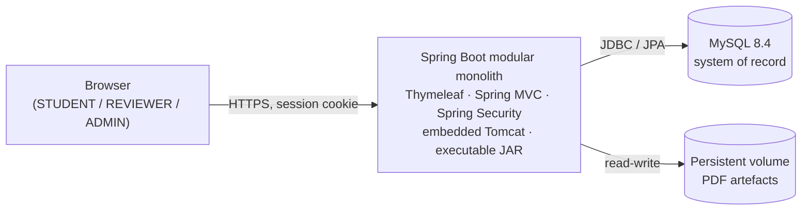

# Git-Driven Online Assignment Submission Portal

A small, production-style **modular monolith** for submitting and reviewing coursework
assignments, wrapped in a full **DevOps delivery pipeline** that runs from a GitHub pull
request through Jenkins, Maven, automated tests, Docker, Ansible provisioning, deployment,
health checking, and rollback.

The application is deliberately modest. The engineering objective of this repository is the
**delivery pipeline and the discipline around it**, not feature volume.

> **Status: Milestone 1 — application skeleton, not yet built.** The Spring Boot application,
> its externalised configuration, the first Flyway migration, the local MySQL Compose service,
> and an integration test are all written. **None of it has been compiled, started, or run:**
> the Maven Wrapper is not generated and no build has executed on this machine.
>
> It has **no authentication and no route protection yet** — Spring Security is not on the
> classpath, so every route is open. That is the next milestone. There is also no `Dockerfile`,
> no `Jenkinsfile`, and no Ansible playbook yet.
>
> See [Unverified claims](#unverified-claims) before relying on any statement below.
>
> See [Current project status](CLAUDE.md#11-current-project-status) and
> [Next milestone readiness](#next-milestone-readiness).

---

## What the application does

The MVP implements exactly two workflows over a single artefact type:

```
STUDENT uploads a PDF  ──▶  SUBMITTED  ──▶  REVIEWER approves  ──▶  APPROVED
                                            └▶ REVIEWER rejects  ──▶  REJECTED (final)
```

- **STUDENT** — submits one PDF per assignment; sees the status and history of their own submissions.
- **REVIEWER** — reviews submitted work and records an approve/reject decision with a comment.
- **ADMIN** — manages users and roles, and can inspect the audit trail.

Rejected submissions are final. Resubmission is explicitly **out of scope** for the MVP.

## Technology stack

| Layer | Choice |
| --- | --- |
| Language | Java 21 |
| Framework | Spring Boot 4.1.1 (Spring MVC, server-rendered) |
| View | Thymeleaf |
| Security | Spring Security, session-based, CSRF enabled |
| Persistence | Spring Data JPA over MySQL 8.4 |
| Migrations | Flyway |
| Build | Maven |
| Unit / integration tests | JUnit 5, Testcontainers |
| End-to-end tests | Selenium 4 |
| Packaging | Docker image containing a Spring Boot executable JAR |
| Local & deploy composition | Docker Compose |
| CI | Jenkins |
| Provisioning | Ansible |

Planned versions and the procedure for recording actual local versions are tracked in
[`docs/operations/toolchain.md`](docs/operations/toolchain.md).

## Architecture at a glance



A modular monolith — not microservices — with package-by-feature organisation, a single
deployable unit, and one relational system of record. Full diagrams and rationale:
[`docs/architecture/system-overview.md`](docs/architecture/system-overview.md).

## Delivery pipeline

```
GitHub → Pull Request / Review → Jenkins CI → Maven Build → Unit Tests
       → Integration Tests → Selenium E2E → Docker Image → Docker Registry
       → Ansible Provisioning → Deployment → Health Check → Rollback
```

Each stage is documented, and every stage that produces evidence stores it under
[`docs/evidence/`](docs/evidence/). The pipeline itself is built in a later milestone; the
required stages are fixed by [`docs/requirements/mvp.md`](docs/requirements/mvp.md).

## Repository layout

```
.
├── CLAUDE.md                     # Engineering handbook & rules of engagement
├── README.md                     # This file
├── CONTRIBUTING.md               # Branch, commit, and review workflow
├── SECURITY.md                   # Threat model, secret handling, reporting
├── pom.xml                       # Java 21, Spring Boot 4.1.1, pinned dependencies
├── mvnw / mvnw.cmd               # Maven Wrapper — the canonical build mechanism
│                                 #   ⚠ NOT YET GENERATED — see Unverified claims
├── .editorconfig / .gitattributes / .gitignore / .env.example
├── .github/                      # Issue templates and PR template
├── src/
│   ├── main/java/com/vit/assignmentportal/
│   │   └── AssignmentPortalApplication.java
│   ├── main/resources/
│   │   ├── application.yml       # Externalised configuration — no secrets
│   │   ├── db/migration/         # Flyway migrations
│   │   ├── templates/            # Thymeleaf views
│   │   └── static/               # CSS and assets
│   └── test/java/com/vit/assignmentportal/
│       └── ApplicationContextIT.java
├── docs/
│   ├── requirements/             # What must be built (and what must not)
│   ├── architecture/             # Structure, diagrams, data model
│   ├── adr/                      # Architecture Decision Records
│   ├── testing/                  # Test strategy and the test pyramid
│   ├── operations/               # Toolchain, runbooks, deployment
│   └── evidence/                 # Captured proof per pipeline stage
├── deploy/                       # Docker Compose and deployment assets
├── ansible/                      # Provisioning roles and inventories
└── scripts/                      # ci/ dev/ ops/ helper scripts
```

## Documentation map

| Read this | To understand |
| --- | --- |
| [`CLAUDE.md`](CLAUDE.md) | The rules this repository is built by — start here |
| [`docs/requirements/mvp.md`](docs/requirements/mvp.md) | Exact MVP scope and explicit exclusions |
| [`docs/architecture/system-overview.md`](docs/architecture/system-overview.md) | Runtime and deployment topology |
| [`docs/architecture/application-structure.md`](docs/architecture/application-structure.md) | Package-by-feature layout and dependency direction |
| [`docs/architecture/data-model.md`](docs/architecture/data-model.md) | User, Submission, SubmissionStatusHistory |
| [`docs/adr/`](docs/adr/) | Why each architectural decision was made |
| [`docs/testing/strategy.md`](docs/testing/strategy.md) | What is tested at each layer |
| [`docs/operations/toolchain.md`](docs/operations/toolchain.md) | Required tool versions |
| [`CONTRIBUTING.md`](CONTRIBUTING.md) | How to propose a change |
| [`SECURITY.md`](SECURITY.md) | How uploads, secrets, and vulnerabilities are handled |

## Quick start

Requires a **JDK 21** and a **running Docker daemon**. No local Maven install is needed — the
wrapper downloads it.

> **Set `JAVA_HOME` to your JDK 21 before building.** Maven picks its JDK from `JAVA_HOME`
> and otherwise falls back to whichever `java.exe` is first on `PATH`. On a machine that also
> has a newer JDK installed, the build stops at the Java 21 check.
>
> ```powershell
> $env:JAVA_HOME = 'C:\Program Files\Eclipse Adoptium\jdk-21.0.12.101-hotspot'
> ```
>
> `JAVA_HOME` is the JDK **root** — not its `bin` directory, and not `java.exe`. Confirm with
> `mvn -version`, which prints the JDK actually in use.

> **Steps 3 and 4 do not work yet: the Maven Wrapper is not in the repository.** Generate it
> once from the repository root, then commit the three files it produces:
>
> ```bash
> mvn -N wrapper:wrapper -Dmaven=3.9.9 -Dtype=only-script
> ```
>
> This is the one command in this document that needs a local Maven. Afterwards it never does
> again. See [`docs/operations/toolchain.md` §9](docs/operations/toolchain.md#9-outstanding-gaps-on-this-machine).

```bash
# 1. Create your local environment file and replace every change-me value
cp .env.example .env

# 2. Start MySQL 8.4
docker compose -f deploy/docker-compose.yml up -d

# 3. Build, and run the unit and integration suites
./mvnw clean verify

# 4. Run the application
./mvnw spring-boot:run

# 5. Confirm it is alive
curl http://localhost:8080/actuator/health
```

On Windows PowerShell or `cmd.exe`, replace `./mvnw` with `.\mvnw.cmd`.

The application reads `DB_URL`, `DB_USERNAME`, `DB_PASSWORD`, `UPLOAD_STORAGE_PATH`, and
`APP_PORT` from the environment. Every variable, with its meaning, is documented in
[`.env.example`](.env.example). Committed defaults live in
[`application.yml`](src/main/resources/application.yml); **no secret is ever committed**.

`clean verify` requires Docker: the integration test starts a real MySQL 8.4 container rather
than an in-memory substitute, so the migration is exercised on the engine that ships. See the
[test strategy](docs/testing/strategy.md).

## Next milestone readiness

**Milestone 2 — authentication.** The application is currently **unauthenticated**: Spring
Security is not on the classpath and every route is reachable. The next milestone adds
session-based sign-in, the three roles, route protection, and an audit trail of sign-in
attempts. It is the first milestone to put real code into the `auth` and `config` packages.

Entry criteria: [`CLAUDE.md` §13](CLAUDE.md#13-next-milestone-readiness).

## Unverified claims

The repository is written but **has never been built**. Stating that plainly is more useful
than a status line that reads as though it works. As of 2026-10-01:

| Claim | Status |
| --- | --- |
| `./mvnw clean verify` passes | **Not run** — the wrapper is not generated and Maven is not installed |
| `spring-boot-starter-parent:4.1.1` and the starter coordinates resolve | **Not checked** against any repository |
| The application starts and serves `/actuator/health` | **Not run** |
| `deploy/docker-compose.yml` brings MySQL up healthy | **Not run** |
| `V1__baseline.sql` applies and the `users` table accepts the documented roles | **Not run** |
| `ApplicationContextIT` passes | **Not run** |

The design intent behind each artefact is recorded and reviewable; its *behaviour* is not yet
evidence. [`docs/operations/toolchain.md` §9](docs/operations/toolchain.md#9-outstanding-gaps-on-this-machine)
lists the gaps and how to close each one.

## License

Not yet decided. Until a licence file is added, this repository is **all rights reserved**
by its author.
