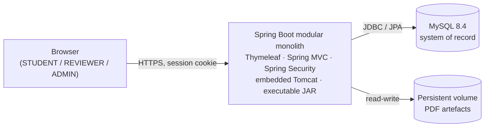

# Git-Driven Online Assignment Submission Portal

A small, production-style **modular monolith** for submitting and reviewing coursework
assignments, wrapped in a full **DevOps delivery pipeline** that runs from a GitHub pull
request through Jenkins, Maven, automated tests, Docker, Ansible provisioning, deployment,
health checking, and rollback.

The application is deliberately modest. The engineering objective of this repository is the
**delivery pipeline and the discipline around it**, not feature volume.

> **Status: Milestone 4 — the reviewer workflow is implemented.** Session sign-in with the three
> roles, PDF upload with server-side validation, SHA-256 checksums, file storage on a volume, and a
> student's own submission list and detail page all exist. Milestone 4 added the reviewer side: a
> queue of work awaiting a decision, a single terminal **approve/reject** decision with a mandatory
> rejection reason, an **append-only status history** written in the same transaction as every
> transition, **optimistic locking** so two reviewers cannot silently overwrite one another, and
> **file download** for both the owner and the reviewer.
>
> **No suite has run to green since Milestone 2.** As of 2026-10-02 the build compiles all 40 main
> sources and reaches test compilation; the tests added by Milestones 3 and 4 have never been
> executed. Treat both milestones as written but unproven.
>
> **Not yet present — deliberately:** the audit trail (FR-24), any form of resubmission, an admin UI
> beyond the role gate, and the delivery pipeline itself — no `Dockerfile`, no `Jenkinsfile`, no
> Ansible playbook. The pipeline this repository exists to demonstrate is still ahead.
>
> See [Unverified claims](#unverified-claims) before relying on any statement below.
>
> See [Current project status](CLAUDE.md#11-current-project-status) and
> [Next milestone readiness](#next-milestone-readiness).

---

## What the application does

The MVP implements exactly two workflows over a single artefact type:

```
STUDENT uploads a PDF  ──▶  SUBMITTED  ──▶  REVIEWER approves  ──▶  APPROVED
                                            └▶ REVIEWER rejects  ──▶  REJECTED (final)
```

- **STUDENT** — submits one PDF per assignment; sees the status, the reviewer's decision and reason,
  and the chronological history of their own submissions, and can download their own file.
- **REVIEWER** — works a queue of submissions awaiting a decision, reads the artefact, and records
  one terminal approve/reject decision; a rejection requires a reason.
- **ADMIN** — reaches the same reviewer screens as a `REVIEWER`. User management and the audit trail
  are **not implemented**; `/admin/**` is gated but has no controller behind it.

A decision is **final**: a decided submission cannot be decided again, and rejected work is never
resubmitted. Resubmission is explicitly **out of scope** for the MVP.

Every status change appends a row to `submission_status_history` in the same transaction as the
change itself, so the history cannot disagree with the submission it describes. The student reading
their own history sees what happened and when, but not who decided it.

### Routes

| Method & path | Who | What it does |
| --- | --- | --- |
| `GET /` | any signed-in user | Home page |
| `GET /login`, `POST /login` | anonymous | Form sign-in |
| `POST /logout` | signed-in | Sign out, invalidating the session server-side |
| `GET /submissions` | `STUDENT` | The signed-in student's own submissions, newest first |
| `GET /submissions/new`, `POST /submissions` | `STUDENT` | Upload one PDF |
| `GET /submissions/{id}` | `STUDENT` | One own submission: status, decision, reason, history |
| `GET /submissions/{id}/file` | `STUDENT` | Download one's own file, as an attachment |
| `GET /review` | `REVIEWER`, `ADMIN` | Queue of submissions awaiting a decision, oldest first |
| `GET /review/submissions/{id}` | `REVIEWER`, `ADMIN` | One submission, with its history and the decision form |
| `POST /review/submissions/{id}` | `REVIEWER`, `ADMIN` | Record one terminal decision |
| `GET /review/submissions/{id}/file` | `REVIEWER`, `ADMIN` | Download the artefact |
| `GET /actuator/health` | anonymous | Liveness — status only, no details |

Authorisation is a route rule in the security filter chain, not a check inside a handler. A student
reaching another student's submission gets **404**, not **403** — "not yours" and "not there" are
deliberately the same answer, so the endpoint cannot be used to discover which identifiers exist.
Uploaded files are always served as attachments with a fixed content type, never rendered inline.

## Technology stack

| Layer | Choice |
| --- | --- |
| Language | Java 21 |
| Framework | Spring Boot 4.1.1 (Spring MVC, server-rendered) |
| View | Thymeleaf |
| Security | Spring Security, session-based, CSRF enabled |
| Persistence | Spring Data JPA over MySQL 8.4 |
| Migrations | Flyway |
| Build | Maven |
| Unit / integration tests | JUnit 5, Testcontainers |
| End-to-end tests | Selenium 4 |
| Packaging | Docker image containing a Spring Boot executable JAR |
| Local & deploy composition | Docker Compose |
| CI | Jenkins |
| Provisioning | Ansible |

Planned versions and the procedure for recording actual local versions are tracked in
[`docs/operations/toolchain.md`](docs/operations/toolchain.md).

## Architecture at a glance



A modular monolith — not microservices — with package-by-feature organisation, a single
deployable unit, and one relational system of record. Full diagrams and rationale:
[`docs/architecture/system-overview.md`](docs/architecture/system-overview.md).

## Delivery pipeline

```
GitHub → Pull Request / Review → Jenkins CI → Maven Build → Unit Tests
       → Integration Tests → Selenium E2E → Docker Image → Docker Registry
       → Ansible Provisioning → Deployment → Health Check → Rollback
```

Each stage is documented, and every stage that produces evidence stores it under
[`docs/evidence/`](docs/evidence/). The pipeline itself is built in a later milestone; the
required stages are fixed by [`docs/requirements/mvp.md`](docs/requirements/mvp.md).

## Repository layout

```
.
├── CLAUDE.md                     # Engineering handbook & rules of engagement
├── README.md                     # This file
├── CONTRIBUTING.md               # Branch, commit, and review workflow
├── SECURITY.md                   # Threat model, secret handling, reporting
├── pom.xml                       # Java 21, Spring Boot 4.1.1, pinned dependencies
├── mvnw / mvnw.cmd               # Maven Wrapper — the canonical build mechanism
│                                 #   pins Maven 3.9.16; no local Maven needed
├── .editorconfig / .gitattributes / .gitignore / .env.example / cspell.json
├── .github/                      # Issue templates and PR template
├── src/
│   ├── main/java/com/vit/assignmentportal/
│   │   ├── AssignmentPortalApplication.java
│   │   ├── auth/                 # identity: sign-in, roles, the User entity
│   │   ├── submission/           # the student's slice, the status transition, the history
│   │   ├── review/               # the reviewer's slice: queue, decision policy, reviewer pages
│   │   ├── storage/              # file bytes on a volume: validate, store, load, checksum
│   │   ├── config/               # the security filter chain and route rules
│   │   └── common/               # shared kernel — value types and enums only
│   ├── main/resources/
│   │   ├── application.yml       # Externalised configuration — no secrets
│   │   ├── db/migration/         # Flyway: V1 users, V2 submissions, V3 status history
│   │   ├── templates/            # Thymeleaf views, one directory per feature
│   │   └── static/               # CSS and assets
│   └── test/java/com/vit/assignmentportal/
│       ├── MySqlIntegrationTest.java      # the shared Testcontainers base class
│       ├── ApplicationContextIT.java      # migrations and every schema constraint
│       ├── auth/                 # encoder unit test + authentication/authorization ITs
│       ├── storage/              # unit tests: validation, checksums, paths, I/O
│       ├── submission/           # upload, access-isolation, failure-handling,
│       │                         #   and the two-reviewer concurrency IT
│       └── review/               # reviewer workflow IT + decision-handler unit test
├── docs/
│   ├── requirements/             # What must be built (and what must not)
│   ├── architecture/             # Structure, diagrams, data model
│   ├── adr/                      # Architecture Decision Records
│   ├── testing/                  # Test strategy and the test pyramid
│   ├── operations/               # Toolchain, runbooks, deployment
│   └── evidence/                 # Captured proof per pipeline stage
├── deploy/                       # Docker Compose and deployment assets
├── ansible/                      # Provisioning roles and inventories
└── scripts/                      # ci/ dev/ ops/ helper scripts
```

## Documentation map

| Read this | To understand |
| --- | --- |
| [`CLAUDE.md`](CLAUDE.md) | The rules this repository is built by — start here |
| [`docs/requirements/mvp.md`](docs/requirements/mvp.md) | Exact MVP scope and explicit exclusions |
| [`docs/architecture/system-overview.md`](docs/architecture/system-overview.md) | Runtime and deployment topology |
| [`docs/architecture/application-structure.md`](docs/architecture/application-structure.md) | Package-by-feature layout and dependency direction |
| [`docs/architecture/data-model.md`](docs/architecture/data-model.md) | User, Submission, SubmissionStatusHistory |
| [`docs/adr/`](docs/adr/) | Why each architectural decision was made |
| [`docs/testing/strategy.md`](docs/testing/strategy.md) | What is tested at each layer |
| [`docs/operations/toolchain.md`](docs/operations/toolchain.md) | Required tool versions |
| [`CONTRIBUTING.md`](CONTRIBUTING.md) | How to propose a change |
| [`SECURITY.md`](SECURITY.md) | How uploads, secrets, and vulnerabilities are handled |

## Quick start

Requires a **JDK 21** and a **running Docker daemon**. No local Maven install is needed — the
wrapper downloads it.

> **Set `JAVA_HOME` to your JDK 21 before building.** Maven picks its JDK from `JAVA_HOME`
> and otherwise falls back to whichever `java.exe` is first on `PATH`. On a machine that also
> has a newer JDK installed, the build stops at the Java 21 check.
>
> ```powershell
> $env:JAVA_HOME = 'C:\Program Files\Eclipse Adoptium\jdk-21.0.12.101-hotspot'
> ```
>
> `JAVA_HOME` is the JDK **root** — not its `bin` directory, and not `java.exe`. Confirm with
> `mvn -version`, which prints the JDK actually in use.

> The Maven Wrapper is committed and pins **Maven 3.9.16**, so steps 3 and 4 need no local Maven
> install. Regenerate it only if that pin should move:
>
> ```bash
> mvn -N wrapper:wrapper -Dmaven=3.9.16 -Dtype=only-script
> ```
>
> See [`docs/operations/toolchain.md` §9](docs/operations/toolchain.md#9-outstanding-gaps-on-this-machine)
> for the gaps still open on this machine.

```bash
# 1. Create your local environment file and replace every change-me value
cp .env.example .env

# 2. Start MySQL 8.4
docker compose -f deploy/docker-compose.yml up -d

# 3. Build, and run the unit and integration suites
./mvnw clean verify

# 4. Run the application
./mvnw spring-boot:run

# 5. Confirm it is alive
curl http://localhost:8080/actuator/health
```

On Windows PowerShell or `cmd.exe`, replace `./mvnw` with `.\mvnw.cmd`.

The application reads `DB_URL`, `DB_USERNAME`, `DB_PASSWORD`, `UPLOAD_STORAGE_PATH`, and
`APP_PORT` from the environment. Every variable, with its meaning, is documented in
[`.env.example`](.env.example). Committed defaults live in
[`application.yml`](src/main/resources/application.yml); **no secret is ever committed**.

`clean verify` requires Docker: the integration test starts a real MySQL 8.4 container rather
than an in-memory substitute, so the migration is exercised on the engine that ships. See the
[test strategy](docs/testing/strategy.md).

## Next milestone readiness

**Milestone 5 — the delivery pipeline.** The application now covers the MVP's functional scope: a
student can submit and read a decision, and a reviewer can decide. The deliverable this repository
actually exists to demonstrate is still absent — no `Dockerfile`, no `Jenkinsfile`, no Ansible
playbooks, no Selenium suite, and no registry publication or rollback path.

The audit trail (FR-24), still outstanding from Milestone 2, is the one functional criterion not yet
met and should either ride along with Milestone 5 or be explicitly deferred in an ADR.

Nothing in Milestone 5 should be started before the current build is green, because a pipeline that
has never seen a passing build has nothing to demonstrate.

Entry criteria: [`CLAUDE.md` §13](CLAUDE.md#13-next-milestone-readiness).

## Unverified claims

**The last recorded green build is Milestone 2's** — 30 Failsafe tests and 5 Surefire tests, zero
failures. That run predates every file Milestones 3 and 4 added, so it is evidence for the milestones
behind us and for nothing in the two in front of us.

Since then the build has been run and has moved forward: on **2026-10-02** it compiled **all 40 main
sources** and reached **test compilation**, where it stopped on a single error. That error has been
fixed but the build has **not been re-run**, and **no test has executed**. As of 2026-10-02:

| Claim | Status |
| --- | --- |
| `./mvnw clean verify` passes **at this revision** | **Not run** — the last green run was Milestone 2 |
| All 40 main sources compile | **Observed** on 2026-10-02, at the revision current then |
| All test sources compile | **Not confirmed** — the run stopped at one test error, since fixed |
| The storage and submission unit tests pass | **Not run** |
| The upload, access-isolation, and failure-handling ITs pass | **Not run** |
| `ApplicationContextIT` passes with the `submissions` and `submission_status_history` constraints | **Not run** — the recorded run executed the 5-test Milestone 2 version |
| The reviewer workflow IT and the decision-handler unit test pass | **Not run** — written, never compiled |
| The two-reviewer concurrency IT refuses the loser | **Not run** — written, never compiled |
| Spring Boot 4.1.1 and the starter coordinates resolve | **Verified** — the parent resolves, the JAR is repackaged, the context boots |
| `V1__baseline.sql` applies and `users` accepts the documented roles | **Verified** by the recorded `ApplicationContextIT` |
| Authentication and route rules behave as documented | **Verified** by the recorded `AuthenticationIT` (11) and `AuthorizationIT` (14) |
| `deploy/docker-compose.yml` brings MySQL up healthy | **Not run** — the tests use a Testcontainers MySQL 8.4.11 instead |
| The application serves `/actuator/health` | **Not run** |
| A real browser can complete a workflow | **Not run** — Selenium is not a dependency yet |

Design intent is recorded and reviewable; behaviour counts as evidence only where a run is named
above. [`docs/operations/toolchain.md` §9](docs/operations/toolchain.md#9-outstanding-gaps-on-this-machine)
lists the gaps and how to close each one.

## License

Not yet decided. Until a licence file is added, this repository is **all rights reserved**
by its author.
