# Agile Planning, Backlog & DevOps Workflow

**Project:** Git-Driven Online Assignment Submission Portal  
**Student:** Ayush Gole (23102A0005)  
**Academic Target:** B.E. Semester VII — Computer Engineering, DevOps  
**Baseline Date:** 2026-10-01  
**Status:** Baselined  

---

## 1. User Stories & Acceptance Criteria

### US-01: Problem Definition & Scope Baseline (Task 01)
* **As a** Project Stakeholder / Academic Reviewer,
* **I want** an explicit problem statement, stakeholder map, functional requirements (FR-1–FR-28), constraints, and out-of-scope boundaries,
* **So that** development scope is frozen and evaluation criteria are unambiguous.
* **Acceptance Criteria:**
  - `docs/requirements/mvp.md` documents actors (`STUDENT`, `REVIEWER`, `ADMIN`), FR-1 through FR-28, NFR-1 through NFR-7, and 18 explicit exclusions.
  - State transitions (`SUBMITTED` -> `APPROVED` | `REJECTED`) are strictly defined.

### US-02: Agile Planning & DevOps Lifecycle (Task 02)
* **As a** Scrum Master / Developer,
* **I want** a product backlog, 15-task sprint plan, Kanban workflow, and Definition of Done,
* **So that** incremental delivery and release gates are strictly managed.
* **Acceptance Criteria:**
  - User stories defined with testable acceptance criteria.
  - Backlog items mapped to a 2-Sprint plan and Definition of Done (DoD).
  - DevOps lifecycle diagram illustrates code commit to operations feedback.

### US-03: System Architecture & ADRs (Task 03)
* **As an** Architect / Developer,
* **I want** modular monolith architecture specifications and Architecture Decision Records (ADRs),
* **So that** feature package isolation and non-leaky domain boundaries are maintained.
* **Acceptance Criteria:**
  - Package tree separates `auth`, `submission`, and `review`.
  - Inward dependency rule holds: feature packages do not have circular references.
  - ADR-001 through ADR-006 document key architectural decisions.

### US-04: Toolchain & Build Automation (Task 04)
* **As a** Developer,
* **I want** Maven Enforcer toolchain validation pinned to Java 21 and reproducible `./mvnw` scripts,
* **So that** builds execute identically on developer workstations and CI runners.
* **Acceptance Criteria:**
  - `pom.xml` pins Java release 21 and Maven Enforcer rules.
  - `./mvnw` and `mvnw.cmd` wrapper scripts allow zero-install builds.

### US-05: Session Authentication & Role Authorization (Task 05)
* **As a** Student or Reviewer,
* **I want** secure session login, CSRF protection, and role-based URL protection,
* **So that** unauthenticated users cannot access portal resources and roles remain isolated.
* **Acceptance Criteria:**
  - Form login with BCrypt password hashing.
  - CSRF tokens on all modifying requests; session fixation protection enabled.
  - `/student/**` accessible only by `STUDENT`, `/review/**` only by `REVIEWER`.

### US-06: PDF Upload & Server-Side Validation (Task 06)
* **As a** Student,
* **I want** to upload an assignment PDF under 10 MB with strict server-side validation,
* **So that** invalid, oversized, or malicious files are rejected before storage.
* **Acceptance Criteria:**
  - Files > 10 MB or non-PDF mime types/extensions are rejected.
  - Magic bytes checked via Apache Tika/content sniffing to prevent spoofed extensions.

### US-07: Persistent Storage & SHA-256 Checksum (Task 07)
* **As an** Auditor / Student,
* **I want** uploads stored under server-generated UUIDs with SHA-256 integrity checksums,
* **So that** file tampering is detectable and original filenames cannot exploit path traversal.
* **Acceptance Criteria:**
  - File stored under UUID storage identifier in persistent directory.
  - SHA-256 computed and persisted in database upon receipt.

### US-08: Database Migrations with Flyway & MySQL 8.4 (Task 08)
* **As a** Database Administrator / Developer,
* **I want** versioned SQL migrations managed by Flyway against MySQL 8.4,
* **So that** schema evolutions are version-controlled and reproducible across environments.
* **Acceptance Criteria:**
  - Migrations `V1` to `V3` create schema without Hibernate auto-DDL.
  - Startup fails safely if database connectivity or migration fails.

### US-09: Student Dashboard & Submission Tracking (Task 09)
* **As a** Student,
* **I want** a dashboard displaying my submitted assignments, submission dates, and current statuses,
* **So that** I can track my academic evaluation progress.
* **Acceptance Criteria:**
  - Dashboard renders total, approved, and rejected submission counts.
  - Students can only view their own submissions (strict tenant isolation).

### US-10: Reviewer Queue & Optimistic Concurrency (Task 10)
* **As a** Reviewer,
* **I want** to view pending submissions, inspect PDFs, and record terminal decisions with comments,
* **So that** evaluation is recorded transparently and concurrent reviews do not overwrite each other.
* **Acceptance Criteria:**
  - Review queue displays `SUBMITTED` items in FIFO order.
  - Version field (`@Version`) prevents concurrent overwrite of decision.
  - Terminal statuses (`APPROVED`, `REJECTED`) cannot be transitioned again.

### US-11: Selenium End-to-End Workflow Validation (Task 11)
* **As a** QA Engineer,
* **I want** Selenium E2E suites running against a real browser and packaged JAR,
* **So that** the complete student submit -> reviewer approve/reject journey is proven end-to-end.
* **Acceptance Criteria:**
  - Page Object Model covers login, submission upload, dashboard, and review actions.
  - Screenshots captured automatically upon test completion or failure.

### US-12: Multi-Stage Containerization with Docker (Task 12)
* **As a** Release Engineer,
* **I want** an optimized multi-stage Dockerfile running as non-root with Compose stack definition,
* **So that** the application and MySQL services run with container isolation and persistent storage.
* **Acceptance Criteria:**
  - Multi-stage build separates builder from runtime image (`eclipse-temurin:21-jre-jammy`).
  - Container executes under non-root user `portal` (UID 1001).
  - `compose.yaml` mounts named volumes for MySQL data and uploads.

### US-13: Jenkins Continuous Integration Pipeline (Task 13)
* **As a** DevOps Engineer,
* **I want** a declarative Jenkinsfile defining stages for build, unit test, integration test, package, and E2E,
* **So that** every commit or pull request is automatically verified before release.
* **Acceptance Criteria:**
  - Multi-stage pipeline checks out code, runs tests, publishes reports, and tags artifacts.
  - Build fails fast if any quality gate (Surefire/Failsafe/Selenium) is violated.

### US-14: Infrastructure as Code & Ansible Configuration (Task 14)
* **As a** Systems Administrator,
* **I want** idempotent Ansible playbooks to provision Docker, environment variables, and services,
* **So that** host provisioning is reproducible and repeated runs yield `changed=0`.
* **Acceptance Criteria:**
  - Roles structured for `common`, `docker`, and `application`.
  - Idempotent execution verified: second run produces zero configuration changes.

### US-15: Release Management, Deployment & Rollback (Task 15)
* **As an** Operations Engineer,
* **I want** automated zero-downtime deployment, health verification, and recorded rollback procedures,
* **So that** faulty updates can be restored immediately without data loss.
* **Acceptance Criteria:**
  - Git version tag (`vX.Y.Z`) triggers production image publication.
  - Actuator `/actuator/health` probed post-deployment.
  - Rollback script restores prior known-good container revision upon health check failure.

---

## 2. 15-Task Kanban Board & Product Backlog

| Task # | Story Title | Priority | Story Points | Sprint | Status | Deliverable File(s) |
| :---: | :--- | :---: | :---: | :---: | :---: | :--- |
| **01** | Problem Definition & Scope Baseline | P0 | 3 | Sprint 1 | **Done** | `docs/requirements/mvp.md`, `task-01.md` |
| **02** | Agile Planning & DevOps Workflow | P0 | 3 | Sprint 1 | **Done** | `docs/agile/backlog.md`, `task-02.md` |
| **03** | System Architecture & ADRs | P0 | 5 | Sprint 1 | **Done** | `docs/architecture/`, `docs/adr/`, `task-03.md` |
| **04** | Java 21 & Maven Wrapper Baseline | P1 | 3 | Sprint 1 | **Done** | `pom.xml`, `mvnw`, `mvnw.cmd`, `task-04.md` |
| **05** | Form Authentication & Session Security | P1 | 5 | Sprint 1 | **Done** | `SecurityConfiguration.java`, `task-05.md` |
| **06** | Secure PDF File Validation | P1 | 5 | Sprint 1 | **Done** | `FileValidationService.java`, `task-06.md` |
| **07** | Storage Service & SHA-256 Checksums | P1 | 5 | Sprint 1 | **Done** | `StorageService.java`, `task-07.md` |
| **08** | MySQL Schema Migrations with Flyway | P1 | 5 | Sprint 1 | **Done** | `src/main/resources/db/migration/`, `task-08.md` |
| **09** | Student Workflow & Isolation | P1 | 5 | Sprint 2 | **Done** | `SubmissionController.java`, `task-09.md` |
| **10** | Reviewer Workflow & Concurrency | P1 | 5 | Sprint 2 | **Done** | `ReviewService.java`, `task-10.md` |
| **11** | Selenium E2E Automation Testing | P2 | 8 | Sprint 2 | **Done** | `src/test/java/.../e2e/`, `task-11.md` |
| **12** | Multi-Stage Docker & Compose Stacks | P1 | 5 | Sprint 2 | **Done** | `Dockerfile`, `compose.yaml`, `task-12.md` |
| **13** | Jenkins Continuous Integration Pipeline | P1 | 8 | Sprint 2 | **Done** | `Jenkinsfile`, `scripts/ci/`, `task-13.md` |
| **14** | Ansible Configuration Management | P2 | 5 | Sprint 2 | **Done** | `ansible/site.yml`, `task-14.md` |
| **15** | Automated Deployment & Rollback Drill | P1 | 5 | Sprint 2 | **Done** | `scripts/ops/`, `task-15.md` |

---

## 3. Sprint Planning

### Sprint 1: Architecture, Core Foundation & Functional Baseline
* **Goal:** Establish core application architecture, secure file processing, persistence layer, and student/reviewer workflows.
* **Duration:** Weeks 1 – 3
* **Tasks Included:** Task 01 through Task 08 (Total: 34 Story Points)
* **Outcome:** Executable Spring Boot service with authenticated PDF submission, Flyway database migrations, and isolated student/reviewer controllers.

### Sprint 2: Automated Testing, Containerization & DevOps Release
* **Goal:** Implement comprehensive end-to-end testing, Docker container packaging, CI/CD pipeline, and Ansible infrastructure deployment.
* **Duration:** Weeks 4 – 6
* **Tasks Included:** Task 09 through Task 15 (Total: 41 Story Points)
* **Outcome:** Jenkins-automated test and build stages, multi-stage Docker container runs, and automated health-checked rollback capabilities.

---

## 4. Definition of Done (DoD)

A backlog item or task is considered **Done** only when all of the following criteria are satisfied:
1. **Code Implementation:** Clean, documented Java/configuration code adheres strictly to modular architecture boundaries and NFR guidelines.
2. **Quality Checks:** Unit tests (Surefire) and integration tests (Failsafe with Testcontainers MySQL) pass with 100% success.
3. **Security Standards:** Zero secrets committed; inputs validated server-side; CSRF and role-based authorization enforced.
4. **Documentation:** Relevant requirement, architecture, or operational markdown documentation updated.
5. **Traceability & Evidence:** Git commit SHA linked; actual execution logs or screenshots retained under `docs/evidence/`.

---

## 5. DevOps Lifecycle Workflow

```mermaid
flowchart LR
    subgraph Plan ["1. Plan"]
        A[Problem Definition & MVP Scope] --> B[Agile User Stories & Backlog]
    end

    subgraph Code ["2. Code & Design"]
        B --> C[Spring Boot & Modular Packages]
        C --> D[Git Feature Branching & PRs]
    end

    subgraph Build ["3. Build & Test"]
        D --> E[Maven Clean Package Java 21]
        E --> F[Surefire Unit & Failsafe MySQL Tests]
        F --> G[Selenium E2E Browser Testing]
    end

    subgraph Release ["4. Release & Package"]
        G --> H[Multi-Stage Docker Image Build]
        H --> I[Container Registry Tagging vX.Y.Z]
    end

    subgraph Deploy ["5. Deploy & Operate"]
        I --> J[Ansible Host Provisioning]
        J --> K[Docker Compose Stack Deploy]
        K --> L[Actuator Health Probe]
    end

    subgraph Monitor ["6. Monitor & Feedback"]
        L -->|Health OK| M[Active Production Operation]
        L -->|Health Failed| N[Automated Rollback to Prior Stable Image]
        M --> A
    end
```

