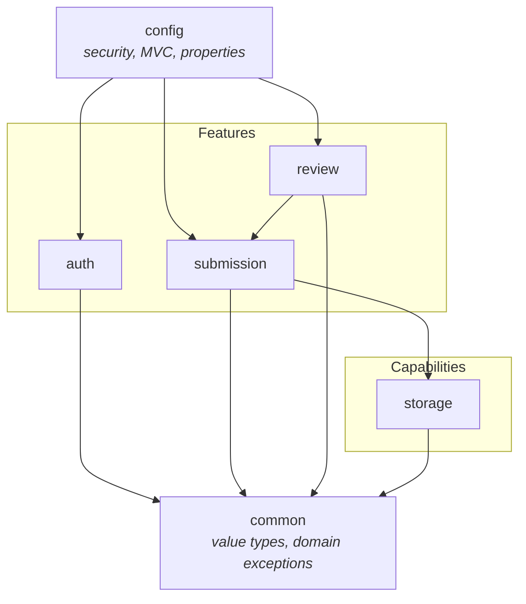

# Application Structure

**Status:** Baselined — Milestone 1 (runtime established; feature packages not yet populated)
**Related:** [System overview](system-overview.md) · [ADR-001](../adr/ADR-001-modular-monolith.md) · [ADR-007](../adr/ADR-007-base-package-and-package-set.md)

This document defines the **internal organisation** of the monolith: how packages are laid
out, which direction dependencies may flow, and what each package is allowed to own.

The package **set** was agreed in [ADR-007](../adr/ADR-007-base-package-and-package-set.md),
which supersedes the package names originally sketched in this document. The structure is
agreed; most of it is still empty, because a package is created when code belongs in it
([`CLAUDE.md` §11](../../CLAUDE.md)).

---

## 1. Package-by-feature, not package-by-layer

A layered layout groups classes by technical role, so a single feature is scattered across
five directories and every change touches all of them:

```
❌ layered — a feature is smeared across the tree
com.vit.assignmentportal
├── controller/     SubmissionController, ReviewController, AuthController
├── service/        SubmissionService, ReviewService, AuthService
├── repository/     SubmissionRepository, UserRepository
├── entity/         Submission, User
└── dto/            SubmissionDto, UserDto
```

A feature layout groups classes by **what they are about**, so one feature is one directory
and a change has one home:

```
✅ feature-oriented — a feature is a vertical slice
com.vit.assignmentportal
├── AssignmentPortalApplication.java
├── common/         the shared kernel: value types and domain exceptions
├── config/         cross-cutting Spring configuration
├── auth/           everything about identity, sign-in, and roles
├── submission/     everything about a submission, end to end
├── review/         everything about the reviewer decision
└── storage/        the file-storage capability
```

Layers still exist — they are simply **inside** each feature: `submission/` contains its own
controller, service, repository, and entity.

## 2. Base package and the six packages

Base package: **`com.vit.assignmentportal`**. Component scanning starts at
`AssignmentPortalApplication`, so every package below it is scanned.

| Package | Kind | Owns | Never contains |
| --- | --- | --- | --- |
| `common` | Shared kernel | Enums, value types, domain exceptions shared across features | Services, Spring beans, anything named `*Utils`/`*Helper` |
| `config` | Cross-cutting | Spring configuration: security, MVC/web infrastructure, persistence, typed `@ConfigurationProperties` | Business rules; anything a single feature owns |
| `auth` | Feature | Identity: sign-in, sign-out, roles, the `User` entity and its service | Submission or review rules |
| `submission` | Feature | The student's submission: upload, listing, download, status | Reviewer decisions |
| `review` | Feature | The reviewer's decision: queue, approve/reject, terminal-status rule | Submission ownership rules |
| `storage` | Capability | File bytes: store, load, validate, checksum | Any knowledge of what a submission is |

Only packages with real code exist on disk. A package is created when a class belongs in it,
never in advance.

## 3. Target layout

The shape each package takes as its feature is built. **Nothing below exists yet** except
`AssignmentPortalApplication` — this is the map, not an inventory.

```
com.vit.assignmentportal
│
├── AssignmentPortalApplication.java        # @SpringBootApplication entry point  [EXISTS]
│
├── common/                                 # shared kernel — value types ONLY
│   ├── Role.java                           #   enum STUDENT, REVIEWER, ADMIN
│   ├── SubmissionStatus.java               #   enum SUBMITTED, APPROVED, REJECTED
│   └── DomainException.java                #   base for expected, user-facing failures
│
├── config/                                 # cross-cutting Spring configuration
│   ├── SecurityConfiguration.java          #   filter chain, CSRF, route rules, session
│   ├── WebMvcConfiguration.java            #   view controllers, formatters, locale
│   ├── GlobalExceptionHandler.java         #   @ControllerAdvice — user-safe error pages
│   ├── StorageProperties.java              #   @ConfigurationProperties("app.storage")
│   └── PersistenceConfiguration.java       #   JPA/auditing settings not covered by yml
│
├── auth/                                   # feature: identity and roles
│   ├── User.java                           #   @Entity  → maps the `users` table
│   ├── UserRepository.java
│   ├── UserService.java                    #   create, find, assign role
│   ├── CurrentUserService.java             #   resolve the authenticated principal
│   ├── DatabaseUserDetailsService.java     #   loads users for Spring Security
│   ├── SignInAuditListener.java            #   records success AND failure events
│   ├── AuthController.java                 #   GET /login, POST /login, POST /logout
│   ├── UserAdminController.java            #   ADMIN-only user management (FR-3)
│   └── templates/                          #   Thymeleaf views owned by this feature
│       ├── login.html
│       └── user-list.html
│
├── submission/                             # feature: the student's submission
│   ├── Submission.java                     #   @Entity
│   ├── SubmissionStatusHistory.java        #   @Entity, append-only
│   ├── SubmissionRepository.java
│   ├── SubmissionStatusHistoryRepository.java
│   ├── SubmissionService.java              #   create, list-own, download
│   ├── SubmissionController.java
│   ├── UploadSubmissionForm.java           #   record, bound to the HTML form
│   ├── SubmissionSummary.java              #   record, read model
│   └── templates/
│       ├── submission-list.html
│       ├── submission-upload.html
│       └── submission-detail.html
│
├── review/                                 # feature: the reviewer decision
│   ├── ReviewQueueService.java
│   ├── ReviewService.java                  #   recordDecision(...) — enforces terminality
│   ├── ReviewController.java
│   ├── ReviewDecision.java                 #   record: APPROVED | REJECTED + comment
│   ├── ReviewQueueItem.java                #   record, read model
│   └── templates/
│       ├── review-queue.html
│       └── review-detail.html
│
└── storage/                                # capability: file bytes on a volume
    ├── StorageService.java                 #   store / load / delete by storage id
    ├── StorageIdentifier.java              #   record — the generated id
    ├── FileValidationService.java          #   PDF-only, <= 10 MB, content sniffing
    ├── ChecksumService.java                #   SHA-256
    └── StoredFile.java                     #   record: identifier, checksum, size, name
```

Plus, outside the Java tree:

```
src/main/resources
├── application.yml                         # committed defaults, NO secrets            [EXISTS]
├── db/migration/                           # Flyway migrations
│   └── V1__baseline.sql                    # `users` table only                       [EXISTS]
├── templates/                              # Thymeleaf view root (feature subdirs nest here)
└── static/                                 # CSS and assets for the server-rendered UI

src/test/java/com/vit/assignmentportal
├── ApplicationContextIT.java               # context + migration + constraint proof   [EXISTS]
└── ...                                     # unit and integration tests, beside the feature
```

## 4. Dependency direction

The rule that keeps a modular monolith modular is a **one-way** dependency graph. Cycles
between features are what turn modules back into a ball of mud.



Rules, in order of importance:

1. **Features do not depend on each other except through services.** `review` may call
   `SubmissionService`; it may **not** import `SubmissionRepository`, and it may not mutate a
   `Submission` directly. This is what makes the terminal-status rule enforceable in one
   place, and it is why `review → submission` is allowed while the reverse is not.
2. **Capabilities depend on nothing but `common`.** `storage` has no idea what a submission
   is. It receives bytes and an identifier, and returns a checksum.
3. **`config` is the outermost ring.** It may depend on every feature; features must never
   depend on it. In particular, a feature service must not read from the HTTP request — it
   takes a resolved principal from `CurrentUserService`.
4. **`common` is the shared kernel and is deliberately tiny.** Enums, value types, and domain
   exceptions only. **No services, no Spring beans, no `Utils`, no `Helper`, no `CommonUtils`**
   — a name that describes a shape rather than a responsibility is banned in this repository
   (see [`CLAUDE.md` §5](../../CLAUDE.md)). If a class in `common` has no single nameable
   responsibility, it does not belong there.
5. **No cycles.** If two features genuinely need each other, the shared concept is missing and
   belongs in `common`, or one of them is not a feature.

Dependency *inversion* is not used here. The graph is acyclic at this size, and interfaces
introduced purely for testability add indirection without buying anything.

## 5. Where things belong — worked examples

| A new concern | Where it goes | Why |
| --- | --- | --- |
| "Compute the SHA-256 of a file" | `storage/ChecksumService` | Single, nameable responsibility |
| "Reject files that are not PDFs" | `storage/FileValidationService` | Validation is its own concern |
| "Who is signed in right now?" | `auth/CurrentUserService` | Resolves the principal, used by features |
| "Load a user for Spring Security" | `auth/DatabaseUserDetailsService` | Identity is the `auth` feature's to own |
| "Configure the session cookie and CSRF" | `config/SecurityConfiguration` | Cross-cutting authentication wiring |
| "Bind `UPLOAD_STORAGE_PATH` to a typed bean" | `config/StorageProperties` | Configuration binding is cross-cutting |
| "Show a friendly error page" | `config/GlobalExceptionHandler` | Applies to every feature |
| "Render the reviewer queue" | `review/ReviewController` + `review/templates/` | Feature owns its own slice |
| "Format a timestamp for display" | `config/` (a small named formatter) | A view concern. **Not** a `DateUtils`. |

If a change does not fit any row above, that is a signal the package structure needs a
deliberate decision — raise it rather than dropping the code somewhere convenient.

### Open item: where does the audit trail live?

FR-24 requires an audit trail, and [`CLAUDE.md` §5](../../CLAUDE.md) names an `AuditService`.
The agreed package set ([ADR-007](../adr/ADR-007-base-package-and-package-set.md)) **has no
`audit` package**, and `AuditService` is a service, so it cannot live in the `common` shared
kernel without breaking rule 4 above.

This is unresolved and must be decided in the milestone that implements the audit trail.
Neither the `auth` package nor `config` is a good home: `auth` would own submission and review
events it has no business knowing about, and `config` is for configuration, not behaviour. A
dedicated `audit` capability package — exactly like `storage` — is the recommendation.

## 6. Rules a reviewer will check

- [ ] The class lives in the feature that owns the concept, not in a generic bucket.
- [ ] The name states a responsibility, not a shape (`*Utils`, `*Helper`, `*Manager` are
      rejected on sight).
- [ ] `common` contains only value types, enums, and domain exceptions.
- [ ] No feature imports another feature's `*Repository` or mutates another feature's entity.
- [ ] No feature service imports anything from `config`.
- [ ] New DTOs are records, and are named for their role rather than `*Dto`.
- [ ] Entities never leave the feature that owns them — controllers bind to records.
- [ ] No Lombok, unless an ADR says otherwise.
