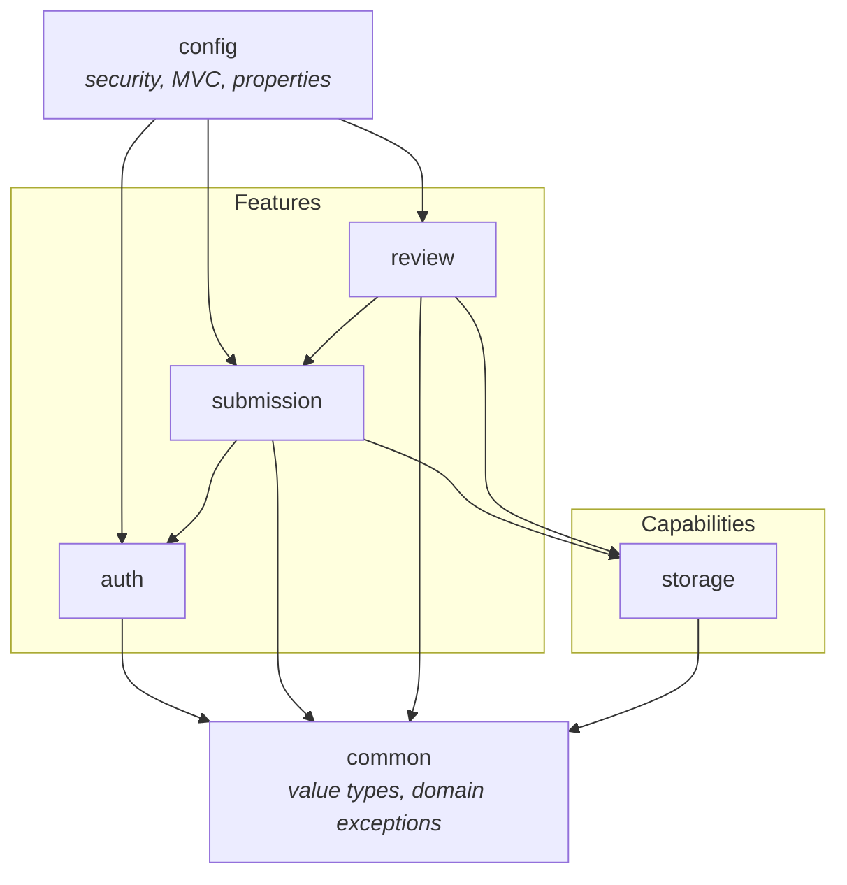

# Application Structure

**Status:** Implemented for `auth`, `storage`, `submission` and `config` — Milestone 3. `review`
is still planned.
**Related:** [System overview](system-overview.md) · [ADR-001](../adr/ADR-001-modular-monolith.md) · [ADR-007](../adr/ADR-007-base-package-and-package-set.md) · [Data model](data-model.md) · [Security architecture](security.md)

This document defines the **internal organisation** of the monolith: how packages are laid
out, which direction dependencies may flow, and what each package is allowed to own.

The package **set** was agreed in [ADR-007](../adr/ADR-007-base-package-and-package-set.md),
which supersedes the package names originally sketched in this document. A package is created when
code belongs in it ([`CLAUDE.md` §11](../../CLAUDE.md)): `auth` arrived with the authentication
milestone, and `storage` and `submission` with the student submission slice. `review` remains
empty by design — see §3.

---

## 1. Package-by-feature, not package-by-layer

A layered layout groups classes by technical role, so a single feature is scattered across
five directories and every change touches all of them:

```
❌ layered — a feature is smeared across the tree
com.vit.assignmentportal
├── controller/     SubmissionController, ReviewController, AuthController
├── service/        SubmissionService, ReviewService, AuthService
├── repository/     SubmissionRepository, UserRepository
├── entity/         Submission, User
└── dto/            SubmissionDto, UserDto
```

A feature layout groups classes by **what they are about**, so one feature is one directory
and a change has one home:

```
✅ feature-oriented — a feature is a vertical slice
com.vit.assignmentportal
├── AssignmentPortalApplication.java
├── common/         the shared kernel: value types and domain exceptions
├── config/         cross-cutting Spring configuration
├── auth/           everything about identity, sign-in, and roles
├── submission/     everything about a submission, end to end
├── review/         everything about the reviewer decision
└── storage/        the file-storage capability
```

Layers still exist — they are simply **inside** each feature: `submission/` contains its own
controller, service, repository, and entity.

## 2. Base package and the six packages

Base package: **`com.vit.assignmentportal`**. Component scanning starts at
`AssignmentPortalApplication`, so every package below it is scanned.

| Package | Kind | Owns | Never contains |
| --- | --- | --- | --- |
| `common` | Shared kernel | Enums, value types, domain exceptions shared across features | Services, Spring beans, anything named `*Utils`/`*Helper` |
| `config` | Cross-cutting | Spring configuration: the security filter chain and route rules | Business rules; the *shape* of a capability's settings (see §5) |
| `auth` | Feature | Identity: sign-in, sign-out, roles, the `User` entity and its service | Submission or review rules |
| `submission` | Feature | The student's submission: upload, listing, viewing, status | Reviewer decisions |
| `review` | Feature | The reviewer's decision: queue, approve/reject, terminal-status rule | Submission ownership rules |
| `storage` | Capability | File bytes: store, delete, validate, checksum, and its own settings | Any knowledge of what a submission is |

Only packages with real code exist on disk. A package is created when a class belongs in it,
never in advance.

## 3. Layout

The structure as it actually stands. Files marked `[EXISTS]` are on disk; the rest is the map for
work that has not happened, and a class appears here only when the milestone that needs it exists.
**No placeholder class is ever created to fill a directory** — empty structure that implies work
which has not happened is worse than no structure ([`CLAUDE.md` §11](../../CLAUDE.md)).

```
com.vit.assignmentportal
│
├── AssignmentPortalApplication.java        # @SpringBootApplication, @ConfigurationPropertiesScan  [EXISTS]
│
├── common/                                 # shared kernel — value types, enums, exceptions ONLY
│   ├── Role.java                           #   enum STUDENT, REVIEWER, ADMIN                     [EXISTS]
│   ├── SubmissionStatus.java               #   enum SUBMITTED, APPROVED, REJECTED                 [EXISTS]
│   └── UuidToVarcharConverter.java         #   JPA converter pinning the UUID column mapping     [EXISTS]
│
├── config/                                 # cross-cutting Spring configuration
│   └── SecurityConfiguration.java          #   filter chain, CSRF, route rules, session           [EXISTS]
│
├── auth/                                   # feature: identity and roles
│   ├── User.java                           #   @Entity → maps the `users` table                 [EXISTS]
│   ├── UserRepository.java                                                                       [EXISTS]
│   ├── UserService.java                    #   create, find; the only place a password is encoded [EXISTS]
│   ├── CurrentUserService.java             #   resolve the authenticated principal               [EXISTS]
│   ├── AuthenticatedUser.java              #   the principal that leaves this feature           [EXISTS]
│   ├── CurrentUserView.java                #   read model for the page header                   [EXISTS]
│   ├── DatabaseUserDetailsService.java     #   loads users for Spring Security                  [EXISTS]
│   ├── DevelopmentUserSeeder.java          #   demo accounts — dev profile AND APP_SEED_ENABLED  [EXISTS]
│   ├── AuthController.java                 #   GET/POST /login, POST /logout, /access-denied     [EXISTS]
│   ├── HomeController.java                 #   GET /                                            [EXISTS]
│   ├── SignInAuditListener.java            #   record success AND failure events                 [PLANNED]
│   ├── UserAdminController.java            #   ADMIN-only user management (FR-3)                 [PLANNED]
│   └── templates/
│       ├── login.html                                                                           [EXISTS]
│       ├── home.html                                                                             [EXISTS]
│       ├── access-denied.html                                                                    [EXISTS]
│       └── user-list.html                                                                      [PLANNED]
│
├── submission/                             # feature: the student's submission
│   ├── Submission.java                     #   @Entity → maps the `submissions` table            [EXISTS]
│   ├── SubmissionRepository.java           #   every query carries the owner                     [EXISTS]
│   ├── SubmissionService.java              #   the two-phase write: bytes, then the row          [EXISTS]
│   ├── SubmissionController.java           #   /submissions, /new, POST, /{id}                   [EXISTS]
│   ├── SubmissionSummary.java              #   record, read model for the list                   [EXISTS]
│   ├── SubmissionDetail.java               #   record, read model for the detail page            [EXISTS]
│   ├── SubmissionTimestampFormat.java      #   package-private; UTC formatting for templates      [EXISTS]
│   ├── InvalidSubmissionException.java     #   refusal with a message safe to render              [EXISTS]
│   ├── SubmissionNotFoundException.java    #   404 — "not yours" and "not there" are one answer  [EXISTS]
│   ├── SubmissionStatusHistory.java        #   @Entity, append-only                              [PLANNED]
│   └── templates/
│       ├── upload.html                                                                          [EXISTS]
│       ├── list.html                                                                            [EXISTS]
│       └── detail.html                                                                          [EXISTS]
│
├── review/                                 # feature: the reviewer decision — NO CODE YET
│   ├── ReviewQueueService.java                                                                  [PLANNED]
│   ├── ReviewService.java                  #   recordDecision(...) — enforces terminality       [PLANNED]
│   ├── ReviewController.java                                                                    [PLANNED]
│   ├── ReviewDecision.java                 #   record: APPROVED | REJECTED + comment              [PLANNED]
│   └── templates/                                                                               [PLANNED]
│
└── storage/                                # capability: file bytes on a volume
    ├── StorageService.java                 #   store / delete by identifier                      [EXISTS]
    ├── StorageIdentifier.java              #   record — the generated name; path traversal cannot
    │                                       #   be represented at all                              [EXISTS]
    ├── StorageProperties.java              #   @ConfigurationProperties("app.storage")            [EXISTS]
    ├── StorageException.java               #   a named I/O failure, for operators only            [EXISTS]
    ├── FileValidationService.java          #   PDF-only, ≤ 10 MB, magic bytes, name normalising   [EXISTS]
    └── ChecksumService.java                #   SHA-256                                            [EXISTS]
```

Two planned classes from an earlier draft of this document have been dropped rather than
implemented:

- `storage/StoredFile` — a record carrying identifier, checksum, size and name. `StorageService`
  returns a `StorageIdentifier` and the caller already holds the bytes it just passed in, so the
  other three fields would be a copy of what the caller already knows. It had no responsibility
  the surrounding types did not already have.
- `submission/UploadSubmissionForm` — a record bound to the HTML form. The form is bound directly
  into `SubmissionController.submit`'s parameters, and there is no second caller that needs a
  named type.

`storage/StorageService` likewise has no `load` method. Nothing reads an artefact back yet — the
download endpoint is not in the MVP — and a method with no caller is a guess about an interface
that has not been designed.

Plus, outside the Java tree:

```
src/main/resources
├── application.yml                         # committed defaults, NO secrets                       [EXISTS]
├── db/migration/
│   ├── V1__baseline.sql                    # `users`                                               [EXISTS]
│   └── V2__submissions.sql                 # `submissions`                                         [EXISTS]
├── templates/
│   ├── auth/                               # views the auth feature owns                           [EXISTS]
│   ├── submission/                         # views the submission feature owns                     [EXISTS]
│   └── fragments/portal-header.html        # the shared page header, replaced into each page       [EXISTS]
└── static/css/portal.css                   # the server-rendered UI's only stylesheet               [EXISTS]

src/test/java/com/vit/assignmentportal
├── MySqlIntegrationTest.java               # the shared Testcontainer base class                   [EXISTS]
├── ApplicationContextIT.java               # context, migrations, and every CHECK constraint       [EXISTS]
├── auth/                                   # PasswordEncoderTest, AuthenticationIT, AuthorizationIT [EXISTS]
├── storage/                                # unit tests for the four storage classes               [EXISTS]
└── submission/                             # upload, access-isolation, and failure-handling ITs    [EXISTS]
```

## 4. Dependency direction

The rule that keeps a modular monolith modular is a **one-way** dependency graph. Cycles
between features are what turn modules back into a ball of mud.



Every edge above is exercised by code that exists, with one exception: `Rev --> Sto` is the
reviewer's future need to read an artefact back, and it is shown because the alternative — the
review feature reaching into `submission`'s storage identifier — is the wrong shape.

Rules, in order of importance:

1. **Features do not depend on each other except through services.** `review` may call
   `SubmissionService`; it may **not** import `SubmissionRepository`, and it may not mutate a
   `Submission` directly. This is what makes the terminal-status rule enforceable in one
   place, and it is why `review → submission` is allowed while the reverse is not.
2. **Capabilities depend on nothing but `common`.** `storage` has no idea what a submission
   is. It receives bytes and an identifier, and returns a checksum. That includes configuration:
   `storage` declares its own `StorageProperties`, because the alternative makes `storage → config`
   — the edge rule 3 forbids. See §5.
3. **`config` is the outermost ring.** It may depend on every feature; features must never
   depend on it. In particular, a feature service must not read from the HTTP request — it
   takes a resolved principal from `CurrentUserService`.
4. **`common` is the shared kernel and is deliberately tiny.** Enums, value types, and domain
   exceptions only. **No services, no Spring beans, no `Utils`, no `Helper`, no `CommonUtils`**
   — a name that describes a shape rather than a responsibility is banned in this repository
   (see [`CLAUDE.md` §5](../../CLAUDE.md)). If a class in `common` has no single nameable
   responsibility, it does not belong there.
5. **No cycles.** If two features genuinely need each other, the shared concept is missing and
   belongs in `common`, or one of them is not a feature.

Dependency *inversion* is not used here. The graph is acyclic at this size, and interfaces
introduced purely for testability add indirection without buying anything.

## 5. Where things belong — worked examples

| A new concern | Where it goes | Why |
| --- | --- | --- |
| "Compute the SHA-256 of a file" | `storage/ChecksumService` | Single, nameable responsibility |
| "Reject files that are not PDFs" | `storage/FileValidationService` | Validation is its own concern |
| "Who is signed in right now?" | `auth/CurrentUserService` | Resolves the principal, used by features |
| "Load a user for Spring Security" | `auth/DatabaseUserDetailsService` | Identity is the `auth` feature's to own |
| "Configure the session cookie and CSRF" | `config/SecurityConfiguration` | Cross-cutting authentication wiring |
| "Bind `UPLOAD_STORAGE_PATH` to a typed bean" | `storage/StorageProperties` | The *shape* of a capability's settings belongs to the capability — see below |
| "Turn a path into a file name that cannot escape the volume" | `storage/StorageIdentifier` | Making the invariant a type beats checking it at every call site |
| "Format a timestamp for display" | `submission/SubmissionTimestampFormat` | A view concern of *this* feature. **Not** a `DateUtils`, and not in `config` — nothing else needs it yet |
| "Render the reviewer queue" | `review/ReviewController` + `review/templates/` | Feature owns its own slice |

If a change does not fit any row above, that is a signal the package structure needs a
deliberate decision — raise it rather than dropping the code somewhere convenient.

### Where configuration properties belong

This document previously placed `StorageProperties` in `config`, under the worked example "Bind
`UPLOAD_STORAGE_PATH` to a typed bean". That placement contradicted rule 3 in §4: `config` is the
outermost ring, and features and capabilities must never depend on it. `StorageService` needs the
type, so a copy in `config` would have made `storage → config` — exactly the edge the dependency
rules exist to forbid.

The distinction that resolves it:

- **Configuration binding is cross-cutting.** `@ConfigurationPropertiesScan` on
  `AssignmentPortalApplication` is what makes the annotation work anywhere in the base package, and
  that is a single decision made in one place.
- **The shape of a capability's settings belongs to the capability.** `storage` knows which keys it
  reads and what they mean; no other package does.

So `StorageProperties` lives in `storage`, and no `@EnableConfigurationProperties` is needed in
`config`. A second capability with settings would follow the same pattern. `SecurityConfiguration`
stays in `config` because it genuinely configures the framework for the whole application, and
because nothing depends on it.

### Open item: where does the audit trail live?

FR-24 requires an audit trail, and [`CLAUDE.md` §5](../../CLAUDE.md) names an `AuditService`.
The agreed package set ([ADR-007](../adr/ADR-007-base-package-and-package-set.md)) **has no
`audit` package**, and `AuditService` is a service, so it cannot live in the `common` shared
kernel without breaking rule 4 above.

This is unresolved and must be decided in the milestone that implements the audit trail.
Neither the `auth` package nor `config` is a good home: `auth` would own submission and review
events it has no business knowing about, and `config` is for configuration, not behaviour. A
dedicated `audit` capability package — exactly like `storage` — is the recommendation.

## 6. Rules a reviewer will check

- [ ] The class lives in the feature that owns the concept, not in a generic bucket.
- [ ] The name states a responsibility, not a shape (`*Utils`, `*Helper`, `*Manager` are
      rejected on sight).
- [ ] `common` contains only value types, enums, and domain exceptions.
- [ ] No feature imports another feature's `*Repository` or mutates another feature's entity.
- [ ] No feature service imports anything from `config`. A **library** type declared as a bean in
      `config` is fine to inject — `UserService` takes a Spring Security `PasswordEncoder` — but
      the `config` package itself is never imported.
- [ ] A capability declares its own `@ConfigurationProperties` rather than putting it in `config`.
- [ ] A class another feature needs is reached through a service, or through the shared kernel —
      never by importing across features. `UuidToVarcharConverter` moved to `common` for exactly
      this reason: `submission` needed it and could not import it from `auth`.
- [ ] New DTOs are records, and are named for their role rather than `*Dto`.
- [ ] Entities never leave the feature that owns them — controllers bind to records.
- [ ] No Lombok, unless an ADR says otherwise.
- [ ] A method with no caller is not written "for later". See the two dropped classes in §3.
