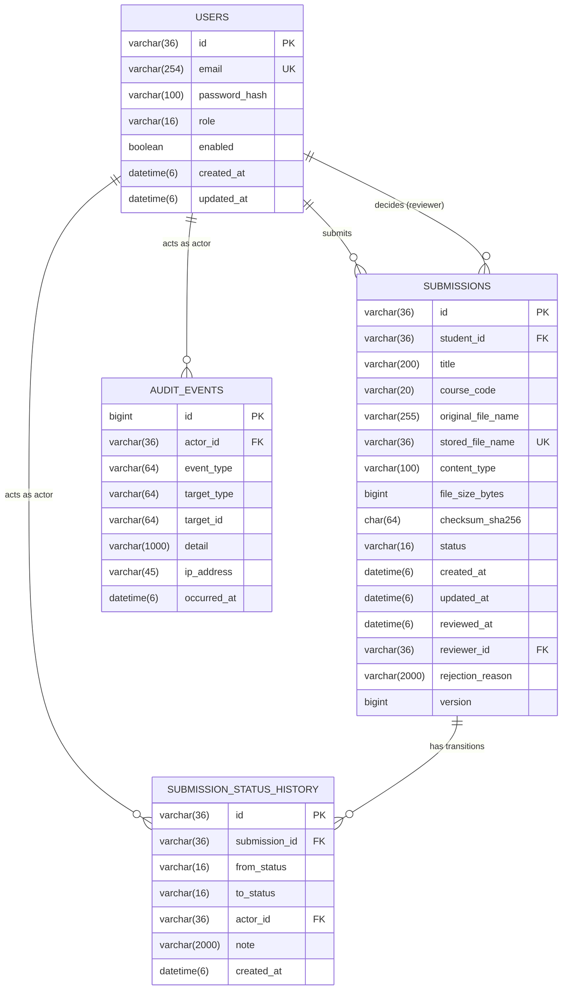
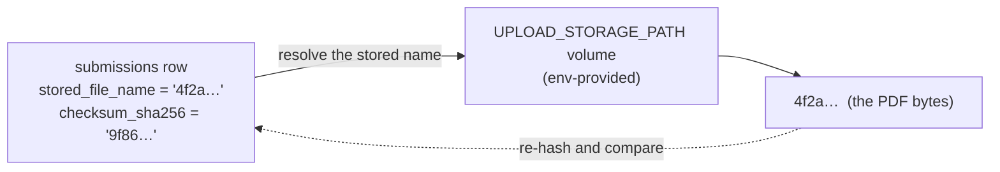

# Data Model

**Status:** Partially implemented — Milestone 4 (`users`, `submissions`, and
`submission_status_history` migrated and mapped; `audit_events` still planned)
**Related:** [System overview](system-overview.md) · [Security architecture](security.md) ·
[Application structure](application-structure.md) ·
[ADR-003](../adr/ADR-003-mysql-system-of-record.md) ·
[ADR-004](../adr/ADR-004-filesystem-volume-and-db-metadata.md) · [MVP requirements](../requirements/mvp.md)

This is the persistence model. Column names are shown as they appear in MySQL. **§2, §3, and §4 are
implemented** — `V1__baseline.sql`, `V2__submissions.sql`, and `V3__submission_status_history.sql`
create them, and the entities under `auth/` and `submission/` map them. **§5 is still planned**: that
table does not exist yet, and the section is the contract the migration implementing it must
satisfy.

> **Amended 2026-10-01 (identity).** §2 originally specified a `BIGINT` surrogate key with
> `username` and `display_name` columns. It now specifies a `UUID` identifier and an `email` login
> identifier, to match the Milestone 2 brief. The amendment was safe because `V1__baseline.sql`
> had never been applied in any environment — see §7.
>
> **Amended 2026-10-01 (submissions).** §3 originally specified an `assignment_code` referencing a
> seeded assignment catalogue, with `submitted_at` / `decided_at` / `decided_by` names. The
> implemented table uses free-text `title` and `course_code`, and `created_at` / `updated_at` /
> `reviewed_at` / `reviewer_id`. The differences and their reasons are recorded in §3 under
> "Deviations from the original specification". This table was never applied before it was written,
> so the same reasoning as §2 applies.
>
> **Amended 2026-10-02 (status history).** §4 originally specified a `BIGINT` auto-increment `id` and
> the column names `previous_status` / `new_status` / `comment` / `occurred_at`. The implemented table
> uses a `UUID` identifier assigned by the application and the names `from_status` / `to_status` /
> `note` / `created_at`. The reasons are recorded in §4 under "Deviations from the original
> specification". Unlike the two amendments above, `V3` is a **new** migration for a table that never
> existed — nothing already applied was edited.

---

## 1. Overview

Four entities in the MVP. The design is deliberately small: a user owns submissions, a reviewer
decides them, and every status change to a submission appends to a history table.

Solid relationships are implemented; the dashed one is planned.



Every foreign key that points at `users(id)` must be `VARCHAR(36)` to match, because MySQL
requires the referenced and referencing columns to have the same type. `USERS`, `SUBMISSIONS`, and
`SUBMISSION_STATUS_HISTORY` exist; `AUDIT_EVENTS` is the corrected contract for the migration that
will create it.

`AUDIT_EVENTS` is required by FR-24 but is not one of the three named entities in the milestone
brief; it is listed here so the migration that introduces the audit trail can create it in the same
pass. **It does not exist yet** — see [security.md §12](security.md#12-what-this-milestone-does-not-do).

## 2. `users`

Stores identity and role. Passwords are stored only as a BCrypt hash.

**Implemented** by `V1__baseline.sql`, mapped by `auth/User.java`.

| Column | Type | Constraints | Notes |
| --- | --- | --- | --- |
| `id` | `VARCHAR(36)` | PK | Application-assigned UUID. Not auto-increment |
| `email` | `VARCHAR(254)` | NOT NULL, **UNIQUE**, case-insensitive | Login identifier |
| `password_hash` | `VARCHAR(100)` | NOT NULL | BCrypt output only. Never plaintext, never reversible |
| `role` | `VARCHAR(16)` | NOT NULL | `STUDENT` \| `REVIEWER` \| `ADMIN` |
| `enabled` | `BOOLEAN` | NOT NULL, default `TRUE` | Disabled users cannot authenticate |
| `created_at` | `DATETIME(6)` | NOT NULL | UTC |
| `updated_at` | `DATETIME(6)` | NOT NULL | UTC |

**Indexes:** unique index on `email` (`uq_users_email`).

**Decisions:**

- The identifier is a `UUID` rendered as `VARCHAR(36)`, not a `BIGINT` and not `BINARY(16)`. It
  appears in URLs, in audit rows, and in log lines; a sequential integer there announces how many
  users exist and invites enumeration. The 20 bytes `BINARY(16)` would save are worth less than
  being able to read an identifier in a `SELECT` or a pipeline log without a decoding step. The
  mapping is pinned by `common/UuidToVarcharConverter`, so the column type stays the migration's
  decision rather than the ORM's — Hibernate's default UUID representation for MySQL has changed
  between major versions, and `ddl-auto: validate` turns that kind of surprise into a startup
  failure.
- The login identifier is an **email address**, not a username. It is what a student already has
  and does not have to be issued; a separate username would be one more thing to remember and one
  more thing to reconcile with the address the portal already needs.
- 254 is the maximum length of an address in the RFC 5321 path, so the column can never silently
  truncate a valid address.
- `role` is a string column, not a numeric ordinal. A readable value survives a schema dump and
  cannot silently change meaning if the enum is reordered. It is validated on write by the `Role`
  enum and again by `ck_users_role` in the database.
- One role per user in the MVP. A future many-role model would add a `user_roles` join table; that
  is out of scope (`mvp.md` §3).
- Email comparison is case-insensitive, enforced by a `utf8mb4_0900_ai_ci` collation on the column
  rather than by lower-casing in application code, so the guarantee holds for any writer. Two people
  cannot register `A@x.com` and `a@x.com` as separate accounts.
- `updated_at` exists here and is written on every update. It is a change-tracking field, not an
  audit log — the audit trail is §5, and the sign-in events that belong in it are still to come.

## 3. `submissions`

One row per uploaded artefact. Contains **metadata only** — the file bytes live on the volume
([ADR-004](../adr/ADR-004-filesystem-volume-and-db-metadata.md)).

**Implemented** by `V2__submissions.sql`, mapped by `submission/Submission.java`.

| Column | Type | Constraints | Notes |
| --- | --- | --- | --- |
| `id` | `VARCHAR(36)` | PK | Application-assigned UUID. Appears in the detail page URL |
| `student_id` | `VARCHAR(36)` | NOT NULL, FK → `users(id)`, `ON DELETE RESTRICT` | Owner. A bare identifier, not an entity association |
| `title` | `VARCHAR(200)` | NOT NULL | The student's own title for the work |
| `course_code` | `VARCHAR(20)` | NOT NULL | Free text as the student entered it |
| `original_file_name` | `VARCHAR(255)` | NOT NULL | **Display metadata only.** Never used as a path |
| `stored_file_name` | `VARCHAR(36)` | NOT NULL, **UNIQUE** | Server-generated bare UUID. The only way to locate the file |
| `content_type` | `VARCHAR(100)` | NOT NULL | Recorded as **validated**, not as claimed — `application/pdf` in the MVP |
| `file_size_bytes` | `BIGINT` | NOT NULL | Validated ≤ 10 485 760 |
| `checksum_sha256` | `CHAR(64)` | NOT NULL | Lowercase hex digest of the stored bytes |
| `status` | `VARCHAR(16)` | NOT NULL | `SUBMITTED` \| `APPROVED` \| `REJECTED` |
| `created_at` | `DATETIME(6)` | NOT NULL | UTC. Set on insert |
| `updated_at` | `DATETIME(6)` | NOT NULL | UTC. Bumped by the optimistic lock and by a review decision |
| `reviewed_at` | `DATETIME(6)` | NULL | Set with the decision. Written by `Submission.approve`/`reject`, never on its own |
| `reviewer_id` | `VARCHAR(36)` | NULL, FK → `users(id)`, `ON DELETE RESTRICT` | The reviewer who decided. Written with the status and the time, so `ck_submissions_decision` cannot fire |
| `rejection_reason` | `VARCHAR(2000)` | NULL | Non-null only when the status is `REJECTED` |
| `version` | `BIGINT` | NOT NULL, default `0` | JPA optimistic lock |

**Indexes:**

- `uq_submissions_stored_file_name` — unique, because two rows pointing at one file would mean one
  artefact overwriting another.
- `idx_submissions_student_id_created_at` on `(student_id, created_at)` — serves the student's own
  list, answering both the filter and the sort (FR-12).
- `idx_submissions_status_created_at` on `(status, created_at)` — serves the reviewer queue
  (FR-16). Created with the table rather than added later, because adding it later means an
  `ALTER` on a table that by then holds data. This is a deliberate exception to "no schema ahead of
  the code", and `V2__submissions.sql` records it as one.

**Constraints and invariants:**

| Invariant | Constraint | Also enforced by |
| --- | --- | --- |
| `status` is one of the three known values | `ck_submissions_status` — `CHECK (status IN ('SUBMITTED','APPROVED','REJECTED'))` | The `SubmissionStatus` enum, and the entity, which has no method that sets any other value |
| `0 < file_size_bytes ≤ 10 MB` | `ck_submissions_file_size` | `FileValidationService`, `spring.servlet.multipart.max-file-size`, and the servlet container |
| A row is either undecided with no reviewer and no time, or decided with both | `ck_submissions_decision` | `Submission.approve`/`reject`, which set the status, the time, and the reviewer together — see below |
| Two rows never share a stored file name | `uq_submissions_stored_file_name` | `StorageIdentifier.generate()`, which returns a fresh UUID per upload |
| A submission always has a real owner | `fk_submissions_student_id` | `SubmissionService.submit`, which takes the owner from the authenticated principal |

The application and the database both enforce these. The database is the backstop that survives a
bug in the service; the service is what produces a friendly error. `ApplicationContextIT` asserts
each constraint by inserting a row the service would never produce — a `CHECK` that is never
exercised is one typo away from being a comment.

**Decisions:**

- `student_id` is a **bare identifier**, not a `@ManyToOne` association. The submission feature has
  no business loading an entity another feature owns, and the ownership check is a
  `WHERE student_id = ?` clause — for which an identifier is exactly what is needed. An association
  would also make it possible to traverse from a submission to a user's password hash, which nothing
  here should be able to do.
- `stored_file_name` holds a bare UUID with no extension. The extension would claim a format, and
  the format is already recorded properly in `content_type`; a file named `.pdf` that is not one is
  the kind of thing that misleads whoever inspects the volume at three in the morning.
- The uniqueness of `stored_file_name` is what makes duplicate file names safe. Two students may
  hand in `essay.pdf`; the names the clients sent are identical, and the names on the volume are
  not.
- `original_file_name` is stored because a reviewer needs to see what the student called the file.
  It is normalised before it gets here — directory components and control characters removed, and
  truncated to the column width from the front so the extension survives — by
  `FileValidationService.safeDisplayName`. It is **never** interpolated into a filesystem path.
- `checksum_sha256` is `CHAR(64)`, not `VARCHAR`, because a SHA-256 hex digest has exactly one
  length. It supports integrity verification and future duplicate detection.
- `content_type` is stored even though it is always `application/pdf` in the MVP, so that lifting
  the single-format restriction is a validation change rather than a migration.
- `reviewed_at` / `reviewer_id` are denormalised from the history table and are written together
  with the status by `Submission.approve`/`reject`. They exist on this row because the reviewer's
  queue needs them on every row, and joining an append-only log to render a list is wasteful. They
  are set in one method, with the status, because `ck_submissions_decision` requires the three to
  agree — a method that set the status and left either null would be refused by the database, and
  the constraint exists to catch a bug, not to be the source of one.
- The decision columns are the reason `recordDecision` takes an outcome and re-reads the row inside
  its own transaction. The status change, the reviewer, the time, and the history row are five
  writes that must all happen or none of them, so they are one transaction and one method.

**Deviations from the original specification:**

| Was specified | Is implemented | Why |
| --- | --- | --- |
| `assignment_code` against a seeded catalogue | Free-text `title` and `course_code` | The catalogue is out of scope (`mvp.md` §3 #2), and without an `assignments` table an `assignment_code` would be a foreign key to nothing. Free text is what the student actually knows |
| `submitted_at` | `created_at` | The row is created when the work is submitted, and the two would be the same instant. One name for one fact |
| `decided_at` / `decided_by` | `reviewed_at` / `reviewer_id` | The status vocabulary already says `APPROVED`/`REJECTED`; naming the column after the act that produces the decision reads better beside `reviewed_at` than `decided_by` beside `REJECTED` |
| No `updated_at` | `updated_at` present and bumped | The optimistic lock changes the row on every update, and a review decision changes it deliberately. A row whose version moved but whose timestamp did not would be the stranger arrangement |
| `submission_id` as `BIGINT` in the history table | `VARCHAR(36)` in §4 below | It is a foreign key to `submissions(id)`, and MySQL requires matching types |

## 4. `submission_status_history`

**Implemented** by `V3__submission_status_history.sql`, mapped by
`submission/SubmissionStatusHistory.java`. Written by `SubmissionService.submit` (the creation entry)
and `SubmissionService.recordDecision` (each decision), both inside the transaction that changes the
submission row.

An **append-only** log of every status transition. This table is the audit of record for the
workflow (FR-15, FR-21).

| Column | Type | Constraints | Notes |
| --- | --- | --- | --- |
| `id` | `VARCHAR(36)` | PK | Application-assigned UUID, like every other identifier here |
| `submission_id` | `VARCHAR(36)` | NOT NULL, FK → `submissions(id)`, `ON DELETE RESTRICT` | The transition belongs to one submission |
| `from_status` | `VARCHAR(16)` | NULL | NULL for the initial creation entry, which is what marks the start of the lifecycle |
| `to_status` | `VARCHAR(16)` | NOT NULL | The status after the transition |
| `actor_id` | `VARCHAR(36)` | NOT NULL, FK → `users(id)`, `ON DELETE RESTRICT` | Who caused the transition: the student for creation, the reviewer for a decision |
| `note` | `VARCHAR(2000)` | NULL | The reviewer's comment. Required by the service when the transition is a rejection |
| `created_at` | `DATETIME(6)` | NOT NULL | UTC |

**Indexes:** `idx_submission_status_history_submission_id_created_at` on `(submission_id,
created_at)` — the only read this table has is one submission's history, oldest first, and the index
answers both the filter and the sort.

**Constraints and invariants:**

| Invariant | Constraint | Also enforced by |
| --- | --- | --- |
| Both statuses are drawn from the lifecycle vocabulary | `ck_submission_status_history_from_status`, `ck_submission_status_history_to_status` | `SubmissionStatus`; the entity exposes only the enum |
| A transition is always attributable | `actor_id` `NOT NULL` | The service passes the authenticated principal's identifier |
| A transition belongs to a real submission | `fk_submission_status_history_submission_id` | The service writes the row after the submission row exists, in the same transaction |
| The actor is a real user | `fk_submission_status_history_actor_id` | The identifier comes from the authenticated principal, never from a request |

`ApplicationContextIT` asserts each of these by inserting rows the entity could never produce — a
status outside the vocabulary, an unknown actor, an orphaned submission.

**Decisions:**

- Rows are never updated or deleted — there is no setter and no `@PreUpdate`. If the application ever
  needs a correction, it appends a compensating entry; that is what makes the table trustworthy as an
  audit record.
- The creation row has `from_status = NULL` and `to_status = 'SUBMITTED'`, so a submission's full
  lifecycle is readable from this table alone. A null `from_status` is meaningful rather than
  missing, which is why the template labels the first entry from the absence of a previous status
  rather than from its position in the list.
- `note` is `NULL`-able at the database level but **required by the service** for a rejection
  (FR-19). The database permits a null so the creation row and an approval can exist; the rule lives
  in `ReviewService`, where it can produce a sentence a reviewer can act on, and again in the
  `Submission` entity.
- The row is written **in the same transaction as the status change**, so the status and the history
  cannot disagree: either both are committed or neither is. A history that could be written
  separately is a history that can drift.
- `actor_id` is **not** carried into the read model a student sees
  (`submission/SubmissionHistoryEntry`). The student is told what happened and when, not who decided
  it; the audit row still records the actor for FR-22.

**Deviations from the original specification:**

| Was specified | Is implemented | Why |
| --- | --- | --- |
| `id` as `BIGINT` auto-increment | `VARCHAR(36)` application-assigned UUID | Every other identifier in the schema is an application-assigned UUID, and the application sets it before the insert. An auto-increment here would be the one table whose key the database chose |
| `previous_status` / `new_status` | `from_status` / `to_status` | The same pair of facts. `from`/`to` reads as the two ends of one transition and pairs naturally with the transition factories (`SubmissionStatusHistory.transition(from, to, …)`) |
| `comment` | `note` | `comment` suggests a discussion thread, which `mvp.md` §3 excludes; `note` is the reviewer's remark attached to a decision |
| `occurred_at` | `created_at` | `users` and `submissions` both use `created_at`/`updated_at`; one vocabulary for timestamps across the schema is worth more than a more evocative name on one table |

**What this table is not.** It records *workflow* transitions. Security events — sign-in success and
failure above all — belong in `audit_events` (§5), which still does not exist. FR-24 remains unmet;
see [security.md §12](security.md#12-what-this-milestone-does-not-do).

## 5. `audit_events`

**Planned — not created by any migration yet.** Required by FR-24, and the one Milestone 2 entry
criterion that was not met; see [security.md §12](security.md#12-what-this-milestone-does-not-do).

Security-relevant events that are not workflow transitions: sign-in success, sign-in failure, user
created, role changed.

| Column | Type | Constraints | Notes |
| --- | --- | --- | --- |
| `id` | `BIGINT` | PK, auto-increment | |
| `actor_id` | `VARCHAR(36)` | NULL, FK → `users(id)` | NULL when the actor is unknown (e.g. failed login) |
| `event_type` | `VARCHAR(64)` | NOT NULL | e.g. `LOGIN_SUCCESS`, `LOGIN_FAILURE`, `USER_CREATED` |
| `target_type` | `VARCHAR(64)` | NULL | Entity kind acted upon |
| `target_id` | `VARCHAR(64)` | NULL | Entity identifier acted upon |
| `detail` | `VARCHAR(1000)` | NULL | Human-readable context. **Never a secret** |
| `ip_address` | `VARCHAR(45)` | NULL | Fits IPv6 |
| `occurred_at` | `DATETIME(6)` | NOT NULL | UTC |

**Indexes:** index on `(event_type, occurred_at)`; index on `(actor_id, occurred_at)`.

`actor_id` is nullable precisely so a failed authentication attempt can be recorded. A failed
sign-in is exactly the event you most want logged, and at that moment there is no authenticated
principal.

## 6. Storage model

Files are **not** in the database. The contract:

```
submissions.stored_file_name  →  a file directly inside the configured storage root
```

- The name is generated **server-side** by `StorageIdentifier` — a bare lowercase UUID, never
  derived from `original_file_name` (`SECURITY.md`, and [`CLAUDE.md` §7](../../CLAUDE.md)).
  Path traversal is made *unrepresentable* rather than guarded against: the record type rejects
  anything that is not a canonical UUID, so `StorageService` never has to remember to check.
- The root comes from `UPLOAD_STORAGE_PATH`, bound to `app.storage.root` and read by
  `storage.StorageProperties`, so the same artefact works in every environment.
- The volume is persistent and survives container replacement (NFR-5). It is **not** servable:
  nothing maps it to a URL, and no static-resource handler points at it. Files are read by two
  controllers — `GET /submissions/{id}/file` for the owner (FR-13) and
  `GET /review/submissions/{id}/file` for a reviewer (FR-17) — each of which resolves the submission
  through a query that carries the caller's identity, then hands the bytes out as an
  `attachment` with a fixed content type and `nosniff` (`CLAUDE.md` §7 rule 10). Neither route ever
  reveals `stored_file_name`.
- Writes go to a temporary file in the same directory and are then moved into place atomically, so
  a crash mid-write leaves either nothing or the complete artefact — never a truncated file that a
  later reader would checksum and find wanting.
- The checksum in `submissions` is the tie-breaker if a file and its row ever disagree.



**The row and the file cannot be committed together.** There is no distributed transaction between
the volume and MySQL; `SubmissionService` orders the two writes and registers a transaction
synchronization that removes the file if the row does not commit. The failure that remains
unhandled is the process dying between the write and the commit: no code runs, and the file is
orphaned. Reconciling the volume against the table is a sweeper, and it is not in the MVP.

## 7. Migration strategy

- Schema is created and evolved **only** through Flyway migrations under
  `src/main/resources/db/migration` (FR-27).
- Hibernate runs with `ddl-auto=validate`. It never creates or alters schema; a mismatch between an
  entity and the migrated schema fails startup rather than mutating the database.
- The migrations are `V1__baseline.sql` (the `users` table), `V2__submissions.sql` (the `submissions`
  table), and `V3__submission_status_history.sql` (the `submission_status_history` table). Each
  creates one table and the constraints and indexes that belong to it. `V3` is a **new** file for a
  table that never existed; neither `V1` nor `V2` was touched by it.
- Migrations are **forward-only**. A released migration is never edited; a correction is a new
  migration. `V1` was amended in place while the authentication milestone was in progress, which
  §2 records: it had never been applied in any environment, because Flyway's autoconfiguration was
  absent and the migration silently never ran. That window closed the moment a migration was
  applied anywhere, and nothing since has been edited in place.
- **Seed data is not a migration.** A migration runs in every environment, and demo accounts
  belong in one. `auth/DevelopmentUserSeeder` creates them, gated on two independent conditions:
  the bean exists only under the `dev` profile, and it acts only when `APP_SEED_ENABLED` is true.
  The default is `false`. Each account's password comes from its own environment variable, so an
  unset variable means the account is skipped rather than created with a guessable password. No
  plaintext credential is in Git, and none can be: there is no default password anywhere in the
  code. See [security.md §10](security.md#10-development-seed-accounts).
- The assignment catalogue that once appeared in this list is out of scope for the MVP
  (`mvp.md` §3 #2), and §3 records what replaced it.

## 8. Deliberately not modelled

| Not present | Reason |
| --- | --- |
| `assignments` table | The MVP takes the course code as free text (out of scope, `mvp.md` §3 #2) |
| A `roles` table | Three fixed roles; an enum column is sufficient |
| `submission_comments` | A decision carries one comment; threads are not an MVP concept |
| Resubmission linkage | Rejected is terminal (`mvp.md` §3 #1) |
| Soft-delete columns | Deletion is not an MVP operation |
| `created_by` / `updated_by` on every table | The history and audit tables already answer "who did what" |
