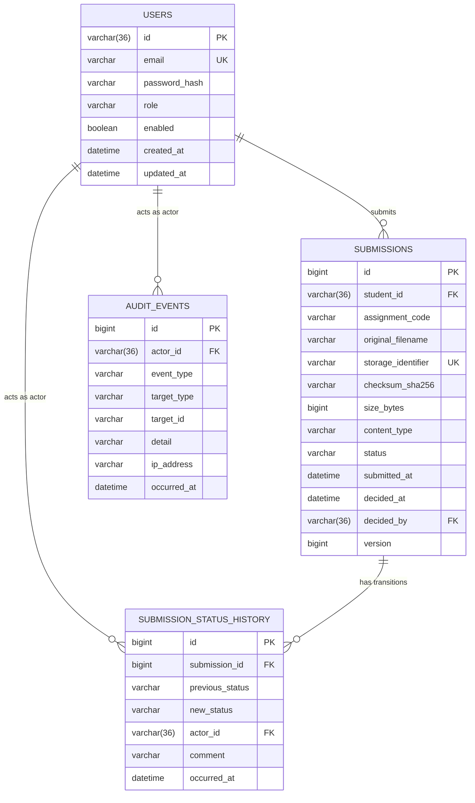
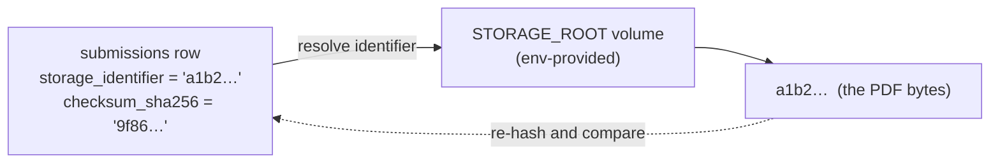

# Data Model

**Status:** Partially implemented — Milestone 2 (`users` migrated and mapped; `submissions`,
`submission_status_history` and `audit_events` still planned)
**Related:** [System overview](system-overview.md) · [Security architecture](security.md) ·
[ADR-003](../adr/ADR-003-mysql-system-of-record.md) ·
[ADR-004](../adr/ADR-004-filesystem-volume-and-db-metadata.md) · [MVP requirements](../requirements/mvp.md)

This is the persistence model. Column names are shown as they appear in MySQL. **§2 `users` is
implemented** — `V1__baseline.sql` creates it and `auth/User.java` maps it. **§3–§5 are still
planned**: those tables do not exist yet, and each is the contract the migration implementing it
must satisfy.

> **Amended 2026-10-01.** §2 originally specified a `BIGINT` surrogate key with `username` and
> `display_name` columns. It now specifies a `UUID` identifier and an `email` login identifier,
> to match the Milestone 2 brief. The amendment was safe because `V1__baseline.sql` had never
> been applied in any environment — see §7.

---

## 1. Overview

Three entities in the MVP. The design is deliberately small: a user owns submissions, and
every status change to a submission appends to a history table.



Every foreign key that points at `users(id)` must be `VARCHAR(36)` to match, because MySQL
requires the referenced and referencing columns to have the same type. Only `users` exists so
far; the rest is the corrected contract for the migrations that will create them.

`AUDIT_EVENTS` is required by FR-24 but is not one of the three named entities in the
milestone brief; it is listed here so the migration that introduces the audit trail can create
it in the same pass. **It does not exist yet** — see [security.md §12](security.md#12-what-this-milestone-does-not-do).

## 2. `users`

Stores identity and role. Passwords are stored only as a BCrypt hash.

| Column | Type | Constraints | Notes |
| --- | --- | --- | --- |
| `id` | `BIGINT` | PK, auto-increment | Surrogate key |
| `username` | `VARCHAR(64)` | NOT NULL, **UNIQUE**, case-insensitive | Login identifier |
| `password_hash` | `VARCHAR(100)` | NOT NULL | BCrypt output only. Never plaintext, never reversible |
| `display_name` | `VARCHAR(128)` | NOT NULL | Shown in the review queue |
| `role` | `VARCHAR(16)` | NOT NULL | `STUDENT` \| `REVIEWER` \| `ADMIN` |
| `enabled` | `BOOLEAN` | NOT NULL, default `TRUE` | Disabled users cannot authenticate |
| `created_at` | `DATETIME(6)` | NOT NULL | UTC |

**Indexes:** unique index on `username`.

**Decisions:**

- `role` is a string column, not a numeric ordinal. A readable value survives a schema dump
  and cannot silently change meaning if the enum is reordered. It is validated on write by the
  `Role` enum.
- One role per user in the MVP. A future many-role model would add a `user_roles` join table;
  that is out of scope (`mvp.md` §3).
- `username` comparison is case-insensitive, enforced by a `utf8mb4_0900_ai_ci` collation on
  the column rather than by lower-casing in application code.

## 3. `submissions`

One row per uploaded artefact. Contains **metadata only** — the file bytes live on the volume
([ADR-004](../adr/ADR-004-filesystem-volume-and-db-metadata.md)).

| Column | Type | Constraints | Notes |
| --- | --- | --- | --- |
| `id` | `BIGINT` | PK, auto-increment | Surrogate key |
| `student_id` | `BIGINT` | NOT NULL, FK → `users(id)` | Owner. Restricted delete |
| `assignment_code` | `VARCHAR(64)` | NOT NULL | Identifies the assignment from the seeded catalogue |
| `original_filename` | `VARCHAR(255)` | NOT NULL | **Display metadata only.** Never used as a path |
| `storage_identifier` | `VARCHAR(128)` | NOT NULL, **UNIQUE** | Server-generated. The only way to locate the file |
| `checksum_sha256` | `CHAR(64)` | NOT NULL | Lowercase hex digest |
| `size_bytes` | `BIGINT` | NOT NULL | Validated ≤ 10 485 760 |
| `content_type` | `VARCHAR(64)` | NOT NULL | Recorded as validated, expected `application/pdf` |
| `status` | `VARCHAR(16)` | NOT NULL | `SUBMITTED` \| `APPROVED` \| `REJECTED` |
| `submitted_at` | `DATETIME(6)` | NOT NULL | UTC |
| `decided_at` | `DATETIME(6)` | NULL | Set exactly once, on the terminal transition |
| `decided_by` | `BIGINT` | NULL, FK → `users(id)` | The reviewer who decided |
| `version` | `BIGINT` | NOT NULL, default `0` | JPA optimistic lock |

**Indexes:**

- Unique index on `storage_identifier`.
- Index on `(status, submitted_at)` — serves the reviewer queue (FR-16).
- Index on `(student_id, submitted_at)` — serves the student's own list (FR-12).

**Constraints and invariants:**

| Invariant | Enforced by |
| --- | --- |
| `status` is one of the three known values | `CHECK` constraint in MySQL 8.4 **and** the `SubmissionStatus` enum |
| A terminal row has both `decided_at` and `decided_by` | `CHECK ((status = 'SUBMITTED') = (decided_at IS NULL))` |
| `size_bytes` ≤ 10 MB | `CHECK (size_bytes <= 10485760)` **and** `FileValidationService` at the boundary |
| A submission is decided at most once | Service layer — it reads the current status, checks terminality, and persists under the optimistic lock |

The application and the database both enforce these. The database is the backstop that
survives a bug in the service; the service is what produces a friendly error.

**Decisions:**

- `original_filename` is stored because a reviewer needs to see what the student called the
  file. It is **never** interpolated into a filesystem path — that is the whole point of
  `storage_identifier`.
- `checksum_sha256` is `CHAR(64)`, not `VARCHAR`, because a SHA-256 hex digest has exactly one
  length. It supports integrity verification and future duplicate detection.
- `content_type` is stored even though it is always `application/pdf` in the MVP, so that
  lifting the single-format restriction is a validation change rather than a migration.
- There is no `updated_at` on `submissions`; the history table is the record of change. Adding
  a mutable timestamp beside an append-only log invites the two to disagree.
- `decided_at` / `decided_by` are denormalised from the history table because the list view
  needs them on every row, and joining the history table to render a queue is wasteful.

## 4. `submission_status_history`

An **append-only** log of every status transition. This table is the audit of record for the
workflow (FR-21).

| Column | Type | Constraints | Notes |
| --- | --- | --- | --- |
| `id` | `BIGINT` | PK, auto-increment | Surrogate key |
| `submission_id` | `BIGINT` | NOT NULL, FK → `submissions(id)` | Restricted delete |
| `previous_status` | `VARCHAR(16)` | NULL | NULL for the initial creation entry |
| `new_status` | `VARCHAR(16)` | NOT NULL | The status after the transition |
| `actor_id` | `BIGINT` | NOT NULL, FK → `users(id)` | Who caused the transition |
| `comment` | `VARCHAR(2000)` | NULL | Required by the service when the transition is a decision |
| `occurred_at` | `DATETIME(6)` | NOT NULL | UTC |

**Indexes:** index on `(submission_id, occurred_at)`.

**Decisions:**

- Rows are never updated or deleted. If the application ever needs a correction, it appends a
  compensating entry — that is what makes the table trustworthy.
- The creation row has `previous_status = NULL` and `new_status = 'SUBMITTED'`, so a
  submission's full lifecycle is readable from this table alone.
- `comment` is `NULL`-able at the database level but **required by the service** for any
  transition out of `SUBMITTED` (FR-19). The database permits a null so the creation row can
  exist; the rule lives where it is meaningful.

## 5. `audit_events`

Security-relevant events that are not workflow transitions (FR-24): sign-in success, sign-in
failure, user created, role changed.

| Column | Type | Constraints | Notes |
| --- | --- | --- | --- |
| `id` | `BIGINT` | PK, auto-increment | |
| `actor_id` | `BIGINT` | NULL, FK → `users(id)` | NULL when the actor is unknown (e.g. failed login) |
| `event_type` | `VARCHAR(64)` | NOT NULL | e.g. `LOGIN_SUCCESS`, `LOGIN_FAILURE`, `USER_CREATED` |
| `target_type` | `VARCHAR(64)` | NULL | Entity kind acted upon |
| `target_id` | `VARCHAR(64)` | NULL | Entity identifier acted upon |
| `detail` | `VARCHAR(1000)` | NULL | Human-readable context. **Never a secret** |
| `ip_address` | `VARCHAR(45)` | NULL | Fits IPv6 |
| `occurred_at` | `DATETIME(6)` | NOT NULL | UTC |

**Indexes:** index on `(event_type, occurred_at)`; index on `(actor_id, occurred_at)`.

`actor_id` is nullable precisely so a failed authentication attempt can be recorded. A failed
sign-in is exactly the event you most want logged, and at that moment there is no
authenticated principal.

## 6. Storage model

Files are **not** in the database. The contract:

```
storage_identifier  →  a path under the configured storage root
```

- The identifier is generated **server-side** — never derived from `original_filename`
  (`SECURITY.md`, and [`CLAUDE.md` §7](../../CLAUDE.md)).
- The root comes from an environment variable, so the same image works in every environment.
- The volume is persistent and survives container replacement (NFR-5).
- The checksum in `submissions` is the tie-breaker if a file and its row ever disagree.



## 7. Migration strategy

- Schema is created and evolved **only** through Flyway migrations under
  `src/main/resources/db/migration` (FR-27).
- Hibernate runs with `ddl-auto=validate`. It never creates or alters schema; a mismatch
  between an entity and the migrated schema fails startup rather than mutating the database.
- The first migration is `V1__baseline.sql`, creating the four tables above plus their
  constraints and indexes.
- Migrations are **forward-only**. A released migration is never edited; a correction is a new
  migration.
- Seed data (an initial `ADMIN`, the assignment catalogue) is inserted by a versioned
  migration so every environment starts identical. The seeded admin password comes from an
  environment variable and is never committed.

## 8. Deliberately not modelled

| Not present | Reason |
| --- | --- |
| `assignments` table | The MVP uses a seeded catalogue (out of scope, `mvp.md` §3 #2) |
| A `roles` table | Three fixed roles; an enum column is sufficient |
| `submission_comments` | A decision carries one comment; threads are not an MVP concept |
| Resubmission linkage | Rejected is terminal (`mvp.md` §3 #1) |
| Soft-delete columns | Deletion is not an MVP operation |
| `created_by` / `updated_by` on every table | The history and audit tables already answer "who did what" |
