# DevOps Lifecycle & Pipeline Workflow

**Project:** Git-Driven Online Assignment Submission Portal  
**Document:** DevOps Lifecycle & Agile Quality Gates  
**Status:** Baselined  

---

## 1. DevOps Lifecycle Flowchart

The portal follows an automated continuous delivery lifecycle where quality gates prevent broken or unverified code from reaching production:

```mermaid
flowchart LR
    subgraph Plan ["1. Plan"]
        A[Problem Definition & Scope] --> B[Agile Product Backlog]
        B --> C[User Stories & DoD]
    end

    subgraph Code ["2. Code & Branch"]
        C --> D[Feature Branches feat/...]
        D --> E[Pull Request & Code Review]
    end

    subgraph Build ["3. Build & Test"]
        E --> F[Maven Compile Java 21]
        F --> G[Surefire Unit Tests]
        G --> H[MySQL Testcontainers IT]
        H --> I[Selenium E2E Suites]
    end

    subgraph Package ["4. Package & Registry"]
        I --> J[Multi-Stage Docker Image]
        J --> K[Version Tagging vX.Y.Z]
        K --> L[Docker Registry Push]
    end

    subgraph Deploy ["5. Provision & Deploy"]
        L --> M[Ansible Host Provisioning]
        M --> N[Docker Compose Stack Up]
    end

    subgraph Operate ["6. Operate & Monitor"]
        N --> O[Actuator Health Probe]
        O -->|Healthy| P[Active Production Service]
        O -->|Degraded/Failed| Q[Automated Image Rollback]
        P --> A
    end
```

---

## 2. Lifecycle Stages and Quality Gates

| Stage | Activity | Tools & Technology | Quality Gate / Exit Criteria |
| :--- | :--- | :--- | :--- |
| **1. Plan** | Requirements breakdown, 15-task backlog, 2-sprint planning. | Markdown, GitHub Projects | All user stories have testable acceptance criteria; DoD defined. |
| **2. Code** | Modular development in `auth`, `submission`, and `review` packages. | Java 21, Spring Boot, Git | Feature branches merged only via reviewed Pull Requests. |
| **3. Build & Test** | Compilation, static enforcement, unit, integration, and E2E testing. | Maven Wrapper, JUnit 5, Testcontainers, Selenium | Maven Enforcer passes; 100% test success rate across all suites. |
| **4. Package** | Non-root container image build and SHA digest pinning. | Dockerfile, Temurin JRE | Image builds non-root (UID 1001); zero vulnerabilities; tag `vX.Y.Z`. |
| **5. Provision & Deploy** | Host configuration and persistent volume container orchestration. | Ansible, Docker Compose | Ansible convergence reports `changed=0` on re-run; named volumes mounted. |
| **6. Operate & Monitor** | Automated health checks, production monitoring, and rollback drills. | Spring Boot Actuator, Shell runbooks | `/actuator/health` returns status `UP`; automated rollback recovers prior image on fault. |

---

## 3. Feedback Loop & Rollback Strategy

When a deployment health check fails or an anomaly occurs in production:
1. The health probe marks the deployment unready.
2. The rollback runbook (`scripts/ops/rollback.sh` / `rollback.md`) immediately restores the previous verified image digest from the deployment ledger.
3. Defect artifacts (test reports, container logs) are archived for diagnosis and fed directly back into the Sprint backlog.
