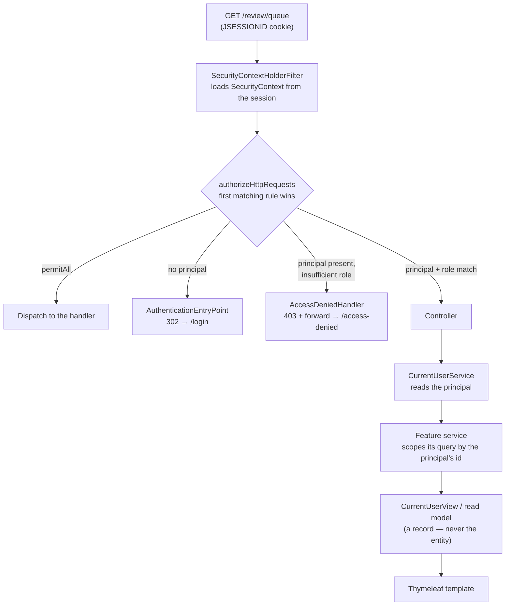

# Security Architecture

**Status:** Baselined — Milestone 2 (authentication and authorisation implemented)

**Related:** [ADR-005](../adr/ADR-005-session-authentication.md) · [ADR-003](../adr/ADR-003-mysql-system-of-record.md) ·
[Application structure](application-structure.md) · [Data model](data-model.md) · [`SECURITY.md`](../../SECURITY.md)

This document describes how a request is authenticated, how the authenticated principal is
established, how authorisation is decided, and where each of those responsibilities lives in the
code. It is the *how*; [`SECURITY.md`](../../SECURITY.md) is the *policy* and the threat model.

---

## 1. The decision this implements

[ADR-005](../adr/ADR-005-session-authentication.md) chose **server-side, session-based
authentication with Spring Security**, and rejected JWT bearer tokens. The consequence that
shapes almost everything below: the server holds the authoritative answer to "who is this?", and
the browser holds only an opaque `JSESSIONID` cookie that names it.

Two properties follow, and they are the reason the choice was made:

- **Revocation is immediate.** Disabling a user or signing out takes effect on the next request,
  because the decision is re-made against server-side state rather than read from a token issued
  earlier.
- **No credential is reachable by JavaScript.** The session cookie is `HttpOnly`, so a script
  that achieves XSS can act as the user for the life of the page but cannot exfiltrate a
  credential for later use.

## 2. Where each responsibility lives

Dependencies flow **inward and downward only**; `config` is the outermost ring and features never
import it ([application-structure.md §4](application-structure.md#4-dependency-direction)).

| Concern | Class | Package |
| --- | --- | --- |
| Route rules, form login, session policy, CSRF, the encoder bean | `SecurityConfiguration` | `config` |
| Loading a user for Spring Security | `DatabaseUserDetailsService` | `auth` |
| The authenticated principal | `AuthenticatedUser` | `auth` |
| Creating users, encoding passwords | `UserService` | `auth` |
| "Who is signed in right now?" | `CurrentUserService` | `auth` |
| The persistence entity | `User` | `auth` |
| The view model a template may see | `CurrentUserView` | `auth` |
| Login, sign-out feedback, access-denied pages | `AuthController` | `auth` |
| The post-sign-in landing page | `HomeController` | `auth` |
| Roles | `Role` | `common` |

`UserService` injects a `PasswordEncoder`. That is a Spring Security type
(`org.springframework.security.crypto.password.PasswordEncoder`), **not** a type from
`com.vit.assignmentportal.config`, so the dependency rule holds: a feature may consume a bean
whose type belongs to a library, but it may not import the configuration package that declares it.

## 3. Signing in

```mermaid
sequenceDiagram
    autonumber
    actor Browser
    participant Filter as CsrfFilter → UsernamePasswordAuthenticationFilter
    participant Provider as DaoAuthenticationProvider
    participant Details as DatabaseUserDetailsService
    participant DB as MySQL `users`
    participant Session as HttpSession

    Browser->>Filter: POST /login (email, password, CSRF token)
    Note over Filter: CSRF token invalid → 403, stop here
    Filter->>Provider: authenticate(email, password)
    Provider->>Details: loadUserByUsername(email)
    Details->>DB: SELECT … WHERE email = ?
    DB-->>Details: row, or nothing
    alt no such account
        Details-->>Provider: UsernameNotFoundException
        Provider-->>Filter: BadCredentialsException
    else account found
        Details-->>Provider: AuthenticatedUser(id, email, hash, role, enabled)
        Provider->>Provider: BCrypt.matches(password, hash),<br/>and isEnabled()
        Note over Provider: disabled account → DisabledException<br/>wrong password → BadCredentialsException
        Provider-->>Filter: Authentication(ROLE_…)
        Filter->>Session: rotate session id (changeSessionId)
        Filter->>Session: store SecurityContext
    end
    alt authenticated
        Filter-->>Browser: 302 → /
    else refused
        Filter-->>Browser: 302 → /login?error
    end
```

Three things in that diagram are the framework's, and deliberately not ours:

- **The password comparison.** `DaoAuthenticationProvider` performs it with a constant-time
  comparison and handles the "user not found" and "wrong password" cases in a way that does not
  leak which occurred. Hand-writing this is the mistake ADR-005 warns against.
- **The session rotation.** `changeSessionId()` runs on successful authentication, before the
  context is stored. See §5.
- **The failure message.** Every refusal becomes the same redirect to `/login?error`, and the
  page renders one generic sentence. The specific reason exists — in the server log, written by
  `DatabaseUserDetailsService` — but never in the response.

`AuthController` has no `POST /login` mapping. The login submission is consumed by Spring
Security's filter, before the request reaches `DispatcherServlet`; a controller mapping would
either never run or would be a second, weaker authentication path beside the tested one.

## 4. Making an authenticated request



The rule that matters is in the last three steps. **A feature never learns who the user is from
the request.** It does not accept a user id as a parameter, does not read a header, and does not
touch `SecurityContextHolder`. It asks `CurrentUserService`, which reads the principal that the
session established. A client-supplied identifier is therefore never an input to an authorisation
decision ([`CLAUDE.md` §7 rule 8](../../CLAUDE.md)).

That matters most for the milestone that follows this one: a student's own-submissions query must
be scoped by `currentUser.requireCurrentUser().id()`, not by anything the browser sent.

## 5. The session

| Property | Value | Set where |
| --- | --- | --- |
| Storage | Server-side `HttpSession`; the browser holds an opaque `JSESSIONID` | ADR-005 |
| Rotation on sign-in | `changeSessionId()` — a new id, the old one discarded | `SecurityConfiguration` |
| Timeout | `SESSION_TIMEOUT`, default `30m` | `application.yml` |
| `HttpOnly` | `true` | `application.yml` |
| `SameSite` | `Lax` | `application.yml` |
| `Secure` | `SESSION_COOKIE_SECURE`, default `false` (must be `true` over HTTPS) | `application.yml` |
| Sign-out | Session invalidated **server-side**, cookie deleted, context cleared | `SecurityConfiguration` |

**Session fixation.** Without rotation, an attacker who can fix a victim's pre-authentication
session identifier holds a valid authenticated session the moment the victim signs in. The
rotation is asserted by `AuthenticationIT.rotatesTheSessionIdentifierOnSignIn`, which observes
the same session object before and after the request and requires a different identifier.

**Timeout and cookie attributes are configuration, not constants.** ADR-005's follow-up requires
this so that local and deployed environments differ without a rebuild — the same artefact is
promoted between environments and never recompiled ([`CLAUDE.md` §8](../../CLAUDE.md)). A
deployed environment sets `SESSION_COOKIE_SECURE=true`; locally it stays `false`, because a
`Secure` cookie is not sent over plain `http://` and turning it on would silently break sign-in on
localhost.

## 6. Authorisation

Route rules live in one place, `SecurityConfiguration#portalSecurityFilterChain`, and **the order
they are written in is the policy**, because `authorizeHttpRequests` is first-match-wins.

| Path | Rule | Why |
| --- | --- | --- |
| `/login`, `/css/**`, `/js/**`, `/images/**`, `/favicon.ico` | `permitAll` | The login page must be reachable by someone who is not signed in, and cannot render without its stylesheet |
| `/actuator/health`, `/actuator/health/**` | `permitAll` | The pipeline's health-check stage (FR-25). A check that requires authentication cannot distinguish "healthy" from "unreachable" |
| `/error` | `permitAll` | Spring Security 6+ applies these rules to ERROR dispatch. Without this, an anonymous visitor who mistypes a URL is sent to the login page instead of seeing a 404 |
| `/review/**` | `hasAnyRole("REVIEWER", "ADMIN")` | The review queue, declared ahead of its feature |
| `/admin/**` | `hasRole("ADMIN")` | Administration, retained for extensibility. No admin UI ships in the MVP |
| everything else | `authenticated()` | **Deny by default** |

The last row is the important one. A route added by a future milestone is protected the moment it
exists, without anyone remembering to come back here. Forgetting to secure a new page is the
failure this line exists to prevent.

### Roles

Three, and only three: `STUDENT`, `REVIEWER`, `ADMIN` ([`CLAUDE.md` §7 rule 9](../../CLAUDE.md)).
`Role.authority()` returns `ROLE_` + the name, which is what `hasRole(...)` matches against.

| Role | May do (MVP intent) | Implemented in this milestone |
| --- | --- | --- |
| `STUDENT` | Sign in, submit coursework, read only their own submissions and status history | Sign-in and route protection only. Submission features arrive later |
| `REVIEWER` | Sign in, read the review queue, approve or reject | Sign-in and the `/review/**` rule only. The workflow arrives later |
| `ADMIN` | Retained for extensibility | The `/admin/**` rule and the role itself. No admin UI, deliberately |

A role is **never** inferred from a request parameter, header, or form field. It is read from the
principal, which came from the `role` column.

`/review/**` and `/admin/**` currently have no controllers. The rules are declared now because the
authorisation model is this milestone's deliverable, and they are proved by `AuthorizationIT`:
a `STUDENT` is refused with a 403, and a `REVIEWER` provably passes the rule and reaches
"no handler found" instead.

## 7. CSRF

CSRF protection is **enabled** — it is Spring Security's default, and
`SecurityConfiguration` states it explicitly so the decision is visible rather than implicit.
Disabling it requires an ADR containing a threat analysis ([`CLAUDE.md` §7 rule 3](../../CLAUDE.md)).

The machinery:

- Thymeleaf's Spring Security integration hooks any form written with **`th:action`** and injects
  the token as a hidden `_csrf` field. Every form in `auth/login.html` and `auth/home.html` uses
  `th:action` for exactly this reason. A plain `action="/login"` produces a form with no token,
  and the request is refused with a 403 before it reaches authentication — the single most common
  way a working login page is broken by a well-meaning edit.
- Sign-out is a **POST**, not a link. A GET logout can be fired by an `` tag on any
  third-party page, which is precisely the attack class this protects against.
- `SameSite=Lax` is the browser-side half of the story: a cross-site form post carries no session
  cookie in the first place. The token check is the server-side half, and both are in force.

`AuthenticationIT.refusesASignInWithoutACsrfToken` is the test that fails if somebody
"temporarily" disables this to make a form work.

## 8. Password storage

- **BCrypt**, at the framework default strength, provided by a single `PasswordEncoder` bean in
  `SecurityConfiguration`.
- Chosen for three properties: it is **adaptive** (the cost factor can be raised as hardware
  improves), **salted per hash** (so two users with the same password do not share a hash, and a
  rainbow table is useless), and **deliberately slow** (the only real defence against offline
  brute-forcing of a stolen table).
- The column is `password_hash VARCHAR(100)`. A BCrypt value is exactly 60 characters; the column
  is wider on purpose, because sizing a column to precisely today's algorithm makes an encoder
  change into a migration.
- **There is no setter for the hash on the entity.** A credential change is a deliberate
  operation that belongs in `UserService`, where it can re-encode and can be audited, rather than
  a field assignment any caller can make.
- `User` and `AuthenticatedUser` both override `toString()` to omit the hash. A record's generated
  `toString` prints every component, and these objects reach Spring Security's debug logging and
  debugger views — the generated version would write a BCrypt hash into a log file the first time
  anyone set that logger to `DEBUG` ([`CLAUDE.md` §8](../../CLAUDE.md)).
- No plaintext password exists in any file in this repository, including tests. Test accounts are
  created through `UserService`, which encodes.

## 9. What a refusal looks like

Two different refusals, deliberately kept distinct:

| Situation | Response | Handler |
| --- | --- | --- |
| Not signed in, requesting a protected route | `302` → `/login` | `AuthenticationEntryPoint` |
| Signed in, lacking the required role | `403` → `/access-denied` | `AccessDeniedHandler` (`accessDeniedPage`) |
| Sign-in failed (either reason) | `302` → `/login?error` | `SimpleUrlAuthenticationFailureHandler` |
| Signed out | `302` → `/login?logout` | `LogoutSuccessHandler` |

Collapsing the first two into one page would send a signed-in user round a login loop they cannot
escape: signing in again does not grant the missing role. The access-denied page says so
explicitly.

The 403 is a **forward**, not a redirect — Spring Security sets the status before forwarding. A
redirect would replace the 403 with a 200 and destroy the signal a browser test asserts on.

## 10. Development seed accounts

`DevelopmentUserSeeder` creates one account per role for local work. It is **not** a Flyway
migration, and the reasoning is worth recording because the data model originally said otherwise
(see [data-model.md §7](data-model.md#7-migration-strategy)).

A migration runs everywhere, exactly once, and is recorded as applied forever. Seeding a login
through one means every environment — including production — receives a predictable account whose
password had to be supplied at migration time. That variable is either set, in which case
production holds a password that also exists in a developer's `.env`, or it is unset, in which
case the migration fails and the deployment stops. Neither is acceptable.

The seeder is a bean, guarded **three times over**:

```mermaid
flowchart LR
    Start["Application start"] --> P{"`dev` profile active?"}
    P -->|no| Never["Bean does not exist"]
    P -->|yes| E{"app.seed.enabled = true?"}
    E -->|no| Never
    E -->|yes| V{"APP_SEED_&lt;ROLE&gt;_EMAIL<br/>and _PASSWORD both set?"}
    V -->|no| Warn["Warn and skip<br/>(never invent a password)"]
    V -->|yes| Exists{"Email already registered?"}
    Exists -->|yes| Leave["Leave unchanged<br/>(idempotent)"]
    Exists -->|no| Create["Create via UserService<br/>(BCrypt)"]
```

The **third gate is the important one**: no password has a default anywhere in the code. Worst
case for a misconfigured production deployment is an empty table, never a guessable account. The
fourth makes it idempotent — restarting changes nothing, and an existing account is never
silently reset.

The email is logged; the password never is. A log file is a place credentials leak from, and the
developer already has the `.env` they wrote it into.

Variable names are documented in [`.env.example`](../../.env.example); `.env` is git-ignored.

## 11. Configuration surface

| Variable | Default | Purpose |
| --- | --- | --- |
| `SPRING_PROFILES_ACTIVE` | *(none)* | Must include `dev` for seeding to be possible at all |
| `APP_SEED_ENABLED` | `false` | Second gate on seeding |
| `APP_SEED_{STUDENT,REVIEWER,ADMIN}_EMAIL` / `_PASSWORD` | *(none)* | Third gate; no defaults |
| `SESSION_TIMEOUT` | `30m` | Idle session lifetime |
| `SESSION_COOKIE_SECURE` | `false` | Must be `true` over HTTPS |

No secret is hard-coded anywhere ([`CLAUDE.md` §7 rule 1](../../CLAUDE.md)). The database password
has no default either — a missing `DB_PASSWORD` fails startup rather than falling back to empty.

## 12. What this milestone does not do

Recorded so the gaps are visible rather than inferred from silence:

- **No submission or review features.** `/review/**` and `/admin/**` are guarded but unbuilt.
- **No admin UI.** `ADMIN` exists as a role and gates `/admin/**`; per the brief, no management
  screens are implemented.
- **No audit trail.** [ADR-005](../adr/ADR-005-session-authentication.md) requires an
  `AuthenticationSuccessEvent` / `AuthenticationFailureBadCredentialsEvent` listener writing
  sign-in attempts — including failures — to the audit table. **This is not implemented**, and it
  is the one Milestone 2 entry criterion in [`CLAUDE.md` §13](../../CLAUDE.md) that is unmet. It
  was left out deliberately: `audit_events` does not exist yet, and
  [application-structure.md §5](application-structure.md#open-item-where-does-the-audit-trail-live)
  records an **unresolved** question about where an `audit` package would live. Answering it needs
  an ADR, which is a decision for the milestone that implements the trail rather than a side
  effect of this one. Today, authentication failures are visible only in the application log.
- **No account-management operations.** Nothing changes a password, a role, or the enabled flag
  at runtime. `User.setEnabled` exists for tests and for the admin feature that will own it.
- **No method-level security.** `@PreAuthorize` is not enabled; the route rules are the whole
  model. Method security becomes necessary when a service needs to check ownership rather than
  route access — the next milestone.
- **No rate limiting or lockout.** Repeated failed sign-ins are not throttled. Out of MVP scope,
  and worth revisiting before any internet-facing deployment.
- **Session state is in memory.** A restart signs everyone out, and horizontal scaling would need
  sticky sessions or a shared store. Accepted in ADR-005 for a single-instance MVP.

## 13. Tests that hold this in place

| Property | Test |
| --- | --- |
| The stored value is a hash, not the password; salting works | `PasswordEncoderTest` |
| A valid sign-in succeeds and lands on `/` | `AuthenticationIT` |
| A wrong password is refused, identically to an unknown email | `AuthenticationIT` |
| A disabled account cannot sign in | `AuthenticationIT` |
| A sign-in POST without a CSRF token is refused | `AuthenticationIT` |
| The session identifier rotates on sign-in | `AuthenticationIT` |
| Sign-out destroys the server-side session | `AuthenticationIT` |
| The password written to the database is encoded | `AuthenticationIT` |
| Anonymous access to any protected route becomes a redirect to `/login` | `AuthenticationIT`, `AuthorizationIT` |
| The health endpoint answers without a session | `AuthorizationIT` |
| Every role reaches its home page | `AuthorizationIT` |
| A `STUDENT` is refused `/review/**` and `/admin/**` with a 403 | `AuthorizationIT` |
| A `REVIEWER` passes `/review/**` but is refused `/admin/**` | `AuthorizationIT` |
| A refusal renders the access-denied page rather than an empty 403 | `AuthorizationIT` |
| Roles and the unique email constraint exist in the schema | `ApplicationContextIT` |

Every one of these runs against a real MySQL 8.4 in a Testcontainer, through the real filter
chain.
