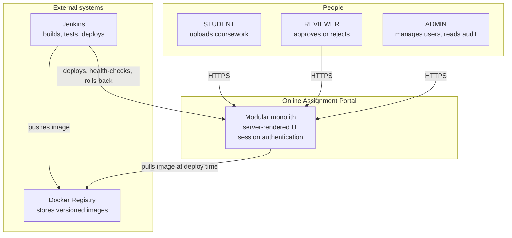
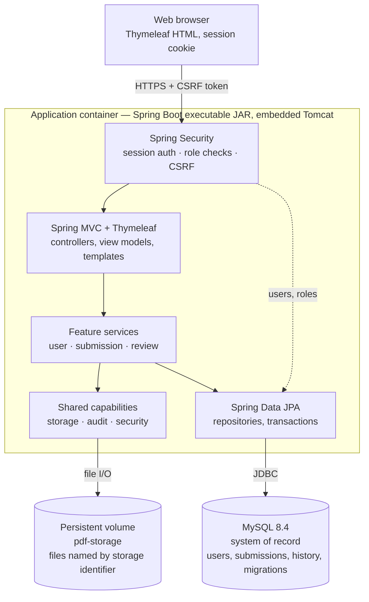
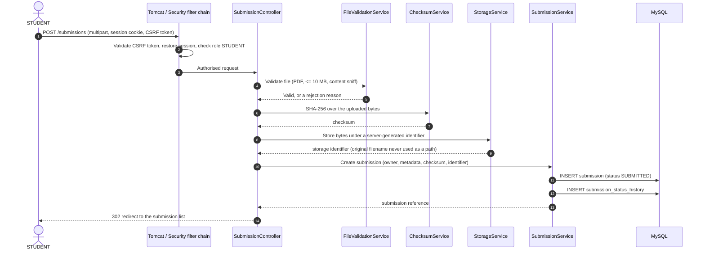
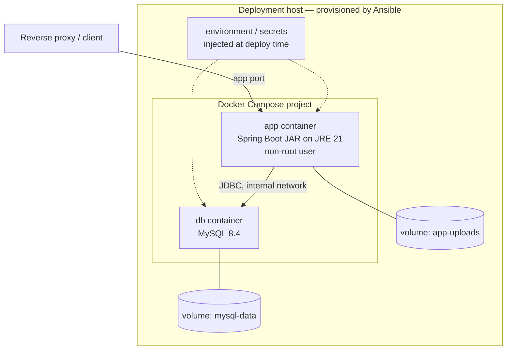

# System Overview

**Status:** Baselined — Milestone 0
**Related:** [Application structure](application-structure.md) · [Data model](data-model.md) ·
[ADR-001](../adr/ADR-001-modular-monolith.md) · [ADR-006](../adr/ADR-006-docker-compose-composition.md)

This document describes **how the system is shaped at runtime and how it is delivered**. It
does not describe business rules — those are in [`docs/requirements/mvp.md`](../requirements/mvp.md).

---

## 1. System context

Who and what the portal talks to. There is no neighbouring system in the MVP: no email
provider, no identity provider, no external file store.

## 2. Container view

The runtime units inside the single deployable application.

Key properties:

- **One process.** Everything above the dashed boundary ships as one JAR and one container.
- **Two stores, one owner each.** MySQL owns structured metadata; the volume owns file bytes.
  Neither is optional, and neither is the container filesystem.
- **No inbound network call is required to serve a request.** The registry is contacted at
  deploy time, not at request time.

## 3. Request lifecycle

The path of an authenticated, state-changing upload — the most demanding flow in the system.

Failure handling: if validation fails, nothing is written and the form is redisplayed with a
message. If storage succeeds but the database write fails, the orphaned file is the lesser
evil and is reconciled by a documented cleanup — the reverse (a database row with no file)
would break downloads, so the file is written first.

## 4. Delivery pipeline

The application is only half the deliverable. This is the other half.

```mermaid
flowchart LR
    A["GitHub<br/>pull request"] --> B["Review<br/>+ required checks"]
    B --> C["Jenkins CI<br/>orchestrates"]
    C --> D["Maven build<br/>compile, package"]
    D --> U["Unit tests<br/>JUnit 5"]
    U --> I["Integration tests<br/>Testcontainers + MySQL 8.4"]
    I --> E["Selenium E2E<br/>real browser, real deployment"]
    E --> F["Docker image<br/>tagged by commit SHA"]
    F --> G["Docker Registry<br/>versioned artefact"]
    G --> H["Ansible<br/>provision target host"]
    H --> J["Deploy<br/>compose up new image"]
    J --> K{"Health check<br/>passes?"}
    K -->|"yes"| L["Release complete<br/>evidence recorded"]
    K -->|"no"| M["Rollback<br/>restore previous image"]
    M --> L
```

Rules that make the pipeline meaningful:

- **A stage fails the build.** Tests that only warn are decoration.
- **The image tag is the commit SHA**, so a deployment is traceable to an exact source
  revision.
- **Provisioning is idempotent.** Running Ansible twice must be safe.
- **The health check is a gate, not a report.** A failed check triggers rollback
  automatically.
- **Every stage's evidence is retained** under [`docs/evidence/`](../evidence/).

## 5. Deployment topology

- Only the application port is published. The database is reachable **only** on the Compose
  network.
- Both volumes are named volumes, so `docker compose down` without `-v` preserves state.
- Secrets enter as environment variables. They are never baked into the image or written to a
  committed Compose file.

## 6. Cross-cutting concerns

| Concern | Approach |
| --- | --- |
| Authentication | Spring Security, session-based, BCrypt hashing |
| Authorisation | Role checks and ownership checks in the service layer, on every request |
| CSRF | Enabled globally; Thymeleaf injects the token into forms |
| Configuration | Environment variables over committed defaults |
| Schema evolution | Versioned Flyway migrations, applied at startup |
| Observability | Health endpoint plus structured application logs; no secrets in log output |
| Error handling | Centralised handling producing user-safe pages; no stack traces to clients |
| File integrity | SHA-256 checksum stored per uploaded artefact |
| Audit | Status transitions and security events persisted with actor and timestamp |
