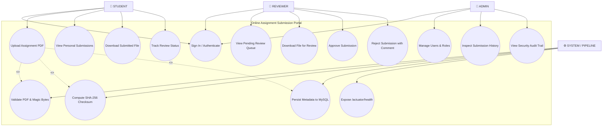

# Use Case Diagram & System Actor Interactions

**Project:** Git-Driven Online Assignment Submission Portal  
**Document:** System Use-Case Specifications & UML Interaction Model  
**Status:** Baselined  

---

## 1. Actors

| Actor | Role Type | Responsibilities |
| :--- | :--- | :--- |
| **`STUDENT`** | Primary User | Signs in, uploads PDF assignments (<= 10 MB), views personal submission status history, and downloads uploaded submissions. |
| **`REVIEWER`** | Primary User (Faculty) | Signs in, accesses the FIFO review queue of pending `SUBMITTED` work, inspects assignment files, and enters terminal decisions (`APPROVED` or `REJECTED`) with comments. |
| **`ADMIN`** | Administrative User | Manages user accounts and roles, inspects end-to-end submission status histories, and reviews system audit trails. |
| **`PORTAL SYSTEM`** | Automated Background Boundary | Validates uploaded PDF content/magic bytes, computes SHA-256 digests, coordinates Flyway schema migrations, and exposes health probes. |

---

## 2. UML Use Case Diagram

---

## 3. Use Case Descriptions

### UC-01: Upload Assignment (Student)
* **Pre-conditions:** User authenticated with `ROLE_STUDENT`.
* **Flow:**
  1. Student selects assignment and chooses a PDF file.
  2. System verifies file is <= 10 MB and inspects byte signature (`%PDF-`).
  3. System assigns UUID storage identifier and calculates SHA-256 digest.
  4. Record persisted in MySQL in status `SUBMITTED`.
* **Post-conditions:** File safely stored on volume; entry appears on student dashboard.

### UC-02: Review Submission (Reviewer)
* **Pre-conditions:** User authenticated with `ROLE_REVIEWER`.
* **Flow:**
  1. Reviewer navigates to FIFO `/review/queue`.
  2. Reviewer downloads and examines the student PDF.
  3. Reviewer submits decision (`APPROVED` or `REJECTED`) along with feedback comment.
  4. Optimistic lock (`@Version`) prevents concurrent decision collision.
* **Post-conditions:** Terminal state recorded; transition logged in `SubmissionStatusHistory`.

### UC-03: User Administration & Audit (Admin)
* **Pre-conditions:** User authenticated with `ROLE_ADMIN`.
* **Flow:**
  1. Admin manages user access and inspects overall submission history across all students.
  2. Admin tracks system health and operational readiness via `/actuator/health`.
