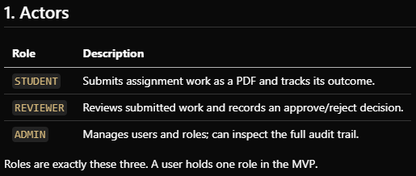
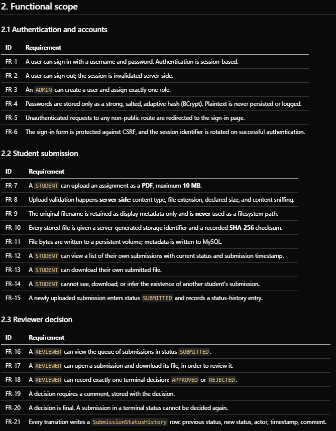
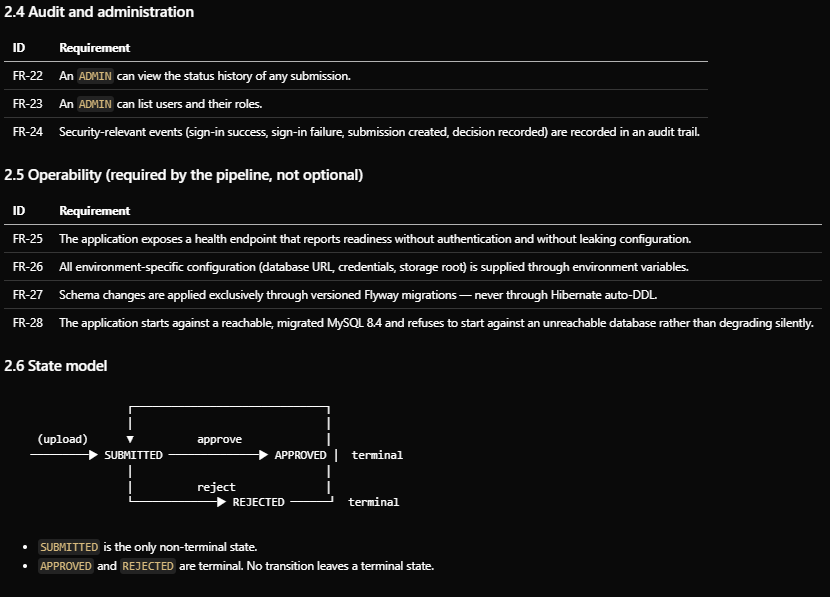
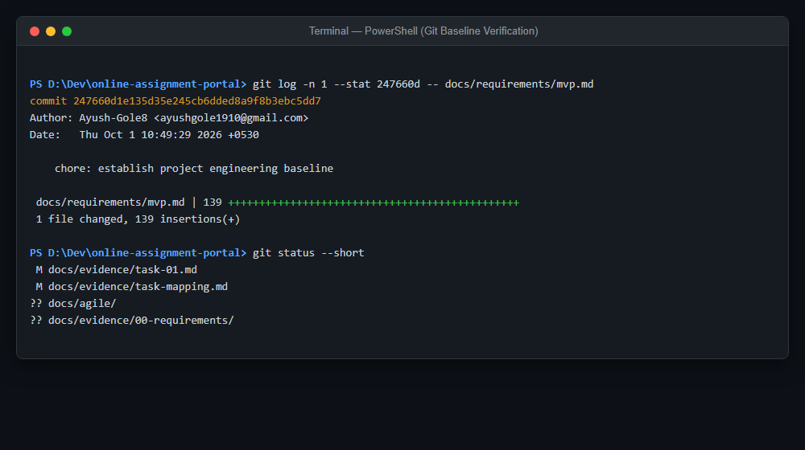
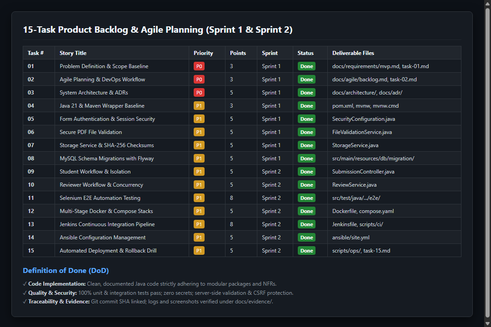

# Task 01 -- Requirements and scope baseline

**Evidence status:** CAPTURED

| Field | Details |
| --- | --- |
| Task | 01: Requirements and scope baseline |
| Objective | Translate the portal brief into explicit functional/non-functional requirements and deliberate exclusions so implementation and viva claims have a reference. |
| Implementation | `docs/requirements/mvp.md` records actors, FR-1 through FR-28, non-functional requirements (NFR-1–NFR-7), state transitions, and 18 out-of-scope exclusions. Agile planning, sprint breakdown, and DoD are documented in `docs/agile/backlog.md`. The present implementation satisfies core MVP paths while deliberately deferring the admin UI (FR-3, FR-22, FR-23) and dedicated audit trail (FR-24). |
| Primary files | `docs/requirements/mvp.md`, `docs/agile/backlog.md`, `README.md`, `docs/adr/README.md` |
| Command/demo | `git log -n 1 --stat 247660d -- docs/requirements/mvp.md` to demonstrate the baseline commit. |
| Expected result | A reviewer can distinguish implemented behaviour from explicitly deferred or missing requirements. No claim of full FR-1 through FR-28 completion is made. |

---

## 1. Evidence Capture Record

| Attribute | Captured Value |
| --- | --- |
| Capture Date | 2026-10-01 UTC |
| Git Commit SHA | `247660d1e135d35e245cb6dded8a9f8b3ebc5dd7` (short: `247660d`) |
| Commit Subject | `chore: establish project engineering baseline` |
| Environment | Local development workstation (Windows 11, PowerShell, Git 2.4x) |
| Author | Ayush-Gole8 |

---

## 2. Command Execution & Baseline Log

```text
$ git log -n 1 --stat 247660d -- docs/requirements/mvp.md
commit 247660d1e135d35e245cb6dded8a9f8b3ebc5dd7
Author: Ayush-Gole8 <ayushgole1910@gmail.com>
Date:   Thu Oct 1 10:49:29 2026 +0530

    chore: establish project engineering baseline

 docs/requirements/mvp.md | 139 +++++++++++++++++++++++++++++++++++++++++++++++
 1 file changed, 139 insertions(+)
```

---

## 3. Visual Evidence & Baseline Views

### 3.1 Actors & Role Boundaries

*Captured view of Section 1: Actors (`STUDENT`, `REVIEWER`, `ADMIN`).*

### 3.2 Functional Scope (FR-1 through FR-21)

*Captured view of Section 2: Functional Scope covering Authentication, Student Submissions, and Reviewer Decisions.*

### 3.3 Audit, Operability & State Transition Model

*Captured view of Section 2.4-2.6: Operability criteria (Flyway migrations, MySQL 8.4, Health endpoints) and State Transition model (`SUBMITTED` -> `APPROVED` | `REJECTED`).*

### 3.4 Terminal Git Baseline Log

*Captured terminal execution showing commit `247660d` locking the requirements baseline and clean git status.*

### 3.5 15-Task Product Backlog & Sprint Plan

*Captured view of the 15-task product backlog across Sprint 1 & Sprint 2 with Definition of Done (DoD).*

---

## 4. Agile Backlog & Planning Linkage

The corresponding 15-task backlog, user stories, acceptance criteria, 2-sprint plan, and Definition of Done (DoD) are established in:
- [`docs/agile/backlog.md`](../agile/backlog.md)

