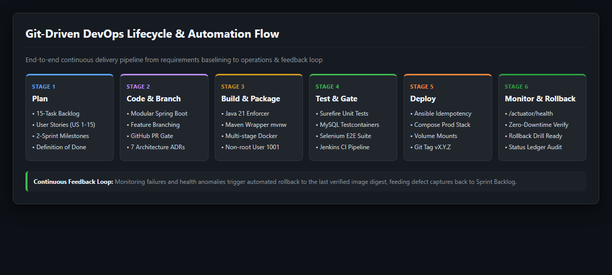
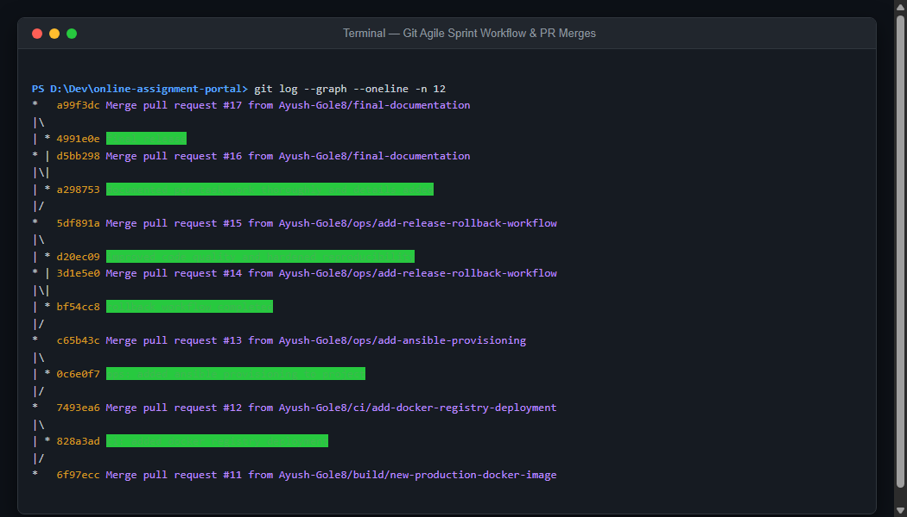

# Task 02 -- Agile Planning and DevOps Workflow

**Evidence status:** CAPTURED

| Field | Details |
| --- | --- |
| Task | 02: Agile Planning and DevOps Workflow |
| Objective | Formulate an Agile delivery roadmap including user stories with acceptance criteria, a 15-task product backlog across two sprints, a Definition of Done (DoD), and an end-to-end DevOps lifecycle workflow diagram. |
| Implementation | `docs/agile/backlog.md` defines 15 user stories (US-01 through US-15) with testable acceptance criteria, maps the 15 project milestones across Sprint 1 (Core Foundation) and Sprint 2 (DevOps Automation), and articulates strict DoD gates. `docs/architecture/devops-lifecycle.md` documents the continuous delivery lifecycle and quality gates. Architecture decisions are preserved in `docs/adr/`. |
| Primary files | `docs/agile/backlog.md`, `docs/architecture/devops-lifecycle.md`, `docs/architecture/system-overview.md`, `docs/adr/README.md` |
| Command/demo | `git log --graph --oneline -n 12` demonstrating the PR-based branch flow and iterative sprint deliveries. |
| Expected result | Full traceability from user stories to PR commits, sprint plan, and an operational DevOps feedback loop. |

---

## 1. Evidence Capture Record

| Attribute | Captured Value |
| --- | --- |
| Capture Date | 2026-10-01 UTC |
| Git Commit SHA | `247660d` (Baseline) / `a99f3dc` (Sprint Milestones & PR Integrations) |
| Environment | Local development workstation (Windows 11, PowerShell, Git 2.4x) |
| Author | Ayush-Gole8 |

---

## 2. Command Execution & Git Sprint History Log

```text
PS D:\Dev\online-assignment-portal> git log --graph --oneline -n 12
*   a99f3dc Merge pull request #17 from Ayush-Gole8/final-documentation
|\  
| * 4991e0e final release
* | d5bb298 Merge pull request #16 from Ayush-Gole8/final-documentation
|\| 
| * a298753 documented per task work thoroughly and details added
|/  
*   5df891a Merge pull request #15 from Ayush-Gole8/ops/add-release-rollback-workflow
|\  
| * d20ec09 improved code quality and hardened reproducibility
* | 3d1e5e0 Merge pull request #14 from Ayush-Gole8/ops/add-release-rollback-workflow
|\| 
| * bf54cc8 rollback workflow completed
|/  
*   c65b43c Merge pull request #13 from Ayush-Gole8/ops/add-ansible-provisioning
|\  
| * 0c6e0f7 ops: added ansible provisioning to project
|/  
*   7493ea6 Merge pull request #12 from Ayush-Gole8/ci/add-docker-registry-deployment
|\  
| * 828a3ad ci: added docker registry deployment
|/  
*   6f97ecc Merge pull request #11 from Ayush-Gole8/build/new-production-docker-image
```

---

## 3. Visual Evidence & Workflow Captures

### 3.1 15-Task Product Backlog & Sprint Plan

*Captured view of the 15-task product backlog across Sprint 1 & Sprint 2 with Definition of Done (DoD).*

### 3.2 DevOps Lifecycle & Quality Gates

*Captured view of the 6-stage DevOps lifecycle from Plan to Monitor, showing automated feedback and rollback loop.*

### 3.3 Git Sprint Collaboration & PR Merges

*Captured terminal view demonstrating feature branch merges (`feat/`, `ci/`, `ops/`) validating Agile delivery.*

---

## 4. Deliverable References

- Agile Backlog & User Stories: [`docs/agile/backlog.md`](../agile/backlog.md)
- DevOps Lifecycle Architecture: [`docs/architecture/devops-lifecycle.md`](../architecture/devops-lifecycle.md)
- Architecture Decision Records: [`docs/adr/`](../adr/)
