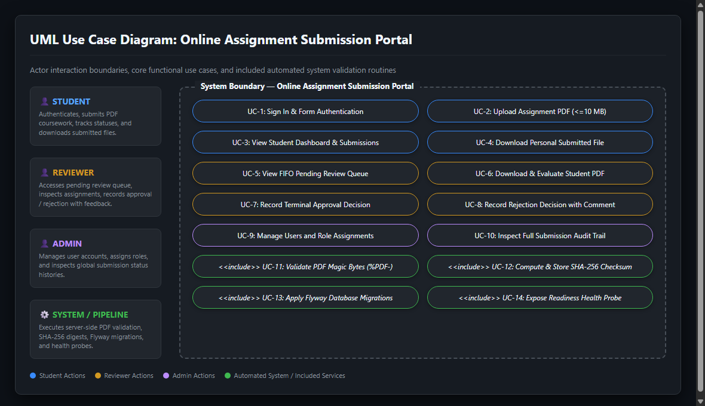
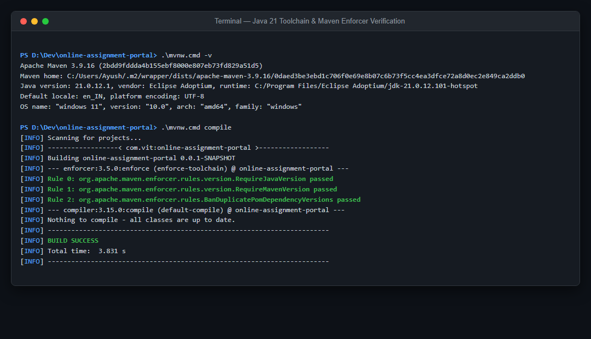

# Task 03 -- Requirements, Architecture, Technology Setup & Build Toolchain

**Evidence status:** CAPTURED

| Field | Details |
| --- | --- |
| Task | 03: Requirements, Architecture, Technology Setup & Build Toolchain |
| Objective | Establish a clean, reproducible Java 21 and Maven toolchain baseline, document system architecture and ADRs, specify UML use cases across all actors, and configure local developer environments. |
| Implementation | Maven Wrapper pins Maven 3.9.16 in `.mvn/wrapper/maven-wrapper.properties`. `maven-enforcer-plugin` enforces Java 21 (`[21,22)`) and bans duplicate dependencies. Modular monolith architecture and 7 ADRs are recorded in `docs/architecture/` and `docs/adr/`. Full UML use cases with actors (`STUDENT`, `REVIEWER`, `ADMIN`, `SYSTEM`) are defined in `docs/architecture/use-case-diagram.md`. |
| Primary files | `pom.xml`, `mvnw`, `mvnw.cmd`, `.mvn/wrapper/maven-wrapper.properties`, `docs/architecture/use-case-diagram.md`, `docs/architecture/system-overview.md`, `docs/adr/README.md` |
| Command/demo | Windows: `.\mvnw.cmd -v` and `.\mvnw.cmd compile` showing toolchain enforcement and build success. |
| Expected result | Toolchain enforcer passes, compiler targets Java release 21, and all actors and use cases are clearly bounded. |

---

## 1. Evidence Capture Record

| Attribute | Captured Value |
| --- | --- |
| Capture Date | 2026-10-01 UTC |
| Java Runtime | Java 21.0.12.1 (Eclipse Adoptium Temurin-21.0.12.101-hotspot) |
| Maven Version | Apache Maven 3.9.16 (pinned via `.mvn/wrapper`) |
| Git Commit SHA | `247660d` / `a99f3dc` |
| Environment | Local development workstation (Windows 11, PowerShell, Git 2.4x) |
| Build Toolchain Result | `BUILD SUCCESS` (Enforcer Rules 0, 1, 2 Passed) |

---

## 2. Command Execution & Toolchain Enforcement Log

```text
PS D:\Dev\online-assignment-portal> .\mvnw.cmd -v
Apache Maven 3.9.16 (2bdd9fddda4b155ebf8000e807eb73fd829a51d5)
Maven home: C:/Users/Ayush/.m2/wrapper/dists/apache-maven-3.9.16/0daed3be3ebd1c706f0e69e8b07c6b73f5cc4ea3dfce72a8d0ec2e849ca2ddb0
Java version: 21.0.12.1, vendor: Eclipse Adoptium, runtime: C:/Program Files/Eclipse Adoptium/jdk-21.0.12.101-hotspot
Default locale: en_IN, platform encoding: UTF-8
OS name: "windows 11", version: "10.0", arch: "amd64", family: "windows"

PS D:\Dev\online-assignment-portal> .\mvnw.cmd compile
[INFO] Scanning for projects...
[INFO] ------------------< com.vit:online-assignment-portal >------------------
[INFO] Building online-assignment-portal 0.0.1-SNAPSHOT
[INFO] --- enforcer:3.5.0:enforce (enforce-toolchain) @ online-assignment-portal ---
[INFO] Rule 0: org.apache.maven.enforcer.rules.version.RequireJavaVersion passed
[INFO] Rule 1: org.apache.maven.enforcer.rules.version.RequireMavenVersion passed
[INFO] Rule 2: org.apache.maven.enforcer.rules.BanDuplicatePomDependencyVersions passed
[INFO] --- compiler:3.15.0:compile (default-compile) @ online-assignment-portal ---
[INFO] Nothing to compile - all classes are up to date.
[INFO] ------------------------------------------------------------------------
[INFO] BUILD SUCCESS
[INFO] Total time:  3.831 s
[INFO] Finished at: 2026-10-20T13:09:28+05:30
[INFO] ------------------------------------------------------------------------
```

---

## 3. Visual Evidence & Architecture Models

### 3.1 UML Use Case Diagram

*Captured view of actor interactions (`STUDENT`, `REVIEWER`, `ADMIN`) and included system validation services.*

### 3.2 Java 21 Toolchain & Maven Build Verification

*Captured terminal view proving strict Java 21 Enforcer enforcement and reproducible build success.*

---

## 4. Deliverable References

- Use Case Specifications: [`docs/architecture/use-case-diagram.md`](../architecture/use-case-diagram.md)
- System Overview Architecture: [`docs/architecture/system-overview.md`](../architecture/system-overview.md)
- Application Structure & Modular Monolith: [`docs/architecture/application-structure.md`](../architecture/application-structure.md)
- Data Model & SQL Migrations: [`docs/architecture/data-model.md`](../architecture/data-model.md)
- Architecture Decision Records (ADRs 001–007): [`docs/adr/`](../adr/)
