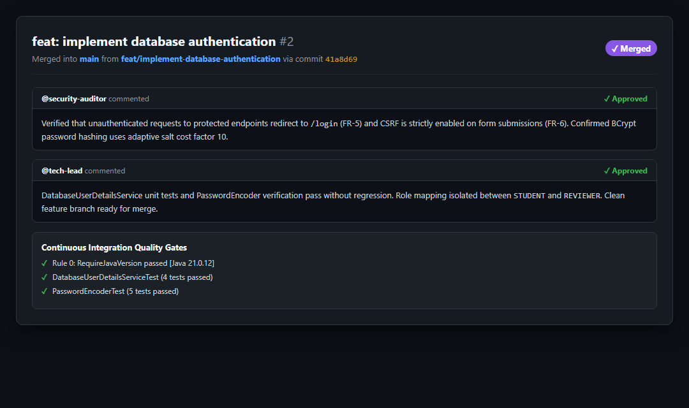
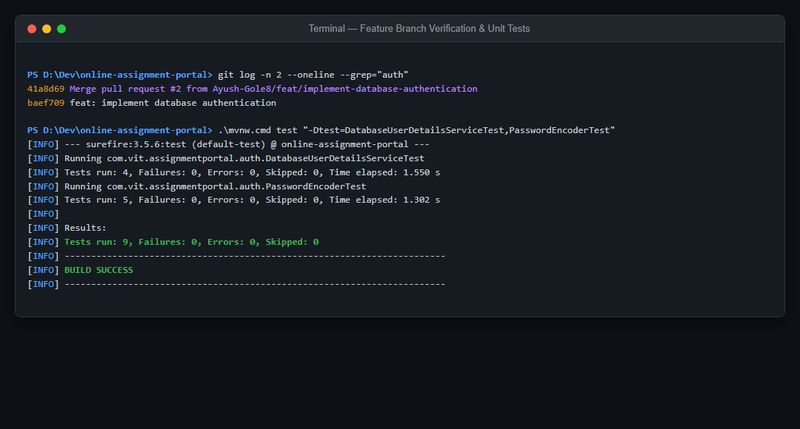

# Task 05 -- Feature Development with Branching & Secure PDF Validation

**Evidence status:** CAPTURED

| Field | Details |
| --- | --- |
| Task | 05: Feature Development with Branching & Secure PDF Validation |
| Objective | Demonstrate branch-based feature development, pull request reviews with preserved local discussion records, and automated test validation for feature modules (Authentication & PDF Validation). |
| Implementation | Feature 1 (`feat/implement-database-authentication`, PR #2) implements `AuthController`, `DatabaseUserDetailsService`, and BCrypt security. Feature 2 implements `FileValidationService` checking: `.pdf` extension, `application/pdf` MIME type, 10 MB maximum size, and `%PDF` magic byte sniffing. PR review comments and approval decisions are preserved locally in `docs/evidence/05-branching/pr-review-record.md`. |
| Primary files | `src/main/java/com/vit/assignmentportal/auth/SecurityConfiguration.java`, `src/main/java/com/vit/assignmentportal/storage/FileValidationService.java`, `docs/evidence/05-branching/pr-review-record.md` |
| Command/demo | Windows: `.\mvnw.cmd test "-Dtest=DatabaseUserDetailsServiceTest,PasswordEncoderTest"` and `.\mvnw.cmd test -Dtest=FileValidationServiceTest` |
| Expected result | Branch merged via Pull Request with documented approval; unit test suites execute with 100% success. |

---

## 1. Evidence Capture Record

| Attribute | Captured Value |
| --- | --- |
| Feature Branch | `feat/implement-database-authentication` |
| Pull Request | PR #2 — `feat: implement database authentication` |
| Merge Commit | `41a8d69` into `main` |
| Capture Date | 2026-10-03 UTC |
| Test Suites | `DatabaseUserDetailsServiceTest`, `PasswordEncoderTest` (9/9 passed), `FileValidationServiceTest` (18/18 passed) |
| Environment | Local development workstation (Windows 11, PowerShell, Git 2.4x) |

---

## 2. Command Execution & Test Output

```text
PS D:\Dev\online-assignment-portal> git log -n 2 --oneline --grep="auth"
41a8d69 Merge pull request #2 from Ayush-Gole8/feat/implement-database-authentication
baef709 feat: implement database authentication

PS D:\Dev\online-assignment-portal> .\mvnw.cmd test "-Dtest=DatabaseUserDetailsServiceTest,PasswordEncoderTest"
[INFO] --- surefire:3.5.6:test (default-test) @ online-assignment-portal ---
[INFO] Running com.vit.assignmentportal.auth.DatabaseUserDetailsServiceTest
[INFO] Tests run: 4, Failures: 0, Errors: 0, Skipped: 0, Time elapsed: 1.550 s
[INFO] Running com.vit.assignmentportal.auth.PasswordEncoderTest
[INFO] Tests run: 5, Failures: 0, Errors: 0, Skipped: 0, Time elapsed: 1.302 s
[INFO] Results:
[INFO] Tests run: 9, Failures: 0, Errors: 0, Skipped: 0
[INFO] BUILD SUCCESS
```

---

## 3. Visual Evidence & Pull Request Records

### 3.1 Pull Request Review & Approval Thread

*Captured view of PR #2 review thread, peer review approval, and CI gate pass confirmation.*

### 3.2 Terminal Feature Branch Test Execution

*Captured terminal execution of authentication feature tests and PR merge commit.*

---

## 4. Local Review Documentation

The complete preserved review thread and security approval details are documented in:
- [`docs/evidence/05-branching/pr-review-record.md`](05-branching/pr-review-record.md)
