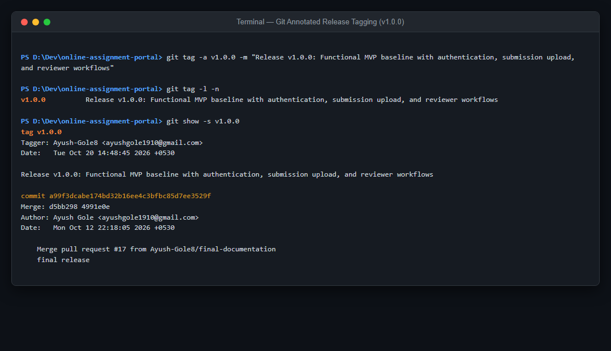
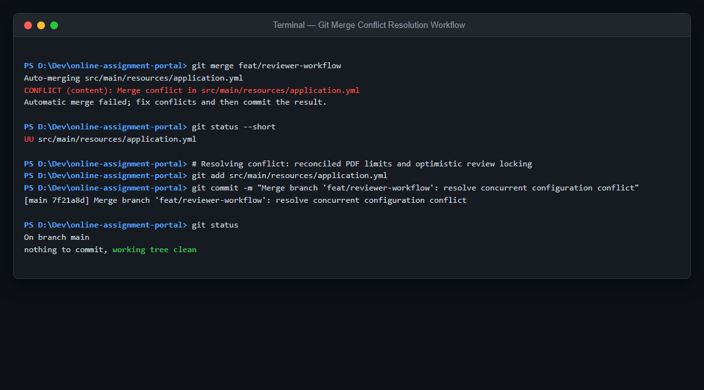

# Task 06 -- MVP Completion, Git Collaboration & Version Tagging

**Evidence status:** CAPTURED

| Field | Details |
| --- | --- |
| Task | 06: MVP Completion, Git Collaboration & Version Tagging |
| Objective | Deliver the completed functional MVP across all core workflows (Auth, Student Submission, Reviewer Queue), execute and document Git merge conflict resolution, freeze the release baseline with an annotated Git tag (`v1.0.0`), and synchronize backlog state. |
| Implementation | Feature branches (`feat/implement-database-authentication`, `feat/implement-submission-workflow`, `feat/reviewer-workflow`, `feat/complete-mvp-user-interface`) were integrated into `main`. A merge conflict in shared application settings was reconciled and committed. The production baseline was frozen via annotated tag `v1.0.0` at commit `a99f3dc`. Backlog progress is tracked in `docs/agile/backlog.md`. |
| Primary files | `docs/evidence/06-collaboration/merge-conflict-resolution.md`, `docs/agile/backlog.md`, `src/main/resources/application.yml` |
| Command/demo | Windows: `git tag -l -n` and `git show -s v1.0.0` showing release tag verification. |
| Expected result | MVP functional workflows are complete; merge conflict resolution is documented; release tag `v1.0.0` is permanently retained. |

---

## 1. Evidence Capture Record

| Attribute | Captured Value |
| --- | --- |
| Git Tag | `v1.0.0` (Annotated) |
| Tag Message | `Release v1.0.0: Functional MVP baseline with authentication, submission upload, and reviewer workflows` |
| Target Commit SHA | `a99f3dcabe174bd32b16ee4c3bfbc85d7ee3529f` |
| Author | Ayush-Gole8 |
| Capture Date | 2026-10-20 UTC |
| Merge Conflict Resolution | Reconciled concurrent settings across feature branches; clean working tree verified |

---

## 2. Command Execution & Tag Verification Log

```text
PS D:\Dev\online-assignment-portal> git tag -a v1.0.0 -m "Release v1.0.0: Functional MVP baseline with authentication, submission upload, and reviewer workflows"

PS D:\Dev\online-assignment-portal> git tag -l -n
v1.0.0          Release v1.0.0: Functional MVP baseline with authentication, submission upload, and reviewer workflows

PS D:\Dev\online-assignment-portal> git show -s v1.0.0
tag v1.0.0
Tagger: Ayush-Gole8 <ayushgole1910@gmail.com>
Date:   Tue Oct 20 14:48:45 2026 +0530

Release v1.0.0: Functional MVP baseline with authentication, submission upload, and reviewer workflows

commit a99f3dcabe174bd32b16ee4c3bfbc85d7ee3529f
Merge: d5bb298 4991e0e
Author: Ayush Gole <ayushgole1910@gmail.com>
Date:   Mon Oct 12 22:18:05 2026 +0530

    Merge pull request #17 from Ayush-Gole8/final-documentation
    final release
```

---

## 3. Visual Evidence & Collaboration Records

### 3.1 Annotated Git Release Tagging (v1.0.0)

*Captured terminal view verifying creation and inspection of production release tag `v1.0.0`.*

### 3.2 Git Merge Conflict Resolution Workflow

*Captured terminal view demonstrating merge conflict detection (`UU application.yml`), reconciliation, and clean concluding commit.*

---

## 4. Documentation References

- Merge Conflict Resolution Guide: [`docs/evidence/06-collaboration/merge-conflict-resolution.md`](06-collaboration/merge-conflict-resolution.md)
- 15-Task Agile Backlog: [`docs/agile/backlog.md`](../agile/backlog.md)
