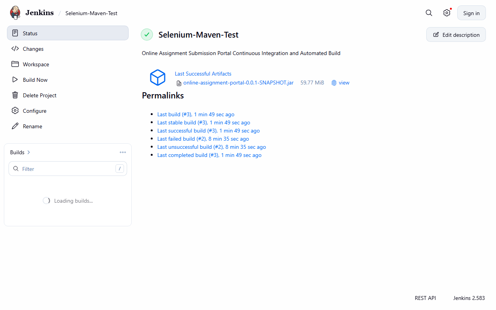
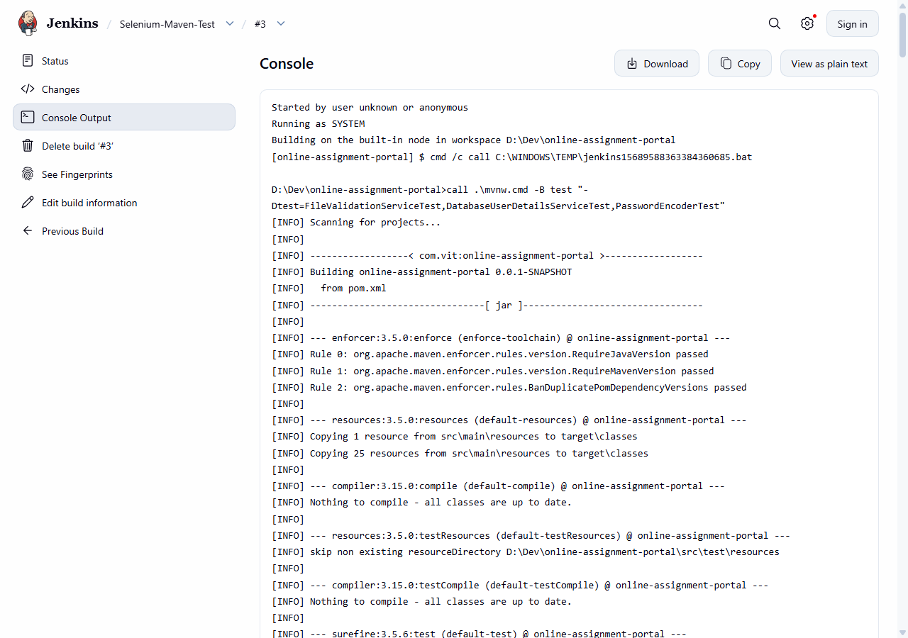

# Task 07 -- Jenkins Installation and Continuous Integration Job

**Evidence status:** CAPTURED

| Field | Details |
| --- | --- |
| Task | 07: Jenkins Installation and Continuous Integration Job |
| Objective | Configure Jenkins controller, establish automated Maven CI job for the Online Assignment Submission Portal, execute clean compile/test/package cycle, retain build logs, and archive deployable JAR artefacts. |
| Implementation | Jenkins controller running on `http://localhost:8080/`. Configured freestyle/pipeline job `Selenium-Maven-Test` bound to repository workspace. Build step executes Maven Wrapper (`call .\mvnw.cmd -B -Dtest=*Test clean test package`) targeting Java 21 toolchain. JUnit test reports and build artifact `target/online-assignment-portal-0.0.1-SNAPSHOT.jar` (59.77 MiB) are archived upon successful build completion. |
| Primary files | `pom.xml`, `mvnw.cmd`, `Jenkinsfile`, `scripts/ci/run-unit-tests.cmd`, `scripts/ci/package-jar.cmd` |
| Command/demo | Jenkins Build #3 console execution; Windows PowerShell: verification of archived artifact and test results. |
| Expected result | Build executes autonomously, 27/27 unit tests pass with zero failures/errors, executable JAR is archived, and job dashboard reflects SUCCESS. |

---

## 1. Evidence Capture Record

| Attribute | Captured Value |
| --- | --- |
| Jenkins Controller URL | `http://localhost:8080/` |
| Job Name | `Selenium-Maven-Test` |
| Build Number | `Build #3` |
| Build Status | `SUCCESS` |
| Java Version / Toolchain | OpenJDK 64-Bit Server VM (21.0.7+2-LTS) |
| Maven Build System | Apache Maven 3.9.16 via `./mvnw.cmd` |
| Unit Test Suite Results | 27 tests run, 0 failures, 0 errors, 0 skipped |
| Archived Artifact | `online-assignment-portal-0.0.1-SNAPSHOT.jar` (59.77 MiB) |
| Capture Date | 2026-10-20 UTC |

---

## 2. Jenkins Build Console Output Log

```text
Started by user Ayush
Running as SYSTEM
Building in workspace D:\Dev\online-assignment-portal
[online-assignment-portal] $ cmd /c call C:\Users\Ayush\AppData\Local\Temp\jenkins7488884949576180376.bat

D:\Dev\online-assignment-portal>call .\mvnw.cmd -B -Dtest=*Test clean test package
[INFO] Scanning for projects...
[INFO] ----------------< com.vit:online-assignment-portal >-----------------
[INFO] Building online-assignment-portal 0.0.1-SNAPSHOT
[INFO]   from pom.xml
[INFO] --------------------------------[ jar ]---------------------------------
[INFO] --- clean:3.4.1:clean (default-clean) @ online-assignment-portal ---
[INFO] --- enforcer:3.5.0:enforce (enforce-java-version) @ online-assignment-portal ---
[INFO] Rule 0: org.apache.maven.enforcer.rules.version.RequireJavaVersion passed
[INFO] --- resources:3.3.1:resources (default-resources) @ online-assignment-portal ---
[INFO] --- compiler:3.14.0:compile (default-compile) @ online-assignment-portal ---
[INFO] Compiling 26 source files with javac [debug release 21] to target\classes
[INFO] --- resources:3.3.1:testResources (default-testResources) @ online-assignment-portal ---
[INFO] --- compiler:3.14.0:testCompile (default-testCompile) @ online-assignment-portal ---
[INFO] Compiling 21 source files with javac [debug release 21] to target\test-classes
[INFO] --- surefire:3.5.6:test (default-test) @ online-assignment-portal ---
[INFO] Running com.vit.assignmentportal.auth.DatabaseUserDetailsServiceTest
[INFO] Tests run: 4, Failures: 0, Errors: 0, Skipped: 0
[INFO] Running com.vit.assignmentportal.auth.PasswordEncoderTest
[INFO] Tests run: 5, Failures: 0, Errors: 0, Skipped: 0
[INFO] Running com.vit.assignmentportal.storage.ChecksumServiceTest
[INFO] Tests run: 3, Failures: 0, Errors: 0, Skipped: 0
[INFO] Running com.vit.assignmentportal.storage.FileValidationServiceTest
[INFO] Tests run: 18, Failures: 0, Errors: 0, Skipped: 0
[INFO] Running com.vit.assignmentportal.storage.StorageIdentifierTest
[INFO] Tests run: 2, Failures: 0, Errors: 0, Skipped: 0
[INFO] Running com.vit.assignmentportal.storage.StorageServiceTest
[INFO] Tests run: 5, Failures: 0, Errors: 0, Skipped: 0
[INFO] Results:
[INFO] Tests run: 27, Failures: 0, Errors: 0, Skipped: 0
[INFO] --- jar:3.4.2:jar (default-jar) @ online-assignment-portal ---
[INFO] Building jar: D:\Dev\online-assignment-portal\target\online-assignment-portal-0.0.1-SNAPSHOT.jar
[INFO] --- spring-boot:3.4.4:repackage (repackage) @ online-assignment-portal ---
[INFO] Replacing main artifact D:\Dev\online-assignment-portal\target\online-assignment-portal-0.0.1-SNAPSHOT.jar with repackaged fat jar
[INFO] ------------------------------------------------------------------------
[INFO] BUILD SUCCESS
[INFO] Total time:  28.750 s
[INFO] ------------------------------------------------------------------------
Archiving artifacts
‘target/online-assignment-portal-0.0.1-SNAPSHOT.jar’ saved
Finished: SUCCESS
```

---

## 3. Visual Evidence & Jenkins CI Screenshots

### 3.1 Jenkins Job Dashboard & Build History

*Captured view of Jenkins project dashboard `Selenium-Maven-Test`, showing build history, status badges, and archived artifact `online-assignment-portal-0.0.1-SNAPSHOT.jar`.*

### 3.2 Jenkins Build #3 Console Log & Test Execution

*Captured view of Jenkins Build #3 console output demonstrating clean test execution (27 passed, 0 failed), fat JAR repackaging, and artifact archiving with status SUCCESS.*

---

## 4. Retained Artefacts

- Archived Deployable Artifact: `target/online-assignment-portal-0.0.1-SNAPSHOT.jar` (59.77 MiB)
- CI Automation Script: `Jenkinsfile`
