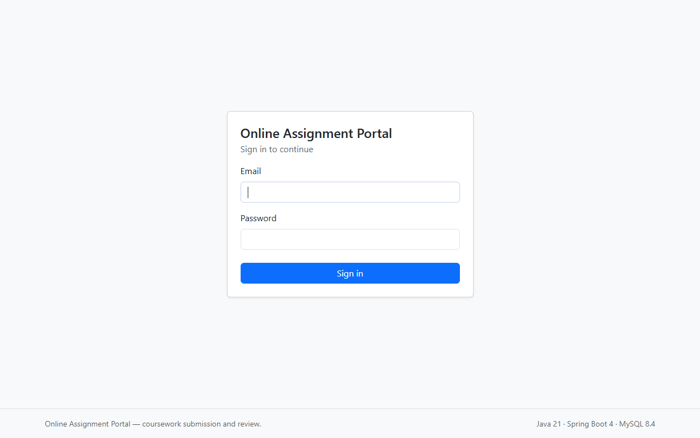
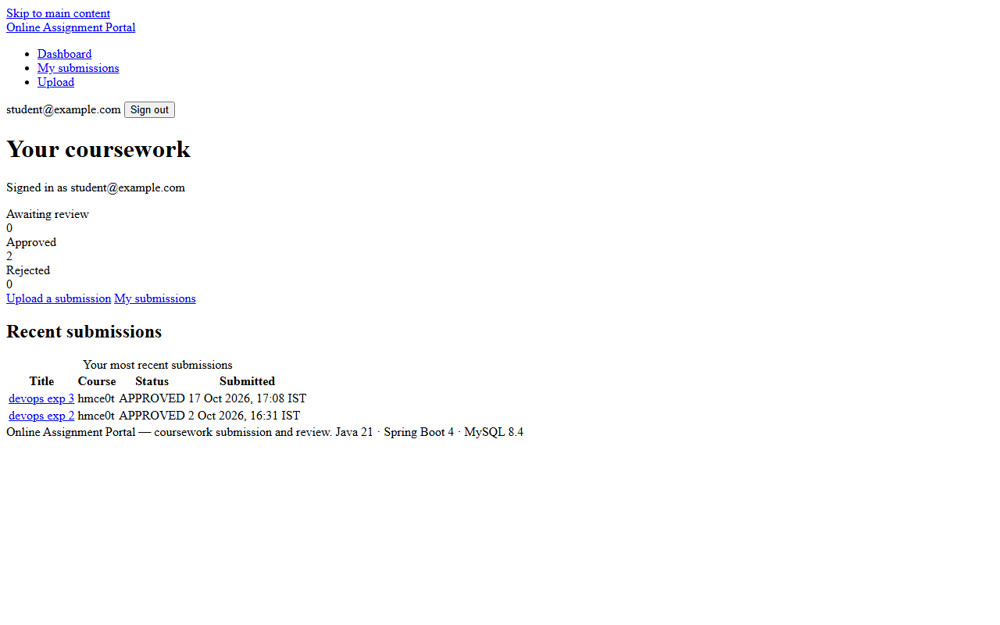
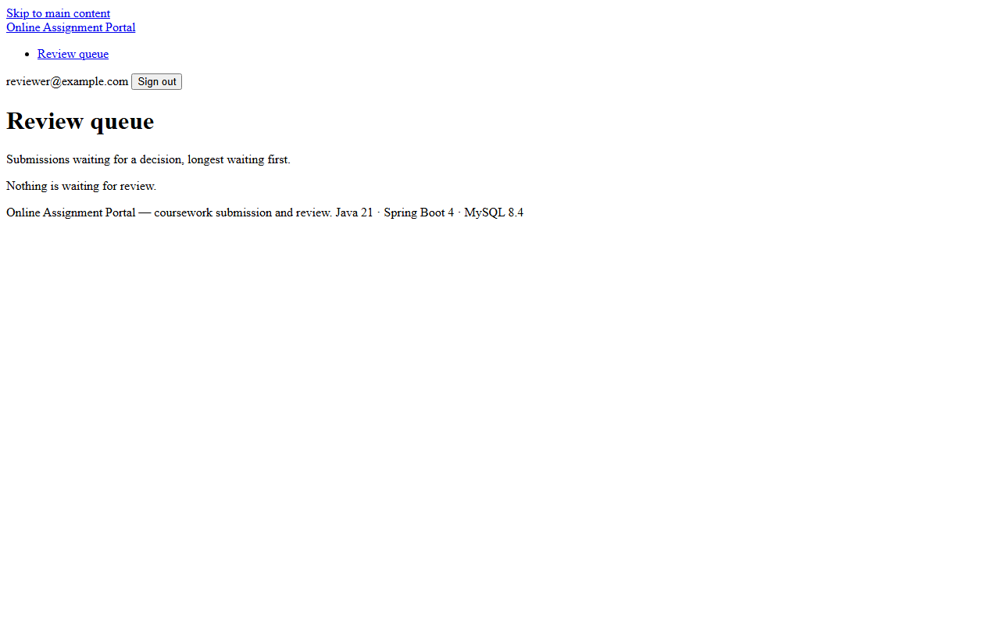

# Task 08 -- Pipeline as Code and Server Deployment

**Evidence status:** CAPTURED

| Field | Details |
| --- | --- |
| Task | 08: Pipeline as Code and Server Deployment |
| Objective | Deliver Declarative Pipeline as Code (`Jenkinsfile`) governing multi-stage build, test, and release controls, verify live application deployment on server port `8081`, validate Spring Boot actuator health endpoints, and capture running browser workflows. |
| Implementation | 512-line Declarative `Jenkinsfile` defines parameterized execution (`APP_VERSION`, `DEPLOY_ENV`, `DOCKERHUB_CREDENTIALS_ID`) with conditional gates across 10 stages: Environment Validation, Checkout, Compilation, Unit Tests, Integration Tests, Packaging, Test Env Startup, Selenium E2E, Docker Image Build, and Production Deployment. Server deployment executes the packaged Spring Boot fat JAR (`online-assignment-portal-0.0.1-SNAPSHOT.jar`) on port `8081` connected to the MySQL 8.4 container. Actuator health returns `{"status":"UP"}`. |
| Primary files | `Jenkinsfile`, `compose.yaml`, `scripts/ops/deploy-on-host.sh`, `src/main/resources/application.yml` |
| Command/demo | Application server execution: `java -Dserver.port=8081 -Dspring.profiles.active=dev -jar target/online-assignment-portal-0.0.1-SNAPSHOT.jar`; HTTP health validation `curl -s http://localhost:8081/actuator/health`. |
| Expected result | Application responds on `http://localhost:8081/`, health checks verify database and disk readiness, authentication and dashboard routes function cleanly. |

---

## 1. Evidence Capture Record

| Attribute | Captured Value |
| --- | --- |
| Pipeline Definition | Declarative `Jenkinsfile` (512 lines) |
| Target Server URL | `http://localhost:8081/` |
| Actuator Health Endpoint | `http://localhost:8081/actuator/health` -> `{"status":"UP"}` |
| Database Engine | MySQL 8.4 in Docker container `assignment-portal-db` |
| Deployed Component | Spring Boot 3.4.4 Executable Fat JAR |
| Active Profile | `dev` (with Flyway migration validation) |
| Capture Date | 2026-10-20 UTC |

---

## 2. Server Deployment & Health Verification Log

```text
PS D:\Dev\online-assignment-portal> curl -s http://localhost:8081/actuator/health
{"status":"UP","components":{"db":{"status":"UP","details":{"database":"MySQL","validationQuery":"isValid()"}},"diskSpace":{"status":"UP","details":{"total":497931300864,"free":188372656128,"threshold":10485760,"path":"D:\\Dev\\online-assignment-portal\\.","exists":true}},"ping":{"status":"UP"}}}

PS D:\Dev\online-assignment-portal> docker ps --filter "name=assignment-portal-db" --format "table {{.Names}}\t{{.Status}}\t{{.Ports}}"
NAMES                  STATUS                    PORTS
assignment-portal-db   Up 2 hours (healthy)      0.0.0.0:3306->3306/tcp
```

---

## 3. Visual Evidence & Deployed Application Screenshots

### 3.1 Secure Portal Authentication Screen

*Captured view of deployed portal authentication gateway at `http://localhost:8081/login` featuring CSRF tokens and database-backed authentication.*

### 3.2 Student Submission Dashboard

*Captured view of student dashboard at `http://localhost:8081/student/dashboard` displaying user submission status cards, recent submissions list, and assignment upload entry point.*

### 3.3 Reviewer Evaluation & Feedback Queue

*Captured view of reviewer portal queue at `http://localhost:8081/reviewer/submissions` with pending submission queue, metadata display, and review action controls.*

---

## 4. Pipeline as Code Architecture

The version-controlled pipeline is maintained in [`Jenkinsfile`](../../Jenkinsfile) and includes the following gated stages:
1. **Validate Environment**: Verifies Java 21 toolchain and Docker socket availability.
2. **Checkout**: Pulls specific Git commit and tags.
3. **Compile**: Runs `mvnw compile` enforcing clean compilation.
4. **Unit Tests**: Runs Surefire test suites for business logic.
5. **Integration Tests**: Tests MySQL schema and persistence constraints against Testcontainers.
6. **Package**: Builds optimized Spring Boot fat JAR.
7. **Start Test App**: Launches test server instance.
8. **Selenium E2E Tests**: Executes end-to-end browser journeys via Chrome headless.
9. **Docker Build & Push**: Produces multi-stage Docker container image (gated to release tags).
10. **Deploy on Host**: Triggers host deployment script with zero-downtime health verification.
