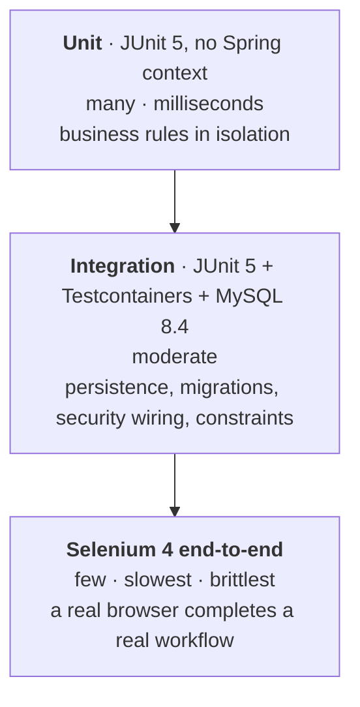

# Test Strategy

**Status:** Baselined — Milestone 0 (no tests exist yet)
**Related:** [MVP requirements](../requirements/mvp.md) · [CLAUDE.md §6](../../CLAUDE.md) · [ADR-003](../adr/ADR-003-mysql-system-of-record.md)

---

## 1. Philosophy

Test at the **lowest layer that can prove the behaviour**, and use higher layers only for what
lower layers genuinely cannot reach.

A test must assert **behaviour**, not implementation. If a refactor changes the code but not
the behaviour and a test breaks, the test was coupled to the wrong thing — fix the test, not
the refactor. Conversely, a test that passes no matter what the code does is worse than no
test, because it manufactures false confidence.

Coverage percentage is **not** a goal. A high-coverage suite that misses the authorisation
check on a download endpoint has failed at the only thing that matters. Coverage is a symptom
to inspect, never a target to hit.

## 2. The pyramid

The shape is a guideline, not a rule, but an inverted pyramid is a defect: a suite that is
mostly Selenium is slow, flaky, and will be disabled — and a disabled suite proves nothing.

| Layer | Framework | Scope | Target runtime |
| --- | --- | --- | --- |
| Unit | JUnit 5, AssertJ, Mockito where a collaborator must be faked | One class, no Spring, no I/O | Whole suite in seconds |
| Integration | `@SpringBootTest` / slice tests + **Testcontainers MySQL 8.4** | Real database, real migrations, real security filter chain | Under two minutes |
| End-to-end | Selenium 4 (headless in CI) | The deployed application, through a browser | Minutes |

## 3. What each layer proves

### 3.1 Unit tests — business rules

Pure logic, no Spring context, no database, no filesystem.

| Target | Examples |
| --- | --- |
| `FileValidationService` | Rejects a file over 10 MB; rejects a non-PDF content type; rejects a `.pdf` extension on non-PDF bytes; rejects an empty file; accepts a valid PDF at exactly 10 MB |
| `ChecksumService` | Produces the known SHA-256 for a known byte sequence; is stable across calls |
| Storage identifier generation | Never returns the original filename; is unique across many calls |
| `ReviewService` decision rules | Refuses to decide a submission already in a terminal state; requires a comment |
| Status transition rules | `SUBMITTED → APPROVED` and `SUBMITTED → REJECTED` are legal; anything out of `APPROVED`/`REJECTED` is not |

The boundary cases are the point: **exactly 10 MB is allowed, 10 MB + 1 byte is not.**

### 3.2 Integration tests — persistence, migrations, security

These use **Testcontainers running real MySQL 8.4**, never H2. A different engine tests a
different dialect, different constraint behaviour, and different transaction semantics — the
classic source of "green in CI, broken in production" ([ADR-003](../adr/ADR-003-mysql-system-of-record.md)).

| Target | Proves |
| --- | --- |
| Flyway migrations | The full migration chain applies cleanly to an empty MySQL 8.4 container |
| Entity ↔ schema mapping | Hibernate `validate` passes — no drift between entities and migrations |
| Database constraints | A `CHECK` violation is actually rejected; a foreign-key violation is actually rejected |
| Repositories | Queue query returns only `SUBMITTED`; a student's list returns only their own rows |
| Concurrency | Two concurrent decisions on one submission leave exactly one terminal decision (`@Version` optimistic lock) |
| Security filter chain | Anonymous → redirect to login; STUDENT → 403 on reviewer routes; CSRF missing → 403 |
| Authorisation | A STUDENT cannot fetch another student's submission or file (FR-14) |

**The security tests are not optional.** They are the tests that protect real user data, and
an authorisation check that is never tested is an authorisation check that may not exist.

### 3.3 End-to-end tests — real workflows

Selenium 4 against a running deployment. Kept deliberately small: these exist to prove the
**assembly** works, not to re-prove business rules.

| Scenario | Why it cannot be covered below |
| --- | --- |
| A STUDENT signs in, uploads a PDF, and sees it listed as `SUBMITTED` | Browser multipart upload and the resulting redirect |
| A REVIEWER signs in, opens the queue, approves with a comment, and the student then sees `APPROVED` | The full cross-role workflow |
| Sign-out invalidates the session | Real cookie and redirect behaviour |
| The upload form renders a CSRF token that the server accepts | The one place Thymeleaf, the security filter chain, and the browser meet |

End-to-end tests must be **deterministic**. A flaky Selenium test is treated as a defect in the
test, not as acceptable noise — flakiness is how a suite gets disabled.

## 4. Test data

- Integration tests create the data they need, inside a transaction that rolls back, or on a
  container that is discarded.
- Tests never depend on a shared, pre-existing database.
- Seeded data (the bootstrap admin, the assignment catalogue) is inserted by a **Flyway
  migration**, so tests and environments start from the same known state.
- **No test contains a real secret.** Test credentials are throwaway values for disposable
  containers.
- Passwords in fixtures are hashed, never plaintext, even in tests — the hash path is part of
  what is under test.

## 5. Naming and location

- Tests live **beside the feature they test**: `submission/` in `src/test` mirrors
  `submission/` in `src/main`.
- Unit test classes end in `Test` and are run by Surefire (`./mvnw test`).
- Integration test classes end in `IT` and are run by Failsafe (`./mvnw verify`), so unit and
  integration feedback can be separated.
- A test name states the behaviour and the condition:
  `rejectsUpload_whenFileExceedsTenMegabytes` — not `testUpload2`.

## 6. Definition of done for a change

- [ ] New behaviour has a test at the lowest layer that can prove it.
- [ ] Changed behaviour has its existing tests updated, and no test was weakened to pass.
- [ ] Every bug fix ships a regression test that **fails before the fix**.
- [ ] Security-relevant changes have an explicit authorisation test.
- [ ] `./mvnw verify` passes locally, and CI is green.
- [ ] End-to-end tests are added only for assembly-level behaviour the lower layers cannot reach.

## 7. Evidence

Each pipeline stage writes its result to [`docs/evidence/`](../evidence/) — test reports,
logs, scan output, deployment records. Evidence is what turns "the tests pass" from an
assertion into a demonstrable fact.

## 8. Planned dependency set

| Purpose | Dependency |
| --- | --- |
| Unit and integration test framework | `spring-boot-starter-test` (JUnit 5, AssertJ, Mockito, Spring Test) |
| Disposable MySQL 8.4 | `org.testcontainers:mysql` |
| Testcontainers ↔ Spring Boot integration | `org.testcontainers:junit-jupiter` + Spring Boot's Testcontainers support |
| Browser automation | `org.seleniumhq.selenium:selenium-java` (4.x) |
| Browser driver provisioning | Selenium Manager, or a container-provided driver in CI |

Exact versions are recorded in [`docs/operations/toolchain.md`](../operations/toolchain.md).
